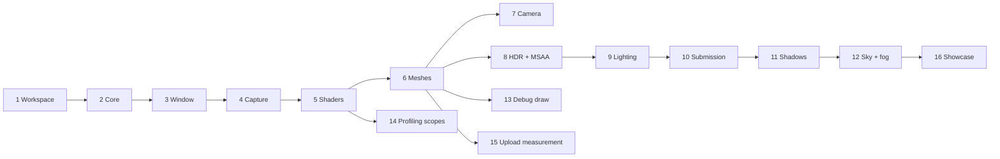

# Implementation Plan — Milestone 1: Engine Bootstrap

An actionable plan for M1 as defined in [docs/ROADMAP.md](docs/ROADMAP.md). It lists steps in a suggested order, each with a concrete verification.

## Status (2026-11-15)

M2 (editor) has started in parallel with the open items below, at the owner's request.

Implemented: steps 1–15 and the showcase example (step 16). All checks pass locally on macOS (fmt, clippy with `-D warnings`, unit tests, golden images, smoke tests with zero GPU validation errors).

**Still open before M1 is accepted:**

| Item | Why open |
|---|---|
| Resize, trackpad and orbit checked by eye on the Mac (step 3, 7, 16) | Windowed presenting is now confirmed: the showcase presented 180 frames at ~7.0 ms mean on Metal with zero validation errors (independent review, 2026-11-15), and the editor presented 400 frames. Resize, trackpad and orbit still need the owner at the screen. |
| Windows CI green and a manual run on the Windows PC (step 1, 16) | CI workflow written and parked in `ci/` (pushing it needs the `workflow` token scope). No Windows hardware run yet. M2's editor builds on the same untested DX12 surface path (risk R26). |
| Tracy capture (step 14) | Profiling scopes are in place behind `--features box_engine/tracy`; no Tracy session recorded yet. |

**Deviations from the steps below, decided during implementation:**

- Transform propagation is a full pass each frame, not dirty-subtree propagation. It is O(entities) and simplest; dirty tracking waits for a scene that needs it.
- Tone mapper: AgX (analytic approximation) is the default; ACES-fitted and none are switchable. Tony McMapface needs a LUT asset and was not implemented.
- Debug draw is drawn inside the HDR MSAA pass, not after tone mapping, so it can share the scene's depth buffer. Debug colours therefore pass through exposure and tone mapping. M2 added post-tonemap `LineLayer::Display*` layers for editor overlays (decision D14).
- Headless frames wait for their GPU work before the next frame. Without this, work queued up and the final capture absorbed hundreds of milliseconds of backlog.
- Asset IDs are unique across every `Assets` store in the process. A shared renderer cached GPU meshes by ID and drew stale meshes from a previous world; a regression test covers it.
- Exposure presets are 0.55 (day) and 0.7 (evening) with the chosen light units, tuned from captures.
- Shadow stability: checked with a captured orbit sequence (`showcase --orbit 0.5 --capture 'target/captures/orbit/f_{frame}.png'`); zoomed shadow edges keep their shape and show no texel crawl. A full-frame difference metric was tried and rejected: shadow edges move on screen with the camera, so it cannot isolate shimmer. The texel-snapping unit test remains the regression guard.
- Measurements: [docs/measurements/m1-upload-stress.md](docs/measurements/m1-upload-stress.md) and [docs/measurements/m1-build-times.md](docs/measurements/m1-build-times.md).

## Outcome

A window showing lit, shadowed primitives under a sky with fog and an orbit camera, on macOS (Metal), with headless capture, a golden-image test, shader hot reload and a recorded upload measurement. The same code builds and passes tests on Windows CI and passes a manual smoke run on the Windows PC (DX12).

## Ground rules

- Only three crates are created: `box_core`, `box_render`, `box_engine`. Nothing else is scaffolded ahead of need.
- **Build the simplest thing that meets the M1 acceptance criteria.** Machinery that M1 does not use is left for the milestone that needs it (see "Out of scope" below).
- **Every visual step ends with a capture** produced by the headless path from step 4. A visual step is not done until the capture exists and has been looked at.
- **Every step ends green:** `cargo fmt --check`, `cargo clippy -- -D warnings`, `cargo test`, and a boot of the showcase example for a few frames with no new warnings or wgpu validation errors.
- No mesh building or GPU buffer reallocation in unthrottled per-frame code paths.

## Before starting

| Item | Action |
|---|---|
| Owner decisions | Answers to the "Decisions requiring input" in the [README](README.md). All were answered on 2026-11-14; see the README. |
| Versions | Re-verify wgpu, winit, glam and hecs on the start date ([docs/TECH_STACK.md](docs/TECH_STACK.md)) |
| Repository | `git init`, `.gitignore` (the MIT `LICENSE` file exists) |
| Spikes S1 and S2 | May run alongside M1 in `spikes/`; they gate M2, not M1 |

## Steps

### 1. Workspace and CI

- Create the workspace with `box_core`, `box_render`, `box_engine`, and `examples/`.
- Add `rust-toolchain.toml`, the dev profile settings from TECH_STACK, `rustfmt` and `clippy` configuration.
- GitHub Actions: build, format check, clippy and non-GPU tests on `macos-26` and `windows-2022`.

**Verify:** CI is green on both platforms for an empty workspace. Record clean and incremental build times.

### 2. Core runtime skeleton (`box_core`)

- A minimal `App` with ordered system lists for Update, PostUpdate and Render, plus resources.
- `Time` (delta and elapsed).
- `World` over `hecs`: spawn, despawn, insert, remove; `hecs` query types re-exported.
- `Transform`, `GlobalTransform`, parent/child hierarchy with dirty-subtree propagation.

Not in this step: the `Plugin` trait, FixedUpdate, events, reflection. They arrive in M2 and M3.

**Verify:** unit tests for system ordering and hierarchy propagation (including reparenting). A headless app runs 100 frames in a test.

### 3. Window, device and surface (`box_engine`, `box_render`)

- winit `ApplicationHandler` loop; window creation; HiDPI scale handling.
- wgpu instance, adapter, device, surface configuration; Fifo present; resize and scale-factor reconfiguration.
- Backend selection: Metal on macOS; DX12 with static DXC on Windows.
- Clear to a colour. Log adapter name, backend and enabled features.

**Verify:** the window opens, resizes without errors or validation messages, and logs the expected backend.

### 4. Headless rendering and capture

- `RenderTarget` abstraction: surface or offscreen texture.
- `--capture <file.png>` and `--frames <n>` flags for examples: render offscreen, read back, write PNG, exit.
- A golden-image test helper: compare against a reference PNG with a per-pixel threshold and an allowed fraction of differing pixels.

**Verify:** `--capture` writes a PNG of the clear colour without opening a window. A golden test passes locally on the Mac. Goldens are not required to pass on CI runners (risk R15).

### 5. Shader loading and pipelines

- Load WGSL from an engine shader directory through a small include step (`#include "globals.wgsl"` style), with a `globals` file for camera and time.
- A simple pipeline cache keyed by shader and the few states that vary in M1.
- File watching in development builds; recompile inside a wgpu error scope; keep the last good pipeline on failure.

**Verify:** a full-screen test shader renders; editing it updates the running window; introducing a syntax error logs a readable message and keeps the old image. A CI test validates every engine shader with naga, which needs no GPU.

### 6. Meshes and the first draw

- `MeshData` in `box_core`: positions, normals, tangents, UV sets, colours, indices, material groups, bounds, and reserved optional joint and weight channels.
- `Handle<T>` and simple stores for meshes and materials.
- GPU meshes: **one vertex buffer and one index buffer per mesh**, allocated with headroom, updated through `Queue::write_buffer`, reallocated only on growth.
- Built-in primitives: box, sphere, cylinder, plane, capsule.
- `Camera` component; view and projection; an unlit draw with a depth buffer.

**Verify:** capture of primitives drawn with a flat colour and correct depth ordering. Unit tests for primitive vertex and index counts and bounds.

### 7. Input and orbit camera

- Input state resource: keys, mouse buttons, motion, scroll, modifiers.
- An orbit camera controller (orbit, pan, zoom toward cursor) as a reusable component and system.

**Verify:** manual check, including trackpad on macOS. A unit test drives the controller with synthetic input and checks the resulting transform.

### 8. HDR, MSAA and tone mapping

- Render the scene to an `Rg11b10Ufloat` target with 4x MSAA and resolve.
- Tone-mapping pass to the output format, with exposure. Choose AgX or Tony McMapface after comparing captures.

**Verify:** captures of a bright test scene with each tone mapper; edges are anti-aliased; no banding in gradients. Record the choice in DECISIONS.

### 9. Lighting and the standard material

- `StandardMaterial`: base colour, roughness, metallic, emissive.
- `DirectionalLight` and hemisphere ambient from an `Environment` resource.
- Lighting functions in a shared shader include. The primary directional light is optional in the global block.

**Verify:** golden capture of a material grid (roughness against metallic) and of a lit primitive scene.

### 10. Draw submission

- An extract step builds a frame packet: visible meshes, camera, lights.
- CPU frustum culling by bounds.
- Sort by pipeline, then material. One draw per object.
- Frame statistics resource: draws, triangles, upload bytes.

Not in this step: instancing and per-instance storage buffers (RS3).

**Verify:** a test confirms that objects outside the frustum are not submitted. Record how many distinct draws the showcase machine sustains at the display refresh rate.

### 11. Shadows

- 3–4 cascades in a depth array; bounding-sphere fit and texel snapping for stability; comparison sampling with PCF; normal-offset bias; cascade blending.
- A debug view that tints cascades.

**Verify:** captures showing soft, correctly placed shadows; a short orbit sequence captured as frames shows no shimmering; the cascade debug view looks correct.

### 12. Sky and fog

- Gradient sky with a sun disc, driven by `Environment`.
- Distance and height fog tinted by sun and sky colour.

**Verify:** golden capture of the showcase scene at two times of day defined by `Environment` values.

### 13. Debug draw

- Immediate-mode lines, boxes, spheres and a ground grid, with a depth-test toggle, drawn after tone mapping.

**Verify:** capture showing a grid and bounding boxes over the scene. Confirm they appear in headless captures.

### 14. Profiling scopes

- `profiling` scopes around phases and passes, with an optional Tracy feature.
- Labels on all GPU resources; validation enabled in development builds.

Not in this step: per-pass GPU timings.

**Verify:** a Tracy capture shows the CPU phases. Frame statistics are printed on demand.

### 15. Upload stress measurement (spike S3)

- An example that rewrites the vertex data of many meshes every frame, and periodically grows some of them, from data prepared in advance.
- Measure frame time distribution, upload bytes and reallocation events on Metal, with validation on and off. Repeat once on the Windows PC.

**Verify:** results are written to `docs/measurements/m1-upload-stress.md`. If frame time leaves the display interval, design a pooled allocator or an upload budget and record the decision; otherwise keep per-mesh buffers.

### 16. Showcase example and Windows smoke run

- `examples/showcase`: a small composed scene exercising everything above.
- Manual run on the Windows PC: window, resize, input, shadows, hot reload, capture.

**Verify:** the M1 acceptance criteria in the roadmap, one by one.

## Suggested order and parallelism

Step 4 comes early on purpose: every later step relies on captures.

## Definition of done for M1

1. All acceptance criteria for M1 in the roadmap are met.
2. Tests pass on CI for both platforms; golden images for the showcase scene pass locally on the Mac.
3. A clean boot of the showcase shows no warnings or validation errors.
4. Captures exist for every visual feature.
5. Measurements (build times, upload stress, draw capacity) are recorded in the repository.
6. No unused scaffolding, stubs or unwired options remain.
7. DECISIONS and TECH_STACK are updated with anything learned (tone mapper choice, measured limits).

## After M1

Spike S6 (wall, opening, junction and roof generation) is the next piece of work, alongside spikes S1 and S2, before M2 begins.

## Explicitly out of scope for M1

Editor UI, reflection, scene files, the `Plugin` trait, fixed timestep, events, asset importing, textures, transparency, point lights, instancing, a pooled mesh allocator, WESL, per-pass GPU timings, bloom, SSAO, water, scripting, physics, audio, in-game UI, packaging, golden images on Windows.
