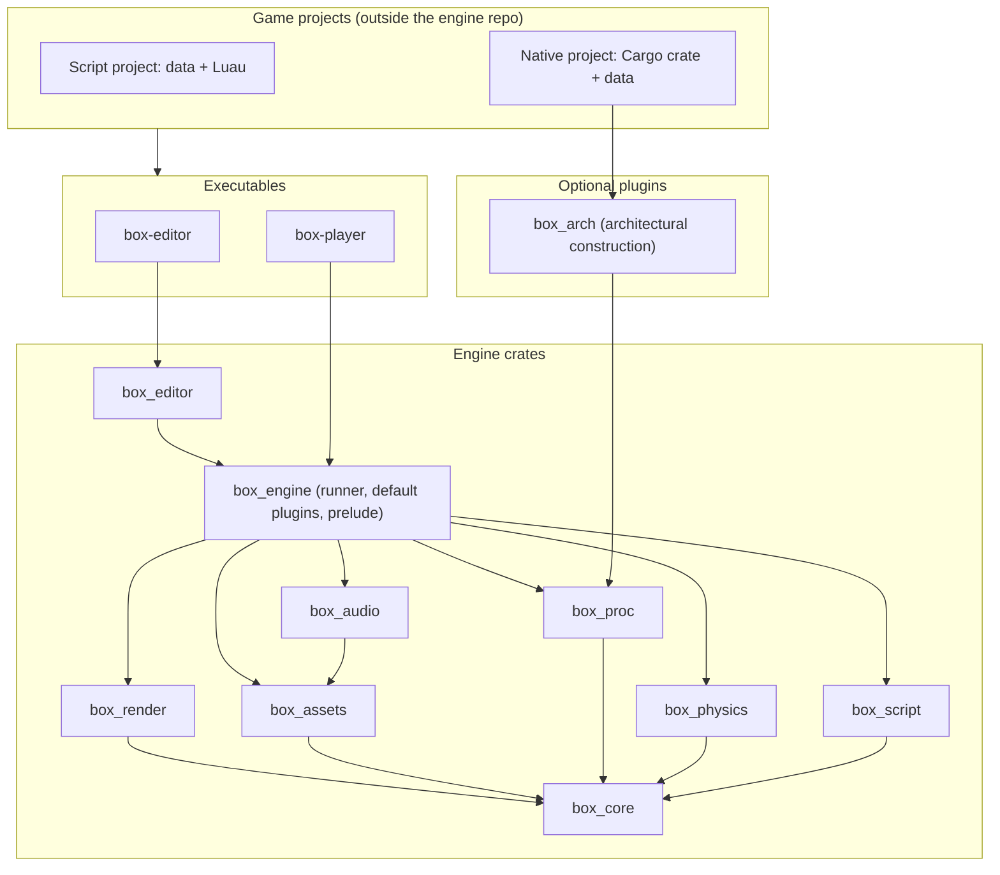
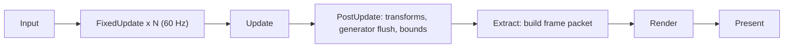
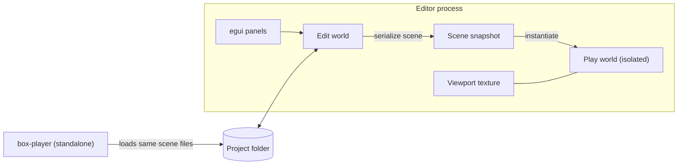
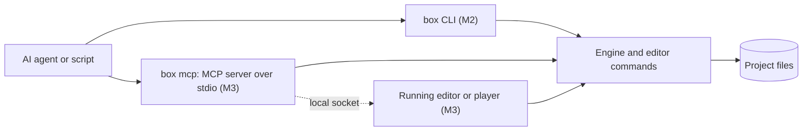

# Architecture

This document describes the overall shape of box-engine: layers, crates, boundaries, the frame loop, and how the editor, runtime and games relate. Detailed designs are in the per-area documents. Decisions and their alternatives are recorded in [DECISIONS.md](DECISIONS.md).

Code in the planning documents is illustrative. Names and signatures are sketches, not commitments.

## 1. Layers



Rule: dependencies point downward only. Nothing in the engine depends on `box_editor`, on a plugin, or on a game.

## 2. Cargo workspace

Nine engine crates, one plugin crate and three binaries. A crate is created when a milestone first needs it, not up front.

```
box-engine/
  Cargo.toml                 workspace
  crates/
    box_core/                M1
    box_render/              M1
    box_engine/              M1
    box_editor/              M2
    box_physics/             M3 (queries); dynamics feature in M7
    box_assets/              M4
    box_proc/                M5
    box_audio/               M6
    box_script/              M7
    box_ui/                  M7 (in-game UI)
  plugins/
    box_arch/                M6
  apps/
    editor/                  bin: box-editor
    player/                  bin: box-player
    cli/                     bin: box (agent and automation CLI, MCP server; M2/M3)
  examples/                  small engine examples and sample projects
  docs/
  spikes/                    throwaway proofs of concept (not part of the workspace build)
```

| Crate | Responsibility | Public API boundary | Depends on |
|---|---|---|---|
| `box_core` | App loop, plugins, phases, time; `World` (entities, components, queries); reflection and type registry; transform hierarchy; events; input state; scene serialization; CPU data types (`MeshData`, `ImageData`); `Handle<T>` and asset stores; `Uid` and `AssetId`; ray and bounds math | `App`, `Plugin`, `World`, `Entity`, `Uid`, `AssetId`, `Reflect`, `Transform`, `Events<T>`, `Scene`, `MeshData`, `Handle<T>` | `glam`, `hecs`, `bevy_reflect`, `serde` |
| `box_render` | wgpu device and surfaces, render passes, GPU meshes and textures, materials, shader loading and hot reload, lights, camera, post-processing, debug draw, headless capture | `Renderer`, `Camera`, `MeshRenderer`, `StandardMaterial`, `ShaderMaterial`, light components, `Environment`, `DebugDraw`, `RenderTarget`, `Overlay` | `box_core`, `wgpu`; `notify` in development builds |
| `box_assets` | Asset identity (`.meta` sidecars), the `Importer` trait and asset server, importers for glTF and images, background loading, hot reload, later an import cache and packaging | `AssetServer`, `Importer`, `load::<T>(id)` | `box_core`, `gltf`, `image`, `notify` |
| `box_proc` | `Generator` trait, regeneration pipeline, 2D polygon kernel, 3D splines, mesh builders (extrude, sweep, lathe), scatter | `Generator`, `Procedural`, `Spline`, `MeshBuilder` | `box_core`, `i_overlay`, `earcut` |
| `box_physics` | Collider components and spatial queries (raycast, shapecast, overlap, triggers) on parry; rigid bodies and character controller on rapier behind a `dynamics` feature | `Collider`, `Physics` (queries, forces), `KinematicCharacter`; with `dynamics`: `RigidBody`, `Velocity`, `Joint`, `PhysicsSettings`, `CollisionEvent`, `Dynamics` | `box_core`, `parry3d`, optional `rapier3d` |
| `box_script` | Luau VM host, `Script` component, bindings generated from the type registry, script importer, hot reload, type-definition generation | `Script`, `ScriptHost` | `box_core`, `box_assets`, `mlua` |
| `box_audio` | Audio playback, 3D sources, buses, audio importer | `AudioSource`, `AudioListener`, `Audio` | `box_core`, `box_assets`, `kira` |
| `box_ui` | In-game UI (D11): retained tree, layout, themes, focus navigation, input capture, world labels, string tables, inline text styling; paints with epaint into box_render's Overlay | `Ui`, `UiNode`, `NodeId`, `UiEvent`, `Strings`, `Theme`, `Style`, `UiPlugin` | `box_core`, `box_assets`, `box_render` (`Overlay`, `Camera` types only), `epaint` |
| `box_engine` | Window and event loop (winit), input devices (gamepads through gilrs, cursor grab) and action mapping, `DefaultPlugins`, glue between optional modules, the `prelude` that games import | `App::run`, `DefaultPlugins`, `prelude::*` | the crates above; optional ones behind cargo features |
| `box_editor` | The editor as a library: panels, docking, gizmos, selection, undo, play sessions, project management | `box_editor::run_game(options, game)` | `box_engine`, `egui`, `egui-winit`, `egui-wgpu`, `egui_tiles` |
| `plugins/box_arch` | Reusable architectural construction: walls along curves, openings, roofs, platforms, stairs as generators | Generator components | `box_proc`, `box_engine` |

Notes:

- **Importers are registered by the crate that owns the asset type**, through the `Importer` trait: audio by `box_audio`, scripts by `box_script`, shaders by glue in `box_engine`. `box_assets` itself knows only glTF, images and plain data files. This avoids `box_assets` depending on `kira`, `mlua` or the renderer.
- **Before `box_assets` exists (M1–M3)**, files are read directly: shaders by `box_render` with its own development-time watcher, and scenes by `box_core`'s serializer through plain file I/O. At M4 the asset server takes over both.
- winit types are confined to `box_engine` and `box_editor`.

### Where circular coupling could occur, and how it is avoided

| Risk | Resolution |
|---|---|
| Renderer needs meshes; importers and generators produce meshes | `MeshData`, `Handle<T>` and `AssetId` live in `box_core`. Producers and the renderer both depend on core, not on each other. |
| Editor wants to draw gizmos and overlays inside the renderer | `box_render` exposes a general `DebugDraw` immediate-mode API and offscreen `RenderTarget`s. The editor is just a client. |
| Procedural meshes need colliders | Neither `box_proc` nor `box_physics` knows the other. A glue system in `box_engine` (enabled when both features are on) rebuilds colliders from changed meshes. |
| Scripts need access to every module | Scripts go through the type registry in `box_core`. Modules register their types and functions; `box_script` depends on no other module. |
| Asset importers need audio, script and shader libraries | Importers are registered by the owning crates (see notes above). |
| Scenes reference assets; scenes are also assets | IDs live in core. From M4 a scene importer in `box_assets` calls core's scene deserializer. |
| Editor-only data on runtime components | Editor state (selection, gizmo mode, expanded rows) lives in editor resources keyed by `Uid`, never in scene components. |
| Renderer must draw game UI; UI must not depend on wgpu | `box_render` owns a data-only `Overlay` resource and draws it after tone mapping in every target; `box_ui` writes it; the editor needs no code to show game UI in Play. |

## 3. Entity model in one paragraph

A `World` holds entities with typed components. Storage is `hecs`; our `World` wraps spawning, hierarchy, reflection and serialization, and re-exports `hecs` query types under `box_core` names. Scene entities have a `Uid` (persistent UUID), a `Name`, a `Transform`, and a place in a parent/child tree; entities spawned at runtime need none of these unless they want them. Components derive `Reflect`, which is what makes the inspector, serialization, undo and scripting work without per-type code. Systems are plain functions run in fixed phases. Details: [SCENE_SYSTEM.md](SCENE_SYSTEM.md).

## 4. Application lifecycle and frame loop

```rust
pub trait Plugin {
    fn register(&self, registry: &mut Registry) {}   // saved types
    fn build(&self, app: &mut App);                   // resources, events, systems
}

struct MyGame;
impl Plugin for MyGame {
    fn register(&self, r: &mut Registry) { r.register_all::<(Spin,)>(); }
    fn build(&self, app: &mut App) { app.add_system(Stage::Update, spin); }
}

fn main() -> anyhow::Result<()> {
    Game::new().with_plugin(MyGame).run("my game")   // engine plugins are added by Game
}

fn spin(world: &mut World) { /* a system is a function of the world */ }
```

Phases per frame, executed in order on the main thread:



- **As built (DX Batch 2):** around every system the app applies deferred commands (`World::defer`) and runs `on_add`/`on_remove` hooks (marker-based, O(archetypes) per check). Systems within a stage run in insertion order adjusted by `.after`/`.before` names (stable topological sort; cycle and unknown names are `OrderError`s, logged once). `Interpolated` entities are recorded after each fixed step and drawn at `FixedTime::alpha` between their last two steps: the blend is written to `GlobalTransform` at the end of PostUpdate and removed at the start of the next, so propagation, physics sync and PostUpdate systems see the simulation, and `Transform` is never touched. `Time::scale` and `Time::paused` scale the frame delta and the fixed accumulator.
- **As built (M3, ease-of-use pass):** event queues advance only on frames where a fixed step ran; `Time` reads as the fixed clock inside FixedUpdate; systems are named by their type name (profiler scopes, `box_core::app::current_system()` for panic reports).
- **As built (M3):** FixedUpdate (60 Hz accumulator, at most 5 catch-up steps), Update and PostUpdate, a frame-start step that advances event queues, the `Plugin` trait (`register` for types, `build` for systems) and `Events<T>` with per-reader cursors. `box_engine::Game` bundles a game's plugins with the registry built from them. Extract is still the renderer reading the world directly.
- **No parallel system scheduler.** Systems run sequentially. Parallelism is used inside jobs (mesh generation, asset import) on a thread pool. See D3 for the consequences.
- **Fixed timestep** uses an accumulator at 60 Hz for simulation and physics, with a cap on catch-up steps. Entities with `Interpolated` are drawn between their last two fixed steps.
- **Extract** copies what the renderer needs into a flat frame packet. Rendering happens on the main thread; the packet is the seam that allows a render thread later.
- **Events** are typed double-buffered queues (`Events<T>`). Scripts additionally get string-named signals.
- **Resources** are singleton values stored in the world (time, input, environment, asset stores).
- **Input** is a resource fed by the runner (winit for keyboard and mouse, gilrs for gamepads) or by the editor during Play. Named actions (`box_core::action`) are evaluated from it at the start of the first fixed step and of `Update`. Edges are delivered once per frame to frame-rate systems and once per fixed step to fixed-rate systems.

## 5. Editor, runtime and games



- The editor and the player link the **same** runtime crates and load the **same** scene files.
- **Play mode** builds a second, isolated `World` from a serialized snapshot of the edit world and runs it in-process. Stop discards it. The edit world is never mutated by gameplay. The play world is only ever created from serialized data, so moving it to a separate process later does not change the model. See D5.
- **Two project tiers:**
  - **Native project** (from M3): a Cargo crate that implements `Plugin`, plus two short binaries (`player::run_game(options, game())`, and `box_editor::run_game(options, game())` behind the crate's `editor` feature). Used for the construction slice and for anyone who wants Rust gameplay or custom generators. Requires a toolchain; changes need a rebuild and editor restart.
  - **Script project** (from M7): a folder of assets, scenes and Luau scripts. Uses the prebuilt `box-editor` and `box-player`. No Rust toolchain.
- **Optional modules** are cargo features for native projects, which compile only what they use: box_engine's `physics`, `dynamics` (needs physics), `audio` and `script` (needs physics), all on by default. A generated native project lists them as its own `default` features; `default = ["physics", "audio"]` drops rapier and Luau (examples/minimal_native; docs/measurements/m8-lean-build.md). A scene that uses a left-out module's types still loads: the data is kept and one warning per type names the feature (`box_engine::modules`). The prebuilt editor and player include every module; a script project that does not use physics or audio simply never initializes them.

## 6. A project versus the engine repository

| | Engine repository | Game project |
|---|---|---|
| Contains | Engine crates, plugins, editor, player, examples, docs | Assets, scenes, scripts, project file; optionally a Rust crate |
| Built by | Engine developers | Nobody (script tier) or `cargo` (native tier) |
| Versioned by | Engine semver | `engine_version` field in `box.project.json` |
| Layout | See section 2 | See [ASSETS.md](ASSETS.md) section 2 |

## 7. Public API surfaces

There are three (D10). All are unstable until M9; the stability rules below are intentions to be confirmed then.

1. **Rust plugin API**: `box_engine::prelude`.
2. **Script API**: generated from the type registry. Additive changes only within an engine minor version.
3. **File formats**: scenes, prefabs, `.meta`, project file. Every file carries an integer `version`.

## 8. Conventions

- Right-handed coordinates, **+Y up, −Z forward**, metres, radians in code and degrees in the inspector. This matches glTF.
- Linear colour internally; sRGB only at texture decode and final output.
- Library crates return `Result` with `thiserror` types; applications use `anyhow`. Bad assets and script errors never panic.
- All logging through `tracing`; all profiling scopes through the `profiling` facade.

## 9. Physics, audio, animation and in-game UI

- **Physics** (`box_physics`) begins in M3 as engine-owned `Collider` components and spatial queries on `parry3d`. As built: `Collider` (shapes matching the entity's `Primitive`, cuboid, sphere, capsule, cylinder) is mirrored into a parry BVH by a change-driven PostUpdate system, and trigger events are computed there from the BVH. Editor picking uses `box_physics::MeshRayCache` (per-asset triangle BVHs, cached by asset id and version). As built in M7: with the `dynamics` feature, rapier3d 0.36.1 mirrors the solid colliders into a `Dynamics` resource that exists only while a `RigidBody` does; `step_dynamics` runs first in FixedUpdate, writes bodies back to `Transform` (interpolated) and moves their colliders in the query world immediately, so queries see bodies at the current step. Kinematic characters use `move_and_slide` on the query world (steps, slopes, platforms) and push bodies through impulses. See D12.
- **Audio** (`box_audio`, M6) wraps `kira` behind `AudioSource`, `AudioListener`, `PlaySound`, three buses (effects, ambience, music) with `AudioSettings` volumes, and the `Audio` resource. Games never use `kira` types. kira's audio thread only receives handle commands; it never touches the world. The device opens on a background thread at the first sound, only in windowed runs.
- **Animation** (`box_core::animation`, M7): `AnimationClip` and `Skin` assets from glTF; the saved `SkinBinding` becomes a runtime `SkinnedMesh` (asset glue) skinned on the GPU (RS4). `AnimationPlayer` plays clips on its entity's descendants by name and crossfades on clip changes; `AnimationStateMachine` runs an `AnimationGraph` (inline or `.animgraph.json`) on float, bool and trigger parameters. Both run in PostUpdate before transform propagation and write joint `Transform`s, so joints stay entities (attachments, gameplay) and propagation computes their world transforms. Property tweens are `Tween`.
- **In-game UI** (`box_ui`, M7, D11): a retained tree of nodes described by `UiNode` (Rust or JSON), flex-like layout, themes, gamepad and keyboard focus navigation with modal input capture, world-anchored labels and text from string tables; painted with epaint into box_render's `Overlay` and drawn after tone mapping in every target. Native projects may still use egui directly.
- **Save games** (`box_engine::savegame`, M7): a snapshot of the running world in scene form plus `SaveHooks` values; atomic writes with `.bak`; version and migration; a validated load restores entities, resources, scene bookkeeping and hooks.

## 10. Performance and reliability philosophy

**First-release requirements**

| Topic | Requirement |
|---|---|
| Frame pacing | Hold the display refresh rate in the editor and in the reference scenes of each milestone on the development machines. |
| Per-frame work | No unthrottled mesh building, collider baking, asset decoding or shader compilation in per-frame paths. Continuous input is accumulated cheaply (stamp) and handled by a throttled flush. Small generators may run synchronously inside the flush; anything that can exceed a frame budget goes to a background job. |
| Background jobs | One thread pool for imports and, when needed, generation. Results return through queues; stale results are dropped by generation counter. |
| GPU uploads | Buffers allocated with headroom and regrown by doubling; a per-frame byte budget once background generation exists. |
| Draw calls | Measure capacity in M1. Sort by material from the start; automatic instancing in RS3. |
| Allocation | Reuse per-frame vectors (frame packet, draw lists). Nothing beyond that until profiling shows a need. |
| Resource lifetime | Handles own their assets; GPU resources are released at end of frame after the last handle drops. |
| Asset loading | Asynchronous with placeholders; never block the main thread on disk. |
| Errors | `Result` everywhere in libraries; bad assets and script errors are reported, never fatal. Panics are reserved for engine bugs. |
| Diagnostics | Frame statistics, CPU profiling scopes, wgpu validation in development builds. |
| Testing | Unit tests for logic; golden images for rendering (local on the Mac until M9); snapshot tests for importers and serialization; property tests for undo and the polygon kernel; headless smoke runs of examples in CI. |
| Profiling | CPU through the `profiling` facade (Tracy); Instruments and the Xcode Metal debugger on macOS; RenderDoc on Windows. |

**Premature for the first release**

A parallel system scheduler, a render thread, GPU-driven culling, custom allocators, pooled mesh buffers (unless measured), streaming of large worlds, level-of-detail systems, occlusion culling, bit-exact determinism, SIMD beyond what `glam` provides. Large scenes are handled by instancing and frustum culling until a real project exceeds them.

**Measure, then decide.** Each milestone records a few numbers (frame time in a reference scene, edit-to-visible latency, build times) in `docs/measurements/`. Optimization work starts from a recorded regression or a missed budget, not from expectation.

## 11. Developer experience

How an independent developer uses box-engine once M9 is reached:

| Activity | How |
|---|---|
| Install | Download the editor for their platform. It includes player binaries for export. No Rust required. |
| Create a project | Start screen, New Project from a template. This creates a project folder; see [ASSETS.md](ASSETS.md) section 2. |
| Import assets | Drop files into `assets/` or the asset browser. |
| Edit scenes | Viewport, hierarchy and inspector; procedural objects edited by parameters and handles. |
| Write game logic | Luau scripts attached to entities, with completion from generated type definitions; or a Rust plugin crate in a native project. |
| Run | Play in the editor, or run `box-player` on the project folder. |
| Debug | Console with script tracebacks, live inspector during Play, diagnostics panel, debug views. |
| Build | Export from the editor: development or release profile, macOS and Windows targets. |
| Use plugins | Script libraries are folders inside the project. Native plugins are Cargo dependencies of a native project. There is no plugin registry in the first release. |
| Move a project | Copy the folder. References are by UUID and paths are relative. |
| Get help | Getting-started guide, manuals, generated API reference, example projects. |

## 12. AI-friendly by design

Many of the engine's users will work with AI assistants. Being easy for an AI agent to understand, drive and verify is therefore a design requirement, not documentation polish. The same properties make the engine better for humans and for CI.

| Property | How it is met | From |
|---|---|---|
| A maintained agent guide | `AGENTS.md` at the root (with `CLAUDE.md` importing it): layout, commands, conventions, definition of done, gotchas. Updated in the same change as anything it describes. | M1 |
| Verification without a screen | Every example accepts `--capture <png>` for a headless, deterministic render (fixed time step) and exits non-zero on GPU validation errors. Golden-image tests compare captures. | M1 |
| Machine-readable diagnostics | `--report <json>` writes frame timings and render statistics. Logs go through `tracing` with targets. Later: a JSON log option and a diagnostics dump. | M1 |
| Precise, actionable errors | Errors name the file, the entity or asset and what to do. Shader errors carry source spans. No silent fallbacks. | M1 onward |
| Text formats that diff and merge | Scenes, prefabs, materials, `.meta` files and project files are stable-ordered JSON with a version field ([SCENE_SYSTEM.md](SCENE_SYSTEM.md)). An agent can create or edit a scene without the editor. | M2 |
| Discoverable APIs | Reflection exposes every component's fields, ranges and docs. The engine can dump its type registry as JSON; script type definitions are generated from it. | M2 (dump), M7 (scripts) |
| Scriptable editor operations | Editor actions are commands (the same objects undo uses). The `box` CLI and the MCP server run the same commands, so anything a user can do with the mouse an agent can do from text. | M2 onward |
| Small, explicit surface | Plain functions as systems, few macros, no hidden scheduling. Code that is easy to read is easy to change correctly. | M1 onward |

### Agent interfaces: the `box` CLI and an MCP server

One command layer, two front ends. Neither contains logic of its own.



**`box` CLI (M2).** A single binary (`apps/cli`, package `box_cli`) that operates on project files without a window. Its logic is a library (`box_cli::run(&Cli) -> Result<Output, CliError>`) so the MCP server can reuse it. Every command accepts `--json` and prints a machine-readable result; errors are `{"error": {"code", "message", "file"?, "entity"?, ...}}` with a stable code (`entity_not_found`, `bad_path`, `scene_parse`, `gpu_validation`, ...) and a non-zero exit. Exit codes: 0 success, 1 failure (or `box check` found errors), 2 usage error (code `usage`, whether the command line or an argument's value was wrong); output cut short by a closed pipe is not a failure. Wherever a scene is expected, a project directory means its start scene. `file` fields in results and errors are relative to the project root with `/` separators when the file is inside a project (the root is given as `project`), otherwise as given. A project whose `start_scene` is absolute or leaves the project root is refused by every command (`path_outside_project`). `box render --out` must end in `.png`, replaces only an existing PNG, writes atomically and writes nothing when the GPU reported validation errors. `box scene apply` with an empty command list does not rewrite the scene.

Results of `render`, `run`, `import` and `scene apply` carry `problems: [{severity, code, message, asset?, entity?, entity_name?, component?}]`. Codes: `asset_not_found`, `asset_import_failed`, `shader_header`, `value_clamped`, `log`. `scene apply` writes dangling references with an `asset_not_found` warning. Errors may carry a `hint`. `box scene apply --help` prints the command format (the same text the MCP tool describes).

| Command | Purpose | From |
|---|---|---|
| `box new <dir> [--name] [--native [--engine-path]]` | Create a project; `--native` adds a game crate (lib plus `editor` and `player` bins, path dependencies on the engine); on an existing project `--native` adds only the crate; prints next steps (`next` in JSON) | M2, `--native` M3 |
| `box check` | Parse every scene, import every asset file and resolve every asset reference; problems with codes `start_scene_missing`, `scene_parse`/`scene_invalid`, `unknown_component`/`unknown_resource` (with `suggestion`), `asset_import_failed`, `shader_header`, `asset_not_found`, `log`; errors exit 1 | M2, assets in the ease-of-use pass |
| `box registry` | List component and resource types with fields, ranges and docs | M2 |
| `box scene list/show <scene>` | Inspect entities and components | M2 |
| `box scene apply <scene> <commands.json\|-> [--dry-run]` | Apply editor commands (spawn, set, set_resource, add/remove_component, reparent, despawn, rename, duplicate) as one all-or-nothing transaction, with the same validation as the editor; writes atomically | M2 |
| `box render <scene> --out <png> [--camera] [--size] [--frames]` | Headless render of a scene file; uses the named or first active camera, or frames the scene bounds | M2 |
| `box run [project\|scene] [--frames] [--capture] [--report] [--size]` | Play with the engine's types through the player library; headless with `--frames`/`--capture`; `--json` summary (frames, timings, validation errors). Native projects (a `Cargo.toml` at the root) run their player bin (read from `Cargo.toml`, `--features` only for bins with `required-features`) with `cargo run` in the project directory; output streamed (stderr with `--json`), exit code propagated; `--no-cargo` prints the command | M3 |
| `box mcp [--project]` | MCP server over stdio (see below) | M3 |
| `box import <file> [--project] [--to <folder>]` | Copy into `assets/` (a `.gltf` with its buffers and images; default folder by type), write the `.meta`, import once; prints id, importer, state and sub-assets; refuses to overwrite | M4 |
| `box export --target <platform>` | Package a game | M9 |

**MCP server (M3).** `box mcp` speaks the Model Context Protocol over stdio, so agents that support MCP get typed tools instead of shell commands. It exposes the CLI operations as tools and adds live tools when an editor or player is running and has opted in to a local control socket:

- Project tools: `check`, `registry`, `scene_list`, `scene_show`, `scene_apply`, `render` (PNG image content).
- Live tools (M3): `status`, `world_query` (entities and component values), `apply_commands`, `screenshot` (viewport PNG), `play` / `stop` / `pause`, `step_frames`, `read_log`, `frame_stats`. Always listed; they return `not_running` when no editor or player has opted in.
- Asset import (M4): MCP tool `import` (`file`, `to`, `project`).
- Later: procedural generator parameters (M5), script reload and errors (M7).

Safety: the control socket is local only, disabled unless the user enables it in the editor or passes a flag, and every change goes through the command layer, so agent edits are undoable like user edits.

**Player host.** `box-player --control` (also `box run --control` and native players) serves the socket with kind `player`, polled once per frame on the main thread. Semantics differ from the editor:
- There is no Edit mode: `status` reports `play` or `paused`.
- `apply_commands` edits the running world through the command layer but is neither saved nor undoable (the result says `saved: false`).
- `pause` stops ticking while rendering and polling continue; `play` resumes; `step_frames(n)` ticks n fixed 1/60 s frames before answering.
- `stop` quits the player cleanly (exit 0, discovery file removed).
- `screenshot` renders offscreen at the requested or window size, windowed or headless.
- `read_log` reads a bounded in-process ring (`box_engine::log_capture`) that `--control` enables.

Headless live players are paced to 60 fps; without `--frames` they run until stopped. Requests are answered after the first rendered frame (windowed: with assets idle, at most 600 frames), so a first screenshot shows the scene.

**Game registry file.** A native project's editor and player write `<project>/.box/registry.json` (the `box registry --json` dump plus `format`, `engine_version`, `hash`; rewritten only when it changes, otherwise touched; `--write-registry` writes it and exits). `box` and `box mcp` load it as *schema-only types* (`Registry::add_schema_types`): their scene data stays raw JSON, but edit commands validate values against the schema (field names with did-you-mean, types via the engine deserializer, enum variants, `Option`/`Vec`, nested structs, ranges clamped with `value_clamped`) and store them raw as undoable `SetRawComponent`/`SetRawResource` edits. So `registry`, `check`, `scene show` and `scene apply` work on game components without the game binary. Problems: `registry_missing`, `registry_stale` (sources newer than the file, or another engine version), `registry_invalid` (warnings with a `hint` command), `invalid_component`, `invalid_resource`, `invalid_settings` (errors).

**Editor host.** The editor implements `ControlHost` in `box_editor::control`. `world_query` and `apply_commands` act on the world shown: the play world during Play, with `"world"` in the result. Edit-mode agent edits are undoable (one step, "Agent edit"); Play-time edits are not and are discarded on Stop. `screenshot` renders the viewport camera offscreen at the viewport's or the requested size. `step_frames` runs fixed 1/60 s frames synchronously and keeps the pause state. The M3 acceptance test `apps/cli/tests/mcp.rs::mcp_drives_the_running_editor` runs `box mcp` against a headless editor.

`box mcp` is a small synchronous JSON-RPC 2.0 loop over stdio (D15), implementing MCP 2026-07-28 and, through `initialize`, 2025-11-25 and 2025-06-18. The live side is `box_engine::control`: newline-delimited JSON over 127.0.0.1 TCP with a per-run token from `<project>/.box/control.json`, polled once per frame on the main thread.

Out of scope: an AI assistant built into the editor UI.

## 13. Explicitly not in the architecture (yet)

Render thread, parallel system scheduler, render graph, dynamic Rust plugins, out-of-process play mode, networking, a separate render world, navigation, terrain. None is built until a milestone demands it.
