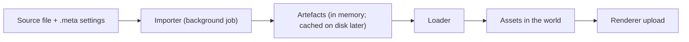
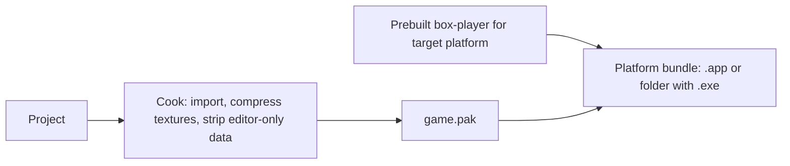

# Assets and Projects

The asset pipeline, project layout, hot reload, and packaging of standalone games. Decision record: D6 in [DECISIONS.md](DECISIONS.md).

## 1. Principles

- **Open formats only.** Source assets stay in their original formats in the project folder. No proprietary formats or services.
- **Source of truth is the project folder.** Everything derived (import results, thumbnails, caches) can be deleted and rebuilt.
- **References survive renames.** Assets are identified by UUID, not by path.
- **Bad assets never crash.** A failed import produces an error in the console and a visible placeholder.

## 2. Project layout

```
my-game/
  box.project.json        name, engine_version, start scene, input map, export settings
  assets/                 everything the game can load
    scenes/main.scene.json
    models/tower.glb
    models/tower.glb.meta
    textures/stone.png
    textures/stone.png.meta
    scripts/spinner.luau
    shaders/water.wgsl
    audio/wind.ogg
  .box/                   local, ignored by version control
    cache/                import cache (added later; see section 4)
    layout.json           editor layout
    recovery/             autosaves made before Play
  # native tier only:
  Cargo.toml
  src/lib.rs              the game Plugin
  src/bin/editor.rs
  src/bin/player.rs
```

Project file (M2, `box_engine::project`), unknown fields rejected:

```json
{ "version": 1, "name": "my-game", "engine_version": "0.1.0", "start_scene": "assets/scenes/main.scene.json" }
```

A project with a newer `version` or `engine_version` is refused with "update box-engine". `start_scene` must be a relative path to a file inside the project: an absolute path, a drive prefix or a `..` that leaves the root is refused at load (checked lexically, so the file need not exist). `box new` / `Project::create` writes a starter scene (ground, cube, sun, camera, `Environment`), a `.gitignore` containing `.box/` and, last and atomically, the project file; if it fails it removes what it created, so it can be retried.

`box new --native` (M3, reworked in the ease-of-use pass) also writes `Cargo.toml` (lib plus bins `editor` (feature `editor`) and `player`, path dependencies on `box_engine` and an optional `box_editor`, its own `[workspace]`; no `bevy_reflect` dependency), `src/lib.rs` (a `<Name>Plugin` with an example component and system, and `game()`), the two bins (both default to the project's own folder), `.cargo/config.toml` (aliases `cargo player`, `cargo editor`), and copies the engine's `rust-toolchain.toml` and `Cargo.lock`; `.gitignore` gains `target/`. Run with `cargo editor` and `cargo player`.

- `.meta` files are small JSON sidecars committed to version control next to their asset.
- The folder names under `assets/` are conventions, not requirements.
- A project is portable: copy the folder to another machine with the same engine version and it opens.

## 3. Asset identity and references

```json
// stone.png.meta
{
  "version": 1,
  "id": "0193a4f2-7c1e-7b3a-9d2e-5f0a1c2b3d4e",
  "importer": "texture",
  "settings": { "color_space": "srgb", "mipmaps": true }
}
```

- `AssetId` is a UUID generated when an asset is first seen. Moving or renaming a file with its `.meta` keeps all references intact.
- One source file can produce several sub-assets (a glTF yields meshes, materials, textures and a scene). Sub-assets are addressed as `AssetId` plus a stable label, for example `tower.glb#Mesh/Roof`.
- Scenes store the `AssetId` and the path as a hint. If an ID cannot be found, the path is used to repair the reference and a warning is logged.
- If a `.meta` file is missing, one is created. If two files claim the same ID (a copied file), the newer one gets a fresh ID.

**M4 as built** (`box_assets`):
- `.meta` files are created only for files with a registered importer; hidden files and folders are ignored. A broken `.meta` is never overwritten (error `BadMeta`). The server writes `.meta` files only to create missing ones, to give a copied file a fresh id (the file whose `.meta` is oldest keeps the id; ties go to the smallest path), in `rename`, and in `set_settings` (editor import settings, checked against the typed settings first); writes are atomic.
- Editor-facing calls: `set_settings(id, json)` (re-imports when the file was requested), `meta(id)`, `write(id, bytes)` (atomic replace plus re-import, used for `.material.json`), `create(path, bytes)`, `broken_files()`, and `index_generation()` (bumped when files, paths or broken entries change, so listings rebuild only then).
- Settings: `TextureSettings { color_space: srgb|linear, mipmaps }`, `ModelSettings { scale, generate_tangents }`. Missing fields take defaults without a write; unknown fields warn. A texture `filter` setting waits for sampler state on `ImageData`; compression is M9.
- glTF import setting `colliders` (default false): every mesh node of `#Scene` (not skinned) gets `Collider { shape: Mesh }` (a static triangle-mesh collider from the node's mesh; M8). Use it for level geometry modelled outside the editor. A node whose name ends in `-nocol` (any case) gets none (M9). For dynamic imported props use `ColliderShape::ConvexHull` (the solid hull of the mesh vertices).
- glTF labels: `Mesh/<name>` (one `MeshData` per glTF mesh, one material group per primitive, slot = primitive order), `Material/<name>`, `Texture/<i>` (embedded image index), `Texture/orm_<mr>_<occ>` (packed ORM: R occlusion with strength, G/B from the metallic-roughness image; the image itself when it already is one), `Skin/<i>` (each skin: joint names, parent joints, inverse bind matrices, translations scaled by the import scale), `Animation/<name>` (each animation: translation, rotation and scale channels with step, linear or cubic-spline keys, targeting node names; morph targets skipped), `Scene` (the default scene). Skinned nodes also get a `SkinBinding {skin, joints}` naming their joint nodes' entities, remapped by prefab instancing; meshes keep `JOINTS_0` (u16) and normalized `WEIGHTS_0`. Names are sanitized to `[alnum - _ .]` or replaced by the index, and duplicates get `_<index>`. A glTF has no main asset: load `#Scene`. Images, `.material.json` and `.scene.json` produce only a main asset.
- Placeholders: a 32x32 magenta/black checker image, a 1 m cube mesh, a magenta default material, an empty scene, an empty `ShaderSource` (drawn with the renderer's magenta error material, like a shader that never compiled). A failed first import, a deleted file or a missing sub-asset gets the placeholder (state Failed, registered in `AssetLookup`); a failed re-import keeps the last good value (state Failed). A reference that names no file returns `NotFound`.
- `.scene.json` files become `SceneAsset` (the parsed JSON tree, not a `World`, because game types are unknown to the asset server). glTF scenes become a root entity named after the file plus the nodes with `Name`, `Transform` and `MeshAsset`; uids are deterministic from (asset id, node index). Cameras, lights and morph targets are not imported, nor `texCoord` other than 0, normal-map scale, `KHR_texture_transform` or extra glTF scenes. Draco, meshopt, KTX2/BasisU, quantized attributes and URIs leaving `assets/` are refused with clear errors.
- Embedded images used as base colour or emissive are sRGB; those used only as normal, metallic-roughness or occlusion maps are linear. When an import uses an external image only as a normal/ORM map and its `.meta` was just created with the default `srgb`, it sets `linear`; an existing `srgb` `.meta` is kept with one warning per process.
- One `AssetServer` serves one World. Handles are not reference counted and assets are not unloaded yet.
- More importers: `.wgsl` → `ShaderSource` (importer `shader`; the `@material` header is validated at import, errors as `path:line`). `.material.json` → `ShaderMaterial` when the object has a `"shader"` key (the reflected `ShaderMaterial`: `shader`, `params`, `alpha_mode`, `double_sided`), else `StandardMaterial`. Changing a loaded material file's kind needs a restart. Never `load::<StandardMaterial>` an unknown material file; use `load_file` plus `AssetLookup`.
- **Runtime glue** (`box_engine::asset_glue`, run by `AssetGluePlugin` in Update and by `sync_scene_meshes`): `MeshAsset` gets a `MeshRenderer` with its mesh and per-slot materials of either kind; nothing is drawn while loading; failures draw the placeholder cube or magenta material and log one error. Textures of every material and the shader of every `ShaderMaterial` are requested from the server. `PrefabInstance` contents are instantiated beneath their root (see [SCENE_SYSTEM.md](SCENE_SYSTEM.md) section 8). Steady-state cost: one query over prefab instances and one over `MeshAsset`s against cached state, plus store-generation compares.
- Headless runs (`--capture`, `--headless`, `box render`) call `settle_assets` before the first frame. `box-player` and `box run` serve `assets/` with hot reload, except with `--no-watch` and in headless runs.
- **Play mode:** the play world gets copies of the edit world's loaded asset entries (same handle ids and versions, so nothing is re-imported or re-uploaded) and an `AssetMirror` for new loads. The server keeps serving the parked edit world, and an `AssetForwarder` copies each change into the play world, so hot reload works during Play. Play start costs 0.8 ms for the collector arena and 9.9 ms with a 1M-vertex mesh and a 2048² texture loaded (the copy).
- **Save repair:** `canonicalize_scene_refs` writes ids and current paths into a scene's references through the edit stack. The editor runs it on every save (one undo step, "Repair asset references"); `box scene apply` too.


Alternatives considered: path-based identity (simple, but renames break references) and content hashes (stable across moves, but every edit changes identity).

## 4. Import pipeline



Staging:

- **M4:** assets are imported when loaded, in a background job, straight from the source file. There is no on-disk cache. Dependencies are the direct references an asset holds (a material's textures, a glTF's buffers), and changing a file reloads the assets that reference it.
- **Later, when load time is measured as a problem (M9 at the latest):** the on-disk cache shown above. **Cache key** = hash of (source bytes, import settings, importer version); a hit skips the import.
- For export, everything reachable from the start scene is imported and cooked.

Importers are registered through an `Importer` trait by the crate that owns the asset type, so `box_assets` itself depends only on the glTF and image libraries.

### Importers

| Type | Sources | Owning crate | From | Notes |
|---|---|---|---|---|
| Models | glTF 2.0 / GLB | `box_assets` (`gltf`) | M4 | Meshes, materials, textures, node hierarchy as an instanced scene. Tangents via `bevy_mikktspace`. Skins (`Skin/<i>`) and animation clips (`Animation/<name>`) since M7. Draco is not supported; meshopt and BasisU extensions are deferred. |
| Animation graphs | `.animgraph.json` | `box_assets` | M7 | The reflected `AnimationGraph` (states, transitions, start); clip paths relative to `assets/`. |
| Textures | PNG, JPEG; HDR/EXR later | `box_assets` (`image`) | M4 | Mipmaps generated at import. Textures load uncompressed in the editor. Compression to BC7/BC5/BC6H in KTX2 happens at export (M9). |
| Materials | `.material.json`, or embedded in glTF | `box_assets` | M4 | Standard or shader material parameters and texture references. |
| Shaders | `.wgsl` (and `.wesl` if adopted) | `box_engine` glue for `box_render` | M4 | Validated at import. Before M4 the renderer loads its own shaders directly. |
| Scenes and prefabs | `.scene.json`, `.prefab.json` | `box_assets` calling `box_core` | M4 | Before M4, scenes are read and written directly. See [SCENE_SYSTEM.md](SCENE_SYSTEM.md). |
| Audio | OGG (Vorbis), MP3, WAV, FLAC | `box_audio` (`kira`, `symphonia`) | M6 | The `audio` importer produces `AudioClip`. `.meta` setting `"stream"`: `"auto"` (default: stream clips longer than 10 s, decode shorter ones to memory), `"always"` or `"never"`; a clip whose length cannot be read is decoded. No placeholder: a failed clip plays nothing (one error). Hot reload: new plays use the new clip; looping `AudioSource`s restart with a 0.1 s crossfade. Registered by `box_engine::asset_server` (player, editor, CLI). |
| Scripts | `.luau` | `box_script` (`mlua`) | M7 | `ScriptAsset`: the source plus declared `properties` (types, defaults, min/max, unit, doc), read at import by running the top level in a throwaway sandboxed VM (2 s budget). Hot reload re-runs the module during Play. |
| Data tables | `.data.json` | `box_assets` (data) | M7 | Any JSON → `DataTable` (`get("a.0.b")`, `rows()`, `row(id)`, `deserialize`/`row_as`); rows are an array of objects (id = `"id"` field, else index) or an object of objects; read with `box_engine::data::data_table(world, path)`; `data_version` changes on reload; a failed file keeps its last good value. |
| String tables | `<lang>.strings.json`, `<name>.<lang>.strings.json` | `box_assets` (strings) | M7 | Object of strings; nested keys joined with dots; language from the file name; `box_ui::Strings` merges all tables of the active and fallback languages; hot reload and new files apply next frame. |
| Fonts | TTF, OTF, TTC (first face) | `box_assets` (font) | M7 | `FontAsset { family, bytes }`, validated with ttf-parser; used by UI theme font roles; bundled Inter (OFL) is the fallback. |
| UI themes | `.theme.json` | `box_ui` via the json importer | M7 | Font roles, palette, focus ring, style classes; merged over the built-in theme; hot-reloaded; a file that does not parse keeps the last good theme. |

FBX is not imported. Projects that start from FBX packs convert the subset they use to glTF once, outside the engine (for example through Blender).

Texture compression note: wgpu exposes BC formats on Apple Silicon as well as on NVIDIA hardware, so a single BC-based KTX2 set serves both primary platforms. This is to be confirmed on hardware. The codec sits behind a small trait so that ASTC can be added for other platforms later.

### Audio

Sound files live anywhere under `assets/` (conventionally `assets/audio/`). Short effects are decoded to memory at import; long ambience and music stream (encoded bytes in memory, decoded on kira's streaming thread while playing). `AudioSource.clip` and `PlaySound` name clips by `AssetRef` (a path is fine). A one-shot whose clip is still loading waits up to 2 s; games preload with `Audio::preload`. Play worlds get clips from the edit world's server like every other asset (`copy_loaded_assets`, `AssetForwarder`).

## 5. Loading and lifetime

- `Handle<T>` is a reference-counted handle into an `Assets<T>` store. When the last strong handle drops, the asset is unloaded and its GPU resources are released at the end of the frame.
- Loading is asynchronous. A handle is valid immediately and reports a state: loading, loaded or failed. Renderers draw a placeholder until the asset is ready.
- A scene load reports aggregate progress over its dependencies, which a game can use for a loading screen.
- Runtime-created assets (generated meshes, procedural textures) use the same stores and handles without going through the asset server.

## 6. Hot reload

- The project's `assets/` directory is watched with `notify` and a debouncer (about 150 ms). A successful re-import logs `reloaded <path> (N ms)` at info. As built: changes are detected by size and mtime, so no-op events do not re-import; glTF buffer and external image dependencies re-import the glTF; `rescan()` does the same without the watcher, and also picks up moves made by other tools.
- Directories are watched rather than individual files, because many tools save by writing a temporary file and renaming it.
- Metadata-only events are ignored, since FSEvents on macOS can emit them spuriously.
- On change: re-import, replace the contents of the existing asset slot, and notify dependants. Handles stay valid, so scenes update in place.
- A `Primitive` with a `MaterialRef` draws the material asset's slot itself, so a material file edit shows on every entity linked to it without touching the scene.
- **Settings files.** `assets/settings/<Type>.json` holds a settings resource (`registry.register_settings::<T>()`, `#[reflect(Resource, Default)]`) in its reflected JSON form; missing fields take defaults and unknown ones are ignored with a warning. Loaded before plugins build in player, Play and tests; hot-reloaded through the `json` importer (any `.json` without a more specific importer becomes a `JsonAsset`); a bad file keeps the last good value. Only the editor creates missing files. `assets/settings/input.actions.json` is an `ActionMap` (`{"actions": {...}}`) applied over the game's code defaults per action (`ActionMap::merge_missing`); it hot-reloads and deleting it restores the defaults.
- Hot reload is enabled in the editor and in development player builds, and disabled in exported games.

## 7. Packaging standalone games

The model follows Godot's export templates: **a prebuilt player plus a data pack**.



| Tier | How export works |
|---|---|
| Script project | The editor copies the version-matched prebuilt player for the target platform, writes the pak, sets name and icon, and signs. **No toolchain needed.** |
| Native project | `cargo build --release` produces the project's own player binary; the same cook and bundle steps follow. |

- **Pak format:** a simple uncompressed archive with an index, suitable for memory mapping. Decided in detail at M9; `zip` is the fallback.
- **macOS:** the player is placed in an `.app` skeleton with a generated `Info.plist` and re-signed. Apple Silicon requires at least an ad-hoc signature. Distribution outside the developer's machine needs a Developer ID signature and notarization, which the user configures with their own credentials. Signing from non-Mac hosts is possible with `rcodesign`.
- **Windows:** the player executable with icon and version resources patched, next to the pak.
- **Build profiles:** development (hot reload, validation, console), and release (no validation, cooked assets only).
- Windows player binaries are built on CI, not cross-compiled from macOS.

**As built (M9).** BOXPAK v1: uncompressed, 16-byte aligned, sorted index at the end, xxh3-128 per file, reproducible; mounted through `box_assets::vfs` (code reads project files through it, so an exported game runs from the pak). Cook = import every asset (stop on problems) + pack `box.project.json`, `assets/**` (with `.meta`) and an `export.json` manifest. `box export --target macos|windows --profile release|development` and File ▸ Export: macOS `.app` (Info.plist, icns, ad-hoc `codesign`), Windows folder (`<Name>.exe` + `game.pak`, icon/version/subsystem patched with `editpe`). Player templates via `BOX_TEMPLATES` or next to `box`/the editor (`Resources/templates` in Box Editor.app). Textures are not compressed yet. Details and numbers: [EXPORT.md](EXPORT.md).

## 8. Engine distribution

- Releases contain the editor plus player binaries for each supported platform, so that a Mac user can export a Windows build of a script project.
- `box.project.json` records `engine_version`. A project is opened by a matching engine; upgrades migrate files explicitly, after making a backup (`box_engine::upgrade`: backup in `.box/backups/<UTC>/`; the editor prompts, `box upgrade` in the CLI; see [FORMATS.md](FORMATS.md)).
- New projects are created from templates bundled with the editor (empty, third-person sample, procedural scene sample).

**As built (M9, macOS).** `scripts/release/package-macos.sh` makes `box-engine-<version>-macos` (folder, zip, dmg): Box Editor.app holding the editor, `box`, the player templates (`Resources/templates/{VERSION,macos,windows when CI built it,projects when present}`), plus `bin/` links, `install.sh` (no sudo, `~/Applications` and `~/.local/bin`), docs and the script examples. `scripts/release/clean-machine-test.sh` installs it without Rust and follows the getting-started guide through export. See [RELEASING.md](RELEASING.md).

**As built (M9).** Templates are folders in `templates/projects/<name>/` (a project plus `template.json` and `preview.png`): `empty`, `third-person`, `procedural`, and `native` (the empty project plus the crate `box new --native` writes). `box new <dir> [--template <name>] [--list-templates]` and the editor's New Project dialog create from them; the editor's Open Example copies a gallery example (`templates/examples/examples.json`). Lookup (`box_engine::templates`): `$BOX_TEMPLATES`, `<exe>/../Resources/templates` (in `Box Editor.app`), `<exe>/templates`, the source checkout's `templates/` (the executable path with symlinks resolved). Layout and packaging: [templates/README.md](../templates/README.md).

## 9. Testing

- Importer tests on a small corpus of fixture assets, including malformed files, with `insta` snapshots of the imported structure.
- Cache tests, once the cache exists: unchanged input is not re-imported; changed settings are.
- Rename test: move an asset with its `.meta`; scenes still resolve.
- Hot reload test: modify a texture on disk; the handle's content changes without reloading the scene.
- Export smoke test: export the sample project and run the player headlessly for a fixed number of frames.

## 10. Deferred

KTX2/BasisU source textures, ASTC, Draco, FBX, a texture atlas packer, streaming of large worlds, asset bundles and downloadable content, a networked asset cache, an asset store or package registry, encrypted paks.
