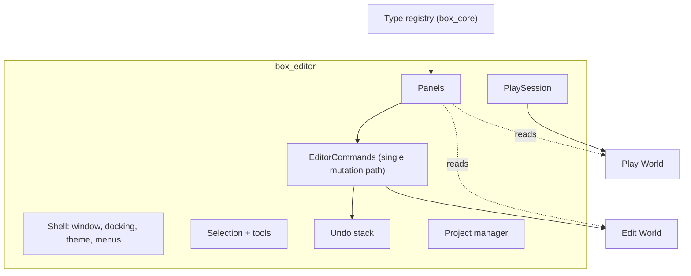

# Editor

The graphical editor is a first-class product. This document covers the user experience, the UI technology, and the technical design. Decision records: D2 (UI framework) and D5 (play mode) in [DECISIONS.md](DECISIONS.md).

## 1. Target workflow

1. Open box-engine.
2. Create or open a project.
3. See the main 3D viewport.
4. Add a mesh or primitive.
5. Select an object.
6. Move, rotate and scale it.
7. Modify properties in the inspector.
8. Save the scene.
9. Press Play.
10. Interact with the running game.
11. Stop and return to editing, with the scene exactly as it was.

Milestone M2 delivers steps 1–8; M3 delivers 9–11.

## 2. UI technology

**Choice: egui 0.37 used through `egui-winit` and `egui-wgpu` directly (not `eframe`), with `egui_tiles` for docking.**

Reasons:

- It shares the engine's wgpu device. The viewport is an offscreen texture registered with egui, so there is no cross-process or cross-API texture sharing.
- Version alignment is exact today: egui-wgpu 0.37 targets wgpu 30 and winit 0.30.
- Rerun ships a professional data tool on egui and maintains `egui_tiles`, which is the strongest evidence that the stack scales.
- Immediate mode fits an inspector driven by reflection: the UI is a function of the current world.

Known costs, and how they are handled:

| Cost | Handling |
|---|---|
| Default egui look reads as a debug tool | A custom theme and a small set of our own widgets (property rows, drag values, section headers, toolbar buttons). Proven by spike S1 before M2. |
| Ecosystem crates lag egui releases (gizmo and `egui_dock` are still on 0.36) | Depend on few egui add-ons. Write our own gizmo glue. Upgrade egui only when `egui_tiles` supports the new version. |
| Large hierarchies in immediate mode | Flatten the visible tree to rows and virtualize with `ScrollArea::show_rows`. |
| Text input and IME come from winit and have had macOS regressions | Accept for now; test CJK input before M9. |

Alternatives are compared in D2. The runner-up is gpui with gpui-component; we would switch only if the S1 spike cannot reach the visual bar.

## 3. Layout

```
+--------------------------------------------------------------------+
| File  Edit  View  Project            [ > Play ] [ Stop ]    status |
+-----------+----------------------------------------+---------------+
| Hierarchy |                                        | Inspector     |
|           |              3D Viewport               |               |
|           |                                        |               |
+-----------+----------------------------------------+               |
| Assets  |  Console                                 |               |
+--------------------------------------------------------------------+
```

- Central viewport; hierarchy left; inspector right; assets and console tabbed along the bottom (Assets in front with a project, the Console in front without one: `layout::default_layout_for`).
- All panels are dockable tabs in an `egui_tiles` tree. Layouts are saved per project in `.box/layout.json`, keyed by stable panel IDs, with a versioned format and a fallback to the default if loading fails.
- A single toolbar row: project menu, transform tool selector, snapping toggle, Play and Stop, and a compact status area. No ribbon.

### Visual direction

A professional creative tool, in the spirit of Blender's and Figma's restraint:

- Flat neutral surfaces, one accent colour used only for selection and active state.
- No gradients, glows, drop shadows or decorative icons.
- One UI font at two sizes, plus a monospace font for the console and numeric fields.
- Dense but aligned: a consistent property row height and label column.
- The viewport is the brightest and largest thing on screen; chrome recedes.
- A dark theme first, built from a token set so that a light theme can follow.

## 4. Panels

| Panel | Function | Notes |
|---|---|---|
| **Viewport** | Renders the edit world (or play world) to a texture; navigation, picking, gizmos, grid | Sized to panel rect times pixels-per-point; recreated on resize with a debounce. Final image is `Rgba8Unorm`, as egui-wgpu requires. |
| **Hierarchy** | Entity tree: select, rename, reparent by drag, duplicate, delete, search | Virtualized rows. Prefab instances are marked. |
| **Inspector** | Components of the selection, edited through reflection; add and remove components | Multi-selection edits shared fields. Fields can declare ranges, units and tooltips through reflection attributes. |
| **Assets** | Folder tree and grid of the project's assets; import settings; drag into the viewport or inspector | M4. Images show a downscaled thumbnail made once per asset version; models, materials and scenes show a type icon. |
| **Console** | Log output, script errors, shader errors, with filters (click-to-source is not built yet). Rows are selectable (click, Cmd-click, Shift-click) and copyable (Cmd+C, context menu Copy / Copy All); hovering shows the whole record. The tab shows unseen warning and error counts until the Console is shown. | M2 in basic form. |
| **Diagnostics** | Frame time, draw calls, upload bytes, job queue length, per-pass GPU timings | Collapsed by default. |

## 5. Viewport interaction

- **Navigation:** Alt + left drag orbits; middle drag (or Shift + Alt + left) pans; the wheel zooms toward the cursor, Alt + right drag zooms; trackpad: two-finger scroll orbits (Shift pans), pinch zooms. **Fly:** hold the right button and move the mouse to look around the eye; W A S D move, Q / E go down / up, Shift is three times faster, the wheel sets the fly speed (0.1–500 m/s, shown briefly in a pill). Releasing the button orbits around a point in front of the eye at the previous orbit distance. While the right button is held over the viewport, the single-key tool shortcuts (W/E/R, Y, F) are off. F frames the selection (an entity without meshes: 2 m around its origin).
- **Picking:** a CPU raycast. In M2 this is a ray against object bounds and then against triangles, using math in `box_core`. From M3 it uses the same BVH query layer games use (`box_physics`). It is synchronous and returns hit position and normal, which snapping needs. A GPU ID buffer is deferred until alpha-tested or very dense scenes make CPU picking inaccurate or slow.
- **Selection:** click, Shift-click (add), Cmd/Ctrl-click (toggle), marquee (M4). Selected objects get an outline from the renderer's outline pass.
- **Gizmos:** translate, rotate, scale; local or world space; grid and angle snapping. Drawn with the renderer's debug draw so that they appear in captures.
- **M2 as built:** the selection highlight is a screen-space silhouette outline (`box_render::SelectionOutline`): selected meshes go into a mask, and an edge pass is composited after tone mapping in display colour. The primary selection uses the accent, others are dimmer, hidden parts show at 30% alpha; each selected entity's subtree meshes are outlined (generated meshes below one selected entity, i.e. prefab contents, rule parts and scatter instances, are outlined while there are at most 256 (`box_editor::GENERATED_OUTLINE_LIMIT`); above that, one bounds box in the outline colour is drawn instead, 30% where hidden, so a selected scatter shows its extent rather than thousands of outlines. The box is cached in the owner's space, following it every frame and recomputed when the count changes or every 250 ms. Measured: selected 9,599-instance scatter +2.6 ms per headless frame before, +0.07 ms after), and entities without meshes (lights, empties) get a small accent cross. Cost: one draw per selected visible mesh plus one scissored composite; nothing when the selection is empty. Gizmo lines are display-referred and always on top; scale handles always use local axes. A left drag on a gizmo handle transforms; elsewhere a left click picks (Shift/Cmd toggles). Gizmo and inspector act on the whole selection from M4 (see below); delete and duplicate act on all selected. W/E/R switch tools, F frames (the primary only).
- **M4 as built (marquee and multi-object editing):** A left drag in the viewport that does not start on a gizmo handle (and without Alt) draws a marquee: a translucent accent rectangle, selecting live while dragging. Shift adds to the selection, Cmd (Ctrl elsewhere) toggles, for clicks and marquees alike; Shift-click on a selected entity makes it the primary; Escape during the drag restores the selection from before it. Hit rule: a mesh is hit when the rectangle meets the screen outline of its world bounding box (the eight corners clipped to the near plane and projected), and selects its nearest saved ancestor-or-self as clicking does; a saved entity without a mesh of its own (light, camera, empty, group) is hit by its origin; flat meshes (a bounds axis under 0.1 mm, such as ground planes) only when entirely inside the rectangle, so dragging over the floor does not select it. Nothing is visibility-tested: occluded objects inside the rectangle are selected too. Cost: one projection pass over the mesh and saved entities per frame while dragging (under 1 ms for 1,000 meshes); mesh bounds are cached per asset version.
- With several entities selected the gizmo sits at the pivot (toolbar "Pivot: Primary / Centre", shown with 2+ selected: the primary's origin or the mean origin of the moved entities) with the primary's axes (or world axes), and moves the top-most selected entities together, so a selected child of a selected parent moves once; rotate turns them about the pivot, scale multiplies each one's local scale and stretches its offset from the pivot along the gizmo axis; one undo step per drag.
- The inspector shows the components every selected entity has; a value that differs shows "—" (per lane for vectors and rotations, rotations compared as shown in degrees); editing sets it on every selected entity, a vector lane only on that lane, as one undo step (drags merged); a differing enum variant hides its fields and a variant switch is applied per entity. Add Component lists components missing on any selected entity and adds them where missing; Remove removes from all; each one step. Names are not edited across a multi-selection: the header shows "N entities" and the primary's name.
- Hierarchy: Shift-click selects the visible rows from the anchor (last plain or Cmd click) to the clicked row, Cmd-click toggles, Cmd+Shift adds the range. Delete and duplicate act on the whole selection (duplicate on the top-most entities). Marquee and pivot work in Play wherever selection does (paused or free camera).
- **M4 as built (assets).** With a project open, the editor runs one `box_assets::AssetServer` for `assets/` (watching) as a resource of the edit world, with `AssetLookup` and `Events<AssetEvent>`, updated once per frame. It is recreated whenever the edit world is replaced (project or scene switch, recovery restore). During Play it keeps driving the parked edit world. Headless captures wait for all imports before each frame.
  - **Assets pane** (tabbed with the Console): folder tree, breadcrumb, search across all folders, and tiles. The browser imports the files it shows, once each. Images show a thumbnail from the smallest mip of at least 128 px, regenerated only when the image's version changes (at most 8 per frame); other files show a type icon. Badges: amber while importing, red "!" when failed, with the error on hover; files with an unusable `.meta` are listed as failed. Double-click opens a folder, a `.scene.json` (as the scene, through the unsaved-changes prompt), or a glTF's sub-assets (also its chevron). F2, double-click on the name or the context menu renames inline (the suffix is kept; the type cannot change); dragging a file onto a folder (tile, tree row or breadcrumb) moves it; both go through `AssetServer::rename`. New ▸ Folder / Material; the context menu also has Reimport. Files dropped on the window from the OS are copied into the folder shown: originals are untouched, `.meta` files are skipped so copies get new ids, folders are copied recursively, and taken names get a number.
  - **Drag and drop** (Escape cancels): a glTF (its `#Scene`) or a `.scene.json` dropped in the viewport becomes an entity with `PrefabInstance`; a mesh sub-asset becomes `MeshAsset`, with the materials the glTF's scene gives that mesh. Placement is on the surface under the pointer, else on y = 0, else at the orbit target; one undo step. A material dropped on an entity (viewport or hierarchy row) goes into slot 0 of a `MeshAsset`, or links a `Primitive` entity to it (`MaterialRef`, added or changed; the inline material is kept but not drawn); one undo step. Later edits to the material file show on the entity (hot reload). An asset dropped on a matching inspector reference sets it.
  - **Path hints:** after an asset file moves (browser or external), references in the open scene to it whose path hint is stale are rewritten to the current path as one undo step, "Update asset paths", which marks the scene dirty. Ids never change, and references resolve by id either way.
  - **Inspector, asset references:** `AssetRef` fields show the file name and label (missing or failed in the warning colour, error on hover), a thumbnail for images, a clear button, a drop target, and a picker listing the project's assets of the field's type (guessed from the field name: texture, mesh, material, scene). Material slot lists have + and − buttons. Every change is one undo step.
  - **Inspector, assets:** selecting an asset in the browser shows it in the inspector until the entity selection changes. Images and models show their import settings (TextureSettings: colour space, mipmaps; ModelSettings: scale, tangents); Apply writes the `.meta` through `AssetServer::set_settings`, which re-imports; Revert drops the edits. A `.material.json` is edited with the reflected material rows and written back atomically when the drag or typing ends, or 300 ms after the last change, which hot-reloads it; each write (and Revert) is a step of that file's own undo history: while the material is shown in the inspector, Cmd+Z / Cmd+Shift+Z and Edit ▸ Undo/Redo ("Undo stone.material.json: Roughness") step it through `AssetServer::write`, and the scene's undo stack is untouched; with an entity in the inspector undo is the scene's again. Histories last for the session. Revert restores the file as it was when opened. glTF materials are read-only.
  - **ShaderMaterial params** are shown from the shader's `@material` header (the loaded `ShaderSource` or the `.wgsl` file), one row per declared type with `@range`, `@color` and the doc comment as tooltip. Unset params show the header default; editing sets them and ↺ resets them. If the header cannot be parsed, the generic list is shown under the parse error. The renderer's compile error for the shader is shown under the section.
- **Command palette:** ⌘K (also F1, Help ▸ Command Palette…) opens a search over every menu action plus Add ▸ kinds, Add Component (for the selection), Open Scene ▸ project scenes, assets (selected in the browser), Open Recent ▸ projects and History ▸ undo states. Matching is fuzzy (each word as a substring or letters in order, across label, category and keywords); recently used actions come first. Rows show the shortcut, On/Off for toggles, or why the action is disabled. Up/Down move, Enter runs, Esc closes. Menus and the palette read one action registry (`crates/box_editor/src/actions.rs`).
- **Edit ▸ History** lists the undo states, most recent first (redo steps dimmed, the current one marked, "Scene opened" last); clicking one undoes or redoes up to it. Off during Play.
- **Fast iteration (DX Batch 2).**
  - **Reset, copy, paste (`values.rs`):** a value that differs from its registry default shows a dot before a brighter label and a ↺ while hovered. Right-click a field's label: Reset to Default, Copy Value, Paste Value (only a value of the same type; the item names it). A section's ⋯ menu: Reset / Copy / Paste <Component> Values (Remove as before). "Paste <X> as New Component" appears under Add Component when the clipboard holds a component the selection lacks. Each reset or paste is one undo step for every selected entity. The clipboard is JSON text (`{"box":"value","type":…,"value":…}` or `{"box":"component","component":…,"value":…}`), read from the system clipboard, so values paste between editor instances. Fields of an enum variant the default does not have have no default. The same menus work in Project Settings (as file edits).
  - **Hide and lock (`visibility.rs`):** each hierarchy row has an eye and a lock (on hover, always when on, dimmed when inherited from a parent); the row menu has Hide/Show and Lock/Unlock; H hides the selection (or shows it when all of it is hidden), Alt+H shows all; Edit has both. Hidden entities and their subtrees get the runtime marker `box_render::Hidden` (not saved, never in the Play world), so they are not drawn or shadowed in the viewport. Locked or hidden entities and their children are not picked (clicks and icons go through), marquee-selected or moved with the gizmo; they stay selectable in the hierarchy. Hide and lock are editor state, not undo steps, and last for the session. Hiding affects meshes only (hidden lights still light).
  - **Linked materials:** a Material Ref section shows the linked file with Edit (show the asset in the inspector) and Unlink (copy its values into the inline Standard or Shader material and drop the link, one undo step). An inline material that a link overrides says so.
  - **Game menu:** Rebuild and Restart (⇧⌘B) is available when the editor runs from the open native project's own editor binary (otherwise disabled with the reason): it builds the editor binary in the background ("Building…"), shows compiler errors as `file:line` toasts (full output in the Console) and keeps running on failure; on success it saves the recovery file and session and starts the new binary with `--after-rebuild`, which restores scene, camera, selection and unsaved changes without asking. Project Settings ▸ <type> shows a settings resource in the inspector; edits are written to its file (atomic, after a drag or 0.3 s), have no undo, do not dirty the scene, apply live during Play and are kept after Stop.
- **Generated objects (M5).** A click or marquee on a derived part selects its owner. Cmd+Alt+click (Ctrl+Alt elsewhere) inspects the part read-only: the selection is cleared, the part is outlined, and the inspector shows "Generated by" (rule, key, owner link) and its components disabled. An owner's inspector lists its rule warnings first (warning colour, one line each) and a "Generated" section with its parts by rule (click a key to inspect it); its hierarchy row shows a gear (part count on hover) and a warning glyph; the viewport shows a warning badge next to it (a click selects the owner). These are rebuilt only when the world or `GeneratedRevision` changes.
- **Viewport tools (M5 extension point, `tools.rs`).** `EditorState::register_tool(impl ViewportTool)` adds a segment after Move/Rotate/Scale and a palette action `tool.<id>`. An active tool that wants input gets the left button and keys (not Escape), hides the gizmo, draws its overlay and hint, and commits through `EditorState::transaction` (one undo step). Escape, W/E/R or a transform segment cancels it. Built-in: **Place on Surface** (toolbar "Place"): click to drop the selection onto the surface under the cursor (ground plane without a hit), up axis along the normal (Shift keeps the rotation), lowest point resting on the surface; the rest of the selection moves rigidly; one undo step per click.
- **Edit Spline (M5, `spline_tool.rs`; toolbar "Spline", palette "Edit Spline Tool")** edits the primary selection's `Spline`, or the spline its `Sweep` reads. Points show as discs with their index, Bézier handles as squares. Press and drag a point or handle: on the horizontal plane through it (a camera-facing plane when the view is nearly level), Shift for height only; a smooth point's handle turns both tangents, a broken one only that one. Cmd-click (Ctrl elsewhere) on the curve inserts a point there (Bézier and Polyline keep the shape exactly); Delete/Backspace removes the selected point (at least two stay); Enter or Escape finishes (Escape during a drag rolls it back). Each drag, insert or delete is one undo step; sweeps that read the spline update during the drag through the throttled flush. Selected splines (and the splines of selected sweeps) show a thin line when not editing. Add ▸ Shapes ▸ Spline adds a `Sweep` with a default `Spline` (a tube). The inspector shows any list field as "n items" (collapsible, open by default up to two items) with + (copy of the last) and −, each one undo step. Enter finishes any viewport tool.
- **Game editor plugins, path tools, overrides, rule list (M6).** Games add editor-only extensions through `box_editor::EditorPlugin` (`fn build(&self, editor: &mut EditorState)`), passed to `box_editor::run_game_with(options, game, &[&MyTools])` (tests: `build_game_editor_with`). box_engine's `Game` cannot hold them (box_engine never depends on the editor). Plugins run once after the project opens and before `--play`; their tools and actions stay for the session. `ViewportTool::on_escape` lets a tool cancel only its operation in progress (Esc again leaves the tool). `box_editor::path_tool::PathTool` draws and edits a game's path intent from a `PathToolConfig` (component, `Vec<Vec3>` points field, JSON defaults, closing, snap sources): click to place points on surfaces (mesh ray, ground plane fallback; snap-source geometry is passed through), snapping with hysteresis (`box_proc::snap::Snapper`, 10 cm / 15 cm, ends then bodies); a ghost of the real rule output on a runtime-only `Preview` owner (never saved, never in undo, not in the hierarchy, warnings not toasted), rewritten only when the snapped cursor moves; Backspace removes the last point; Enter, a click on the last point, or a click on the first point (closing) commits as one undo step; Esc cancels. With a path selected, its points are handles (drag = one undo step, ends snap; a click without dragging starts a new path there). Generated parts: Cmd+Alt+click inspects a part; editing a field writes an override into the owner's saved `Overrides` (one undo step; a drag is one step), marked like a non-default value with ↺, listed with Reset in "Overrides"; Edit ▸ Hide Generated Part (`edit.hide_part`) hides it; the owner's Generated section lists overrides and hidden parts with Show and Reset. View ▸ Rules (`view.rules`) lists rules (intent and read types, intents, parts, last run, warnings) with a per-session switch: a disabled rule stops in the edit world and in Play started from the editor and its parts and warnings are removed; nothing is saved.
- **Edit-world systems (M6).** The edit world runs no gameplay: only the game's rules (`Game::rules`), generators and the systems plugins mark with `App::add_edit_world_system` (`Game::edit_world_systems`, installed with the rules and run after `sync_scene_meshes`, never during Play). box_arch's anchors use it, so anchored decorations follow their walls while editing.
- **Paint Scatter (M6, `scatter_brush.rs`; toolbar "Paint", palette "Paint Scatter Tool"; needs a selected entity with a `Scatter`):** drag paints the scatter's mask on its ground, Shift-drag or X erases, `[`/`]` radius, `-`/`=` strength; a ground-hugging ring shows radius and strength. Dabs stamp into a working mask; the `Scatter.mask` is written at most every 30 ms and on release, and only changed chunks are placed again. One undo step per stroke ("Paint Scatter" / "Erase Scatter"); Esc cancels a stroke in progress.
- **Viewport icons (`icons.rs`):** lights, ambient volumes, particle emitters, cameras, empties (and groups without meshes below) and prefab instances without loaded content get an icon of constant screen size, painted by egui over the viewport image from a glyph texture built once per context (three textured quads per icon, one mesh; 1,000 icons: 0.04 ms to place, under 0.1 ms to paint, release). A click within 12 pt picks the nearest icon, before meshes; the marquee hits an icon when the rectangle meets its 11 pt disc. Instanced prefab content gets none. A selected camera shows its frustum (fov, near plane, viewport aspect), a directional light its direction, a point light its range (three circles), a spot light its cone, an ambient volume its box, a particle emitter its emission cone and spawn sphere; colliders show as wireframes for the selection, all or none.
- **View menu:** the mode pill opens Grid, Icons, Collider wireframes (Selected / All / None), Contact points, Particle preview (Selected / All / None) and View from (Top, Bottom, Front +Z, Back, Right +X, Left); session-only. There is no orthographic or unlit view yet (the renderer has neither).
- **Particle preview (`particle_preview.rs`):** while editing, the emitters View ▸ Particle preview selects (default: those of the selected entities; All; None) are simulated in the edit world with the frame time, so their look can be tuned without Play. Only the runtime `ParticleState` is written (unregistered: never saved, never an undo step, never copied into Play, which builds its world from the saved scene and simulates on its own). The preview ignores `despawn_when_finished`, plays an emitter whose `playing` is off, restarts a finished one-shot after 0.6 s and skips hidden emitters. It costs one step per previewed emitter per frame, and the editor repaints continuously only while something is previewed.
- **Axis gizmo:** clicking an axis end (negative ends are the hollow dots) turns the view to look from that side (0.22 s); clicking it again turns to the opposite side.
- **Framing on open:** opening a project, a scene, a new scene or the scratch scene frames the non-flat objects and the active scene camera's position from the default angle, never closer than the scene camera; with only a camera, its view. Undo and Play do not reframe.
- **Gizmo readout:** during a gizmo drag a pill next to the cursor shows the change (`X  Δ 1.50 m`, `XZ  Δ 1.00, −0.50 m`, `Y  45.0°`, `×1.25`) and the snapping state (`Snap 0.5 m` / `Snap off`).
- **Ease-of-use pass (DX review, editor interaction).**
  - **Placement:** Add ▸ (toolbar "+ Add", Edit ▸ Add, the hierarchy's background menu) places a new root object where the viewport centre looks: on the mesh hit, else the ground plane y = 0, else the orbit target. It rests on the surface below that point by its bounds, and moves sideways along the camera's right while it would overlap a non-flat mesh. A point light goes 2.5 m above the surface, a spot light 3 m above it pointing straight down, an ambient volume stands on it and a particle emitter sits on it; a directional light and a camera are placed as before. The new entity is selected; one undo step. Children are added at the parent's origin.
  - **Shortcuts:** one table (`crates/box_editor/src/shortcuts.rs`) drives key handling, menu shortcut text, tooltips and Help ▸ Keyboard Shortcuts; modifiers match exactly. Tools W/E/R; Y toggles snapping; F frames from anywhere (when no text field has focus); F2 renames; Delete/Backspace deletes; Cmd+D duplicates; Escape selects nothing; Cmd+Z / Cmd+Shift+Z undo and redo; Cmd+S / Cmd+Shift+S save; Play Cmd+P, Pause Cmd+Shift+P, Step Cmd+Alt+P. Mouse navigation is listed from `camera::NAVIGATION`. A navigation hint over the viewport is shown until clicked (remembered per project). Help ▸ Documentation opens the source checkout's `docs/` folder when it exists.
  - **Scoped Delete/Duplicate:** they act on entities only while the asset browser is not the active pane and the inspector is not showing an asset. In the browser, Delete (or Move to Trash… in a file's context menu) asks, then moves the file and its `.meta` to `<project>/.box/trash/<time>/<path>`; move them back to restore the asset with its id. The open scene's file is refused. Not an undo step.
  - **Snapping:** click the step next to the snap toggle for a popover with the move (m), rotate (°) and scale steps and the toggle, kept per project in `.box/editor.json`. Holding Cmd (Ctrl elsewhere) during a gizmo drag inverts snapping for that drag.
  - **Hierarchy:** a pinned Scene row at the top selects nothing, so the inspector shows the scene's settings (Environment: sky, fog, exposure, tone mapping); View ▸ Scene Settings does the same. Right-click on empty space offers Add ▸ (all kinds). Double-clicking a row's icon frames the entity (double-click on the name renames). An empty scene shows how to add objects, in the hierarchy and the viewport. Point lights, spot lights, ambient volumes and particle emitters have their own Add entries and icons (Add groups: meshes, Empty, lights and Ambient Volume, Camera and Particle Emitter).
  - **Inspector:** section headers use friendly names ("Standard Material", type name in the tooltip). Add Component is a search popup (focused on open; Enter adds the first match) grouped as Rendering, Lights, Physics, Assets & Prefabs, Gameplay (the game's own types) and Other. Labels write ORM, UV, FOV, RGB, HDR, ID in capitals; a truncated label shows in full in its tooltip. Number decimals are the larger of the range-based count and the decimals of `@Step` (script properties use their `step`), plus more for a non-zero value below 1 (two significant digits, trailing zeros beyond the base trimmed), and below 1e-6 the exponent form, so a non-zero value never shows as 0. Display only: typing keeps every digit (f32 fields compare as f32) and dragging moves by the step; `@Logarithmic` (fog density) gives a log-scale slider. Nested structs (Wind of a material, Bloom, Aerial haze and the other Environment groups, list items such as a scatter's species) are folding headings: closed by default, opened or closed per type and field path for the session (it holds for every entity and scene); a click anywhere on the row toggles it. A heading shows the modified dot and ↺ when the struct differs from its default, "—" while closed when its fields differ across the selection, and the struct's `enabled` switch as a check box (no separate Enabled row); right-clicking its label resets, copies or pastes the whole struct (one undo step). Add Component (and Paste as New Component) is pinned below the scrolling sections, so it is in view at any window size; its list opens above it. List items are named by the singular of their field ("Species 0", "Point 1", "Entry 2").
- **Input routing:** the viewport receives input only while hovered or focused. During Play, the viewport captures game input; Escape releases it.
- **Feedback (DX batch 1, `feedback.rs`).** Nothing fails silently:
  - **Toasts** at the bottom right of the viewport for warnings and errors logged under `box` / `box_*` targets (not wgpu or other dependencies), read from the console log once per frame, plus short notes for explicit actions ("Saved main.scene.json", "Undo: Delete Cube"). Repeats merge ("×3"); at most 4 are shown (errors kept first) and the rest are counted ("N more in the Console"); at most 32 new records per frame. Info 2.5 s, warnings 4 s, errors 8 s; hover holds a toast; × closes it; a click opens the Console at that record.
  - **Console badge:** warnings and errors logged since the Console was last shown, as amber and red counts on its tab.
  - **Unknown components** (types this editor does not register, kept as raw data and saved back) appear in the inspector as collapsed read-only sections "Name — not registered (data kept)" with a hint to open the project with the game's editor and the raw data. Opening a scene with such types logs one warning and toasts the type names once per session.
  - **Asset error marks:** an entity whose `MeshAsset` mesh or `PrefabInstance` scene failed to load or is missing gets a warning mark on its hierarchy row (reason on hover) and a note in the inspector section. Rebuilt only when the world or the asset server's state changes.

## 6. Undo and redo

All edits go through one path, `box_core::edit::EditStack` (headless, no UI types), which the editor, the `box` CLI and later the MCP server share:

```rust
pub enum Edit {
    SetField { uid: Uid, path: FieldPath, old: Value, new: Value },
    SetResource { path: FieldPath, old: Value, new: Value },
    AddComponent { uid: Uid, component: &'static str, data: Value },
    RemoveComponent { uid: Uid, component: &'static str, data: Value },
    Spawn { snapshot: EntitySnapshot },
    Despawn { snapshot: EntitySnapshot },
    Reparent { uid: Uid, old: Placement, new: Placement },
}

pub struct Transaction { label: String, edits: Vec<Edit> }
```

Text front ends submit JSON `Command`s (`spawn`, `set`, `set_resource`, `add_component`, `remove_component`, `reparent`, `despawn`, `rename`, `duplicate`; entities by uid or unique name). `reparent` keeps the world position; `"keep": "local"` keeps the local transform instead. A command list is applied as one transaction, all or nothing.

- A transaction is one undo step. A gizmo drag or slider drag opens a transaction, **merges** successive changes to the same field, and closes on release.
- Material files have their own undo history while shown in the inspector (see §5); the Edit menu names the file.
- Undo labels are readable: "Cube: Translation", "3 entities: Base color", "Rename Cube", "Environment: Exposure" (`inspect::edit_label`). Undo and redo show a short toast with the label.
- Each undo state remembers the selection last seen in it; undo and redo restore it (entities that no longer exist are dropped), so Delete then Undo selects the entity again.
- Edits address entities by persistent `Uid`, not by runtime entity handle, so they survive despawn and respawn. Snapshots reuse the scene serializer, so unknown components survive delete and undo.
- Inside a transaction a set merges into the latest edit of the same entity and field even when sets of other entities came in between, so a multi-object drag stays one edit per entity; another field of that entity, or any structural or resource edit, starts a new edit.
- Reparenting keeps the world position: one undo step made of `Reparent` plus a `Transform` `SetField` (see SCENE_SYSTEM section 4 for limits).
- Values are reflected values, so new component types need no undo code.
- The undo stack is cleared on scene load, not on Play.
- Game plugins that add editor tools (for example a construction game's brushes) submit the same `Edit`s and get undo for free.

The command layer and undo stack have no UI dependencies and are built and tested headlessly first (M2a).

## 7. Play mode

**Choice: an isolated play world in the editor process**, created from a serialized snapshot of the edit world.

```
Play   : serialize edit world -> build play World -> start scripts and systems -> viewport shows play world
Pause  : stop stepping the play world; inspector can still read it
Stop   : drop the play World; viewport shows the untouched edit world
```

| Option | State isolation | Crash recovery | Debugging | Complexity | Verdict |
|---|---|---|---|---|---|
| Same world, restore afterward | Poor | Poor | Easy | Low | Rejected: gameplay corrupts edit state |
| **Isolated world, same process** | Good | A game panic can take down the editor | Easy: one process, inspect live | Low | **Chosen** |
| Separate process | Best | Best | Needs remote inspection and IPC | High (shared textures via IOSurface or DX12 handles, input forwarding) | Deferred; kept reachable |

Mitigations for the chosen option:

- The scene is **autosaved to a recovery file before Play**.
- Once scripting exists (M7), script errors are caught at the script boundary and reported in the console; they cannot crash the editor.
- In native projects, panics in game systems are caught at the phase boundary where possible, and Play is stopped with an error.
- The play world is constructed **only from serialized scene data** and the editor talks to it through a narrow `PlaySession` interface, so moving it out of process later changes the transport, not the model.

During Play, the inspector shows live play-world values. Changes made during Play are discarded on Stop, except values marked to keep.

**Keep after Stop (DX Batch 2).** During Play, a field's context menu and a section's ⋯ menu have "Keep after Stop" (kept rows get an accent bar; the banner says "N changes will be kept, the rest discarded"). On Stop the current play values of the kept fields or components are read before the play world is dropped and applied to the edit world as one undo step, "Apply Play changes". Entities created during Play and prefab contents are refused with a warning; a game panic that stops Play discards kept changes. A Play panic message names the system that panicked.

**M3 as built.** `box_editor::play::PlaySession` is built only from a serialized snapshot (`scene::save` → `scene::load` with the game registry → `Game::app`). Play (toolbar ▶, Cmd+P) first writes unsaved changes to the autosave (the project's `.box/recovery/<scene>.scene.json`, or without a project `<user data>/box-editor/autosave/<scene>.scene.json`; a clean scene's file is already the copy) and refuses to start if that fails. The edit world, its undo history and dirty state are parked; every pane shows the play world, and edits made during Play go to the play world and a throwaway undo stack and are discarded on Stop. Undo/redo and Save are off during Play; New/Open Project, Open Scene and Quit stop Play first. Pause (Cmd+Shift+P) freezes time and fixed steps; Step (Cmd+Alt+P) runs one frame of one fixed step. The viewport renders the play world's first active `Camera` without editor overlays, or the editor camera (with overlays) when there is none or Free Camera is on. The game's own UI is never covered: during Play the viewport's status (Game Camera, a dot in the Play colour with the input hint or Paused, and in the game camera's view the selection) is in the Viewport tab bar, not over the image; the game camera's view has no chips, only the border inside its edge. Free Camera brings back the editor's own chips. A tinted border (accent running, warn paused), a tint on every panel's background (`surface_play`), an inspector banner ("Playing — changes are discarded when you stop", or Paused), the status area and the window title show the state. While the viewport has game focus (on Play, or a click in it), keyboard, button, motion and scroll input go to the play world's `Input` and editor shortcuts other than Play/Pause/Step are not seen; Escape, a click elsewhere, Pause or window blur give input back. Plugin `build`, every frame and dropping the play world run under `catch_unwind`; a panic stops Play, logs one console error with the phase, panic location, message and plugin names, and leaves the edit world and autosave intact. A game that sets `AppExit` stops Play. `box-editor --play` starts in Play (with `--capture`, the capture shows a Play frame).

- **Play input.** While the game view has focus, keyboard and mouse go to the play world's `Input`, and gamepads too: the windowed editor owns one `GamepadPoller`; events are dropped while the game has no focus, and the devices' state is copied in when focus returns. If the game requests a cursor grab (`CursorOptions`), the editor window grabs and hides the cursor and feeds raw device motion to `Input::mouse_delta` (the pointer delta is then not counted). Escape, Pause, Stop and losing window focus release input and the cursor; clicking the viewport gives them back.
- **Runtime scenes.** The play world gets a `Scenes` resource with the project root and the edit scene as its start scene, so `Scenes::switch("arena2")` and `load_additive` resolve in the project. Stop drops every scene the game loaded and restores the edit scene unchanged.
- **Agent control during Play.** `apply_commands` from `box mcp` edits the play world like inspector edits during Play: not undoable, discarded on Stop (the result says `"world": "play"`, `"discarded_on_stop": true`). An agent's `play` does not give the game input focus, so an agent never grabs the user's cursor.
- **GPU memory.** The renderer's mesh cache holds only the meshes of the world being drawn, so Stop and scene replacement do not leave the play world's meshes on the GPU.

## 8. Editor architecture



- `box_editor` is a **library**. `apps/editor` is a thin binary; native projects build their own editor binary that adds their plugin.
- **Extension points for plugins:** register a panel, register a viewport tool (input handling plus overlay drawing), register a custom inspector widget for a type, add menu commands. `box_arch` and construction games use these for their tools.
- **The editor never bypasses the engine.** It reads and writes the world through the same reflection and scene APIs that scripts and save files use.

## 9. Project management

- Start: `box-editor` with a project folder opens it. Without one, a windowed launch opens the project the working folder is in, else the most recent project (unless `--no-restore`), else the scratch sample scene under a Welcome card: New Project…, Open Project…, the example projects (each opens a copy, M9), up to eight recent projects (scrolling in a small viewport), "Explore the sample scene" (closes the card) and a ⌘K hint. Help ▸ Welcome Screen shows it again.
- Recent projects (most recent first, at most 10) live in `recent.json` in the user config folder: `$BOX_EDITOR_CONFIG_DIR`, else `~/Library/Application Support/box-editor` (macOS), `%APPDATA%\box-editor` (Windows), `$XDG_CONFIG_HOME/box-editor` or `~/.config/box-editor`. File ▸ Open Recent lists them (moved or deleted folders are disabled) with Clear Recent Projects. Opening one that fails shows the error and drops it from the list. Tests and `--capture` never read or write this folder.
- Session restore: `.box/editor.json` keeps the last session (open scene, editor camera orbit, selection), written on quit and before switching projects. When a project opens in a windowed run (unless `--no-restore`), or in a capture with `--restore`, the scene reopens, then the camera and the still-existing selected entities. It never replaces unsaved changes or a start scene that failed to load. Active dock tabs are part of `layout.json`.
- Logs: a windowed editor on macOS whose stderr is not a terminal (the app started from Finder) also writes `~/Library/Logs/box-editor.log`, replaced at each launch. Plugin registration errors are logged as errors at startup, so they show as a toast.
- Double-clicking `box.project.json` is not supported yet: winit 0.30 does not deliver the macOS open-file event without a custom `NSApplicationDelegate` (unsafe objc2).
- **M2 as built:** File ▸ New Project…, Open Project…, Open Scene ▸ (the project's `*.scene.json` under `assets/`), Save Scene (Cmd+S), Save Scene As… (Cmd+Shift+S), Quit. Scene writes are atomic. Save on a scene with no file (the scratch scene) opens Save As, which works with or without a project; without a project the scene becomes a standalone file with no recovery copy. In windowed runs New/Open Project and Save As use native dialogs (`rfd`); headless runs and tests use in-editor path-entry modals and never open a native dialog. If a chosen folder fails, the modal shows the error so the path can be corrected. **M9:** New Project is a modal with the project templates (preview cards, description, folder field, Browse… in windowed runs) from `box_engine::templates`, the same lookup as `box new --template`; native templates show the `box new --native` command with Copy Command instead of Create. File ▸ Open Example… (and the Welcome card) copies a gallery example (`templates/examples/examples.json`) into a new or empty folder and opens the copy (`crates/box_editor/src/new_project.rs`).
- File ▸ New Scene (through the unsaved-changes prompt) opens an unsaved scene: a sun, ground, camera and the day environment, named `untitled` (or `untitled N`); Save goes to Save As in `assets/scenes/`. Assets ▸ New ▸ Scene writes `New Scene.scene.json` with the same contents into the folder shown.
- Startup: `box-editor --help` prints the options, and unknown options are an error. A project that cannot be opened leaves the scratch scene open; a start scene that cannot be loaded opens the project with an empty, unsaved scene (the file is untouched). Either way the editor shows an error dialog with the cause and what to do. With `--capture` both are errors.
- Opening a project or scene, New Project and Quit (menu or window close button) with unsaved changes ask "Save / Don't Save / Cancel". Save on a scene with no file goes through Save As first. Don't Save discards the changes and the scene's recovery file, but only once the switch actually happens.
- Unsaved changes go to a recovery copy that mirrors the scene's project-relative path: `.box/recovery/project/<path>` (scenes outside the project: `.box/recovery/external/<absolute path>`), so two scenes with the same file name never share one. It is written at most every 30 s while the scene has changed since the last copy (never mid-drag), on quit or switch without a prompt (`--frames`, or the macOS app-menu Quit, which ends the app directly), and deleted when undo returns to the saved state. The layout is saved on quit. When a project or scene is opened and its recovery file is newer than the scene, the editor offers Restore (load as unsaved changes; the file is kept until you save or discard) or Discard. Recovery files from the old flat `.box/recovery/<scene>.scene.json` scheme are ignored.
- Dirty tracking compares undo-step identity with the saved step, so undoing back to the saved state is clean; diverged history never is. A failed save opens an error dialog with the reason.
- Undo and redo leave text fields alone while one has keyboard focus. Undo, redo, save and delete during a gizmo or inspector drag end the drag as one step first; Escape cancels an active drag and restores the pre-drag values.
- Dragging a hierarchy row within two rows of the list's top or bottom edge auto-scrolls it.
- **Allow Agent Control** (File menu, or `box-editor --control`, M3) starts the control socket for the open project and writes `<project>/.box/control.json` (port and token, readable only by the user). It needs a project. While on, the toolbar shows "Agent" (hover: port and connections). The scene in the file follows Open Scene and Save As. Opening another project or quitting turns control off and removes the file. Requests are answered on the main thread once per frame, and every 16 ms while the window is hidden. Agent edits in Edit mode are one undo step labelled "Agent edit" and mark the scene dirty.
- A project is a folder with `box.project.json`; see [ASSETS.md](ASSETS.md).
- The project file records `engine_version`. Opening a project made with a newer engine is refused with a clear message; an older one is migrated after a prompt and backup.

## 10. Testing the editor

- Logic (commands, undo, selection, play session round trip) is tested without a window.
- Property test: a random sequence of edits followed by the same number of undos returns the world to a byte-identical serialization.
- Play round trip: serialize, Play, mutate, Stop, serialize again; the two serializations must match.
- Feedback (`crates/box_editor/tests/feedback.rs`): toasts from warning records and from a game panic, the Console badge, a toast click opening the Console at the record, selection restored by undo and redo, unknown components, hierarchy error marks, and captures of each in `target/captures/feedback_*.png`.
- Multi-selection property test (`crates/box_editor/tests/multi.rs`): random selections, marquees, multi-object gizmo moves and scales, lane edits, add/remove component, duplicate and delete, each at most one undo step; undoing all of them restores a byte-identical serialization.
- UI screenshots of the full editor through the headless capture path, compared against goldens with tolerance.

## 11. Staging

| Milestone | Editor content |
|---|---|
| M2a | Reflection, scene serialization, command layer, undo (headless) |
| M2b | Shell, theme, docking, viewport, hierarchy, inspector, console, gizmos, project open and save |
| M3 | Play, pause, stop; play-world inspection; picking moves to `box_physics` |
| M4 | Asset browser, material inspector, marquee selection, multi-object editing (done) |
| M5 | Viewport tool extension point; spline handles; generated geometry selects its owner; "Generated by" and warnings in the inspector |
| M6 | Construction tools contributed by `box_arch` and the construction slice; wall and path drawing tools (built: `path_tool`, game `EditorPlugin`s); manual overrides (built); rule list panel (built); Paint Scatter brush (built) |
| M7 | Script property editing, script error navigation |
| M9 | Export dialog, project templates |

## 12. Deferred

Multi-window panels, a GPU ID picking buffer, a timeline or animation editor, a material graph, a visual scripting editor, terrain sculpt tools, collaborative editing, localization of the editor, out-of-process play.
