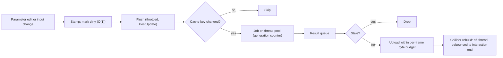

# Procedural Modeling and World Creation

Procedural creation is box-engine's main differentiator. This document defines the core abstraction, the regeneration pipeline, the staged feature set, and how the construction slice (M6) tests it. Decision record: D7 in [DECISIONS.md](DECISIONS.md). Direction review (what to add around rules, provenance, overrides and editor tools, and what stays deferred): [PROCEDURAL_DIRECTION.md](PROCEDURAL_DIRECTION.md).

## 1. Core idea

**A procedural object is a set of parameters plus a pure function that turns them into geometry.**

- **Parameters are the source of truth** and are what scenes save.
- **Generated meshes are a cache.** They are never saved in scenes. They are kept in memory, and optionally on disk under `.box/cache`, keyed by a hash of their inputs.
- Editing a parameter marks the object dirty; the engine regenerates it off the main thread and swaps the mesh in.

This is the model every mature tool uses in some form (Blender modifiers and Geometry Nodes, Houdini assets, Unreal dynamic meshes and PCG), and it is how the construction game the engine was first proven against works: only semantic entities are stored, and everything visible is derived.

### Store parameters, meshes, or both?

| Option | Verdict |
|---|---|
| Mesh only | Rejected. Loses editability, which is the point. |
| Parameters only, regenerate on load | **Default.** Small files, always editable, always consistent with the current generator. |
| Parameters plus a disk cache of meshes | **Optional accelerator**, added when load times require it. The cache is disposable. |
| Parameters plus a baked mesh saved as an asset | An explicit user action ("Bake to mesh") that produces a normal mesh asset and detaches it from the generator. Used to freeze results or hand-edit them elsewhere. |

## 2. The Generator abstraction

```rust
// Illustrative. Revised after spike S6.
pub trait Generator: Reflect + Clone + Send + Sync + 'static {
    /// Bumped whenever output changes for the same parameters.
    const VERSION: u32;

    /// Named material slots this generator emits, e.g. ["wall", "trim", "glass"].
    fn material_slots() -> &'static [&'static str];

    /// Assets this generator reads (a spline, a profile, a footprint asset).
    /// Never neighbouring entities: neighbour facts arrive as parameters (see "Rule systems").
    fn inputs(&self, deps: &mut Deps) {}

    /// Pure and deterministic. No world access, no global state, no randomness without ctx.seed.
    /// Validates and degrades; never panics.
    fn generate(&self, ctx: &GenContext) -> GenOutput;
}

pub struct GenContext<'a> {
    pub seed: u64,
    pub inputs: &'a ResolvedInputs,
}

pub struct GenOutput {
    pub mesh: Option<MeshData>,          // material groups indexed by material_slots()
    pub instances: Vec<InstanceBatch>,   // scattered or repeated items
    pub collider: ColliderHint,          // None, Box, Convex, Compound(Vec<Primitive>), or use the mesh
    pub anchors: Vec<Anchor>,            // opening frames, eave/ridge lines, surface parameterisation
    pub warnings: Vec<String>,           // shown in the inspector, e.g. "opening too close to corner, dropped"
}
```

- A generator **is a component**. A `Lathe`, a `Wall` or a `ScatterArea` sits on an entity next to a `Procedural` component, which holds the saved `seed` and the unsaved cache key and dirty state. Because the generator derives `Reflect`, it gets an inspector, serialization, undo and script access with no extra work.
- **The cache key is a hash of the reflected parameter bytes** (plus generator type, version, seed and input asset keys).
- **Built-in primitives are generators.** `Primitive` (box_core, M2) implements `Generator` in `box_proc::builtin` (VERSION 1, Add ▸ Shapes), so primitives use the same stamp, flush, cache key, warnings and bake as every generator. Scenes keep the `Primitive` component unchanged (no migration); colliders still read it (`ColliderShape::Primitive`). The runtime always runs `Primitive`, even with a core-only registry. Every engine and editor golden image stayed pixel-identical through the change.
- Games register their own generators through `registry.register_generator::<T>()` in `Plugin::register` (`app.add_generator::<T>()` is for tests and runtime-only generators).

**M5 as built (runtime).** `pub trait Generator: Component + Reflect + … + Default + Clone + PartialEq { const VERSION: u32; const MATERIAL_SLOTS: &[&str] = &["Surface"]; const CATEGORY: &str = "Procedural"; fn inputs(&self, &mut Inputs) {} fn generate(&self, &GenContext) -> GenOutput; }`. `inputs` declares components of other entities by `Uid` and assets by `AssetRef`; `GenContext` gives the seed, a seeded `rng()`, and typed `component::<C>(uid)` / `asset::<A>(&ref)` access. `GenOutput { mesh, warnings, collider }` (instances and anchors deferred to M6; `ColliderHint` is stored but physics does not use it yet). `Procedural { seed, materials (by slot), cast_shadows }` is saved and optional; runtime state lives in the unsaved `ProcState`. Register with `registry.register_generator::<T>()` in `Plugin::register` (component plus `ReflectGenerator` type data); `registry.generators()` lists them for the editor's Add ▸ <category> ▸ <name> menu and the palette. Material per slot: `Procedural.materials[i]` if set, else the entity's own material with primitive precedence (`MaterialRef` > `ShaderMaterial` > `StandardMaterial` > default). Edit ▸ Bake to Mesh writes `assets/baked/<Name>.glb` (minimal glTF writer, one primitive per slot) and swaps the generator for a `MeshAsset` as one undo step; the baked mesh re-imports with an identical hash. Worked example: `crates/box_engine/examples/common/steps.rs`. Built-in generators (`box_proc::builtin`, CATEGORY "Shapes"): `Primitive`; `Lathe { shape: LatheShape::{Vase, Column, Dome, Custom{profile, closed}}, segments, start_angle, sweep_angle, caps, smooth_angle }` with slots Surface and Cap; `Extrude { outline: Outline::{Rectangle, Circle, Polygon, Star, Custom}, hole: Hole::{None, Inset, Circle, Rectangle, Custom}, depth, bevel_width, bevel_segments, caps, smooth_angle }` with slots Sides, Caps and Bevel. Presets make the common case one dropdown; Custom point lists edit in the inspector. New generator objects are not throttled (they show in the frame they appear); an output equal to the current mesh is not re-uploaded. The editor places Add ▸ <generator> by the bounds of one synchronous generate. Bake keeps a primitive's shadow flag and writes its shape into a following Collider.
- Generators are **typed components**, not a node graph. A node graph editor can be layered on later; it is explicitly deferred.
- A quality level (preview while dragging) is not part of the trait. Spike S6 measured every architectural generator under 0.2 ms; it can be added later for expensive generators.

### Rule systems and derived entities

Spike S6 showed how elements that depend on each other (rooms sharing walls, one roof over two rooms) fit this model without a document-level generator:

1. **Semantic components are saved.** A game saves what the user made (for a building game, for example a room with a footprint, storeys and a roof kind).
2. **A rule system** (ordinary game code, in `Update`) reads the semantic components and computes generator parameter sets with stable keys (`room2/wall1`, `room1/roof`). Every neighbour fact (which walls are shared, where a roof abuts, which corners are concave) is written into those parameters.
3. **`reconcile(world, parts)`** (engine helper) spawns, updates or despawns **derived entities** that carry the generator components. Derived entities are marked `Derived { owner, key, rule }` and are never saved. They share the behaviour of prefab `Instanced` contents: skipped by scene save, not editable, and a click on one selects its owner. `rule` names the rule that produced the part. Rule and part warnings are shown on the owner (`GeneratedWarnings`); a generator's own warnings are stored on the entity that runs it (`ProcState::warnings`), not on the owner. Keys are stable and semantic (owner `Uid` plus role, never a positional index), because manual overrides (an `Overrides` component on the owner, M6) are stored by key.
4. The throttled flush (`PostUpdate`) regenerates only parts whose parameter hash changed. Because neighbour facts are parameters, this replaces dependency declarations between entities.

Derived entities are not 1:1 with semantic ones: a room's walls may become one to three wall runs, and one roof can span two rooms. Ownership policy (who builds a shared wall) belongs to the game's rule system, not to the engine.

**M5 as built (derived entities).** Derived entities are `box_core::derived::Derived { owner, key, rule }`, children of their owner (owner-local `Transform`, despawned with it), with uid `PartKey::uid()` and `Name` = role. `PartKey::new(owner_uid, "role")` gives `<uid>/<role>`; `check` refuses foreign, empty and bare-index segments. `box_proc::derive::reconcile(world, owner, rule, parts)` (and `reconcile_with` for rule-level warnings) spawns missing parts, writes a component only when it differs (`PartialEq`), removes components a part no longer lists, despawns vanished keys with their subtrees, never touches other owners or rules, and keeps this rule's deduplicated warnings in the owner's `GeneratedWarnings`, logging new ones once (`warn!`, target `box_proc::derive`). `app.add_rule::<Intent>(name, fn(&RuleInput<Intent>) -> RuleOutput)` runs a pure rule over all intents of the type, only when an intent value, uid or world transform changed (cached-copy compare: about 4 µs idle for 1,000 intents), in PostUpdate (`box_proc::rule::RULES_SYSTEM`; generation is ordered after it), and lists rules in the `RuleRegistry` resource. Calling `reconcile` from a plain system works the same way. One edit with 1,000 intents (2,000 parts) costs 1.37 ms, mostly reconcile checking unchanged parts of every owner: the input to the scoping decision after `examples/walls`.

**M7: script rules.** Rules can also be Luau functions in a data project (`box_script::rules`, docs/SCRIPTING.md "Script rules"): a `ScriptIntent` names the rule file; parts name registered components converted through reflection (`Part::with_reflect`) and go through the same `reconcile`, change gate, Overrides, warnings and rule list. Rules found at run time plug in through `box_proc::rule::RuleSource` (`app.add_rule_source`), which uses `RuleParts` for the reconcile and rule-list bookkeeping typed rules share. `RuleRegistry::set_enabled` remembers names not found yet. A rule file may narrow its scope (`scope = "intent"` or `{ neighbours = r }`); `RuleParts::apply_to` reconciles part of a rule's owners, and owners a rule no longer serves lose its parts and warnings, overrides' warnings included.

## 3. Mesh representation

- **`MeshData`** is an indexed triangle list with positions, normals, tangents, up to four UV sets, vertex colours, up to two custom vec4 sets (data for material shaders; `MeshBuilder::with_custom_sets`, `Vertex::custom`; part of `mesh_hash` only when present), and material groups. Generators *emit* geometry, and a triangle list is sufficient for that.
- A half-edge or polygon mesh is only needed for topological editing of arbitrary meshes (general bevel, subdivision, loop cuts). It is **deferred**. Chamfers and bevels are done on 2D profiles before extrusion.
- A **`MeshBuilder`** helper accumulates quads, polygons and swept sections into `MeshData`, with per-group materials. This mirrors the builders construction games already use.

## 4. Building blocks

In the order they will be built:

| Block | Purpose | Crate | From | Library support |
|---|---|---|---|---|
| 2D polygon kernel | Polygons with holes, boolean operations, offsetting, triangulation | `box_proc` | M5 | `i_overlay`, `earcut` |
| Extrude | Profile to prism, with caps | `box_proc` | M5 | own |
| Lathe | Revolve a profile around an axis (pillars, towers, domes) | `box_proc` | M5 | own |
| 3D spline | Cubic Bezier or Catmull-Rom points with roll, scale and width; arc-length table; rotation-minimizing frames | `box_proc` | M5 | own (on `glam`) |
| Sweep | Profile along a spline (walls, rails, trims, paths) | `box_proc` | M5 | own |
| Split and repeat | Divide a length or height into bays; place elements per bay | `box_proc` | M5 | own functions, no grammar language |
| Openings | Subtract door, window and arch outlines from a wall's 2D elevation, then extrude thickness and add reveals | `box_arch` | M6 | 2D booleans from the kernel |
| Roofs | Gable, hip, cone and dome in closed form for rectangles and circles | `box_arch` | M6 | own |
| Scatter | Poisson-disk placement over an area with density masks and rules, output as instance batches | `box_proc` | M6 | own (Bridson) |
| Heightfield terrain | Chunked height grid with sculpting and splat weights | `box_proc` | after M9 | own |

**M5 as built** (`box_proc`, pure functions on `box_core` types; every block has an `*_into(&mut MeshBuilder, ..)` form):
- `mesh_builder`: `MeshBuilder` accumulates triangles, quads, earcut polygons, strips and grids into per-slot groups (slot = material group index). A vertex with a zero normal gets the area-weighted normal of the triangles sharing it (shared vertices shade smooth; `flat_*` helpers shade hard). Up to four UV sets, vertex colours, welding, tangents. `build()` returns `BuiltMesh { mesh, warnings }`; degenerate, non-finite and out-of-range triangles are dropped and reported, and the mesh always validates. `edge_report`, `signed_volume`, `surface_area` and `inward_triangles` support tests.
- `poly`: `Polygon { outer, holes }`. Booleans and offsets use i_overlay with the non-zero fill rule after orienting rings, so output is always valid; output is snapped to input vertices (no slivers). Triangulation uses earcut and expects valid input (run `make_valid` first). Plus simplify, chamfer and fillet corners. Nothing panics on NaN, degenerate or self-intersecting input.
- `extrude`: polygon with holes to a prism; caps and sides in separate slots; chamfer or rounded bevel by insetting the 2D profile. `lathe`: (r, y) profile around Y, partial sweeps with caps, poles on the axis, smoothing by angle. `spline`: centripetal Catmull-Rom, Bézier or polyline, per-point roll and scale, arc-length table, uniform or adaptive sampling, rotation-minimizing or up-locked frames, closest point; `Path` stations carry incoming and outgoing frames (they differ at polyline corners). `sweep`: a profile (per-edge slots) along a `Path`, corners cut by mitre planes (bevelled with a warning past `miter_limit`), ends `JointEnd::{Cap, Open, Extend, Mitre, Butt}` (the S6 joint-line model as planes); mitre ends of two separate sweeps share bit-identical vertices. `split`: `divide_count`, `divide_size` with a remainder policy, `place_bays` / `place_along` by arc length, `stack`.
- Timings (M3 Ultra, release): lathe 32×64 0.10 ms, sweep of a 20-point spline × 16-point circle 0.15 ms, wall sweep 0.015 ms, boolean of two 200-vertex polygons 0.1 ms, 1,000-vertex triangulation 0.15 ms ([measurements/m5-geometry.md](measurements/m5-geometry.md)).

Rules of thumb that keep this tractable:

- **Work in 2D wherever possible.** Openings are cut in the wall's elevation plane with 2D booleans. General 3D CSG is avoided in the interactive path.
- **Rules are Rust functions.** Shape-grammar ideas (split, repeat) are used as plain functions, without a grammar language or interpreter.
- **No wave function collapse.** It depends on hundreds of hand-authored modules, which is an art cost more than a code cost.

## 5. Regeneration pipeline

Expensive work never runs unthrottled in the per-frame path. Input is accumulated cheaply, and rebuilds are throttled.

**Staging.** The pipeline is built in two steps, and the second only when measurement calls for it:

1. **M5: stamp, throttled flush, cache key, synchronous generation.** Lathes, sweeps and primitives generate in well under a frame, so the flush runs them directly on the main thread, bounded by a time budget per flush; objects over budget wait for the next flush.
2. **M5 if the latency benchmark fails, otherwise M6: background jobs.** Generation moves to the thread pool with generation counters, stale-result rejection, an upload budget, preview quality during drags, and asynchronous collider rebuild. Architectural generators and scatter are expected to need this.

The diagram shows the full pipeline after step 2.



- **Stamp:** editing a parameter sets a dirty flag. Cost per frame is constant no matter how many edits arrive.
- **Flush:** at most once per throttle interval (configurable; about 30 ms while interacting), dirty objects compute their **cache key** = hash of (generator type, generator version, canonical parameter bytes, input keys, seed, quality). Unchanged keys are skipped. This is the same idea as per-entity input signatures in existing procedural games.
- **Jobs:** generation runs on the thread pool (`rayon`). Each object has a generation counter; a result that arrives after a newer request was issued is discarded.
- **Upload:** the main thread uploads finished meshes within a byte budget per frame.
- **Quality:** during a drag, generators may run at `Preview` quality; on release, a `Full` pass runs.
- **Dependencies:** when a spline changes, generators that declared it as an input are stamped dirty. Cycles are rejected at registration of the dependency.
- **Colliders:** rebuilding a triangle-mesh BVH is too slow for every drag step. During interaction, queries use the previous collider or the generator's cheap `ColliderHint`; the accurate collider is rebuilt off-thread when interaction ends.

**Expected per-frame cost on the main thread:** flag checks, at most one hash per dirty object per flush, and a bounded upload. Everything else is in jobs.

**M5 as built (step 1).** Every frame each generator is compared with a cached copy (and its seed), and declared inputs are watched (components by cached copy, assets by handle and version); changes are queued once. A flush runs when the queue is not empty and the throttle (30 ms) has passed or the previous flush left a backlog: FIFO, cache key = hash(type, VERSION, canonical reflected params with sorted maps and canonical floats, seed, input keys), unchanged keys skipped, synchronous generation within a 6 ms budget (always at least one object). The first edit after a pause shows in the same frame; during a drag at most once per 30 ms; the last value always lands. Meshes are written with `Assets::set` on the same handle. Warnings are logged once per change (editor toasts); a panic in `generate` becomes a warning. The flush runs inside `sync_scene_meshes` after rules (`run_rules`), so apps, the editor's edit world, Play and the CLI share it; `settle()` ignores throttle and budget for headless captures. Measured (release): 1,000 idle generators 2.75 µs per frame; one edit visible in 1 frame (0.03–0.06 ms); a 60 Hz drag gives 30 regenerations per second with the last value visible 1 frame after release. Background jobs are not needed yet.

## 6. Determinism and versioning

- Saved form: the generator component (type name and parameters) and the `seed` field of `Procedural`. The generator's `VERSION` is part of the cache key, not of the saved data.
- Randomness comes only from `ctx.seed` through an explicitly seeded PRNG. No thread-local RNG and no iteration over hash maps in generators.
- The goal is **"the same save looks the same"** across machines, not bit-exact floating-point equality. Bit-exactness is deferred until a feature (such as multiplayer) requires it.
- **Parameter migrations** use the component migration mechanism from the scene system.
- **Golden tests:** each generator has fixture parameter sets with a stored hash of quantized output and a rendered capture. A change to generator output fails the test until the version is bumped and the goldens are reviewed. This prevents silent changes to saved worlds.

**M5 as built (golden harness).** `golden::assert_golden::<T>(dir, &[GoldenCase::new(name, params, seed)])` checks `<dir>/<Type>.golden.json` (`{generator, version, cases: [{name, seed, params, hash, vertices, triangles, warnings}]}`), regenerating each case from its stored parameters and comparing `mesh_hash` (positions and UVs quantized to 1e-4, directions and colours to 1e-3, triangles as drawn, by slot). The same VERSION with a different hash fails even with `BOX_UPDATE_GOLDEN=1`; a changed VERSION or new case fails until re-recorded. Generators with inputs supply them per case (`GoldenCase::with_owner(uid).with_input(uid, value)`, stored as `owner` and `inputs` in the fixture); they are part of what must match.

## 7. Shading inputs from generators

Stylized procedural geometry looks good when generators supply shading data that only they know:

- **World-space or triplanar projection** for stone and plaster, so that textures do not swim or seam when geometry changes.
- **Arc-length UVs** along swept surfaces for bricks and trim.
- **Vertex-colour channels:** ambient occlusion computed analytically (darker under eaves and at wall bases), a per-element random tint, and a wear mask.
- **Extra UV sets as data channels** for effects such as growth or water fronts.
- Hard normals per face group, with smoothing only on swept and lathed surfaces.

## 8. Splines, scatter and terrain

- **Splines** are components: control points with tangents, roll and width. The editor provides point and handle gizmos. Splines drive sweeps, placement along a path, and deformation.

**M5 as built (splines).** `Spline { points: Vec<ControlPoint { position, in_tangent, out_tangent, roll, scale }>, mode: CatmullRom | Bezier | Polyline, closed }` is a saved component; points are in its entity's local space; `Spline::default()` is a 4-point S curve, `Spline::new` an empty one. The `Sweep` generator (Add ▸ Shapes ▸ Spline; slots Surface, Caps) sweeps `profile` (`Rect { width, height }` standing on the path, `Circle { radius, segments }`, `Custom { points, closed }`) along the `Spline` of its own entity (`spline: None`) or of `spline: Some(uid)`, sampled adaptively (`tolerance`), with `Up` or `RotationMinimizing` frames (up = the entity's +Y) and optional `caps`. It declares the spline with `Inputs::component::<Spline>(uid)`, so editing the spline regenerates exactly the sweeps that read it; a spline on another entity also declares both entities' world transforms (`Inputs::world_transform`, `GenContext::world_transform`) and is swept in `inverse(own) × spline` space, so moving either regenerates. A missing spline is a warning and draws nothing. Measured (release): dragging a point of a 216-sample tube (6,912 triangles) at 60 Hz costs 0.37 ms mean / 0.84 ms max per editor frame, with a regeneration every other frame (0.24 ms mean).
- **Scatter** saves rules (area or mask, species list, density, minimum distance, slope and height limits, seed) and manual overrides. Placement is deterministic per (seed, chunk, rule). Instances are a cache, like meshes.

**M6 as built (scatter).** `box_proc::scatter::Scatter` (saved): `species` (`ScatterSpecies { source: Mesh { mesh, materials } | Prefab { scene }, weight, scale (min, max), random_yaw, align_to_normal, tint_jitter, cast_shadows }`), `density` (/m²), `min_distance`, `max_slope` (rad), `min_height`/`max_height` (owner-local Y), `area` (owner-local XZ polygon), `surface` (ground entity uid; none = owner XZ plane), `seed`, and `mask`: a sparse grid of u8 weights stored as one `MaskTile { x, z, cells: 512 hex }` per painted 16×16-cell chunk (cell 0.5 m, chunk 8 m). A tile overrides the area in its chunk; painting starts a tile from the area and drops it when it returns to the area. Placement (`ScatterPlan::place`) is pure per chunk: one seeded candidate per global cell (r/√2), random thinning from a measured Matérn-II table to reach the density, min distance by random priority (holds across chunks), then mask weight (seeded draw, so painting only adds), ground, slope and height filters. `chunk_key` hashes the parameters, seed, chunk, its tile or area coverage and the ground triangles over it, so strokes, area edits and ground edits re-place only affected chunks. The ground is the `surface` entity's `MeshRenderer` mesh in owner space, rebuilt when its handle, version or relative transform changes. `box_engine::scatter_glue` (in `sync_scene_meshes`, after generator renderers; `settle` in `settle_assets`) stamps every frame, flushes with the generator throttle and budget, makes one derived part per chunk (`<uid>/chunk_x_z`, rule `scatter`, warnings on the owner) and plain instance children (`Transform`, `MeshRenderer`, `Derived`; no uid or name) sharing meshes and one material per tint variant (4), so instancing batches them. Measured (release): 50,079 instances spawn in 47 ms, idle 0.24 ms per frame, a 60 Hz stroke 0.50 ms mean per frame with 0.32 ms flushes; one reconcile part per instance would cost 30 ms per unchanged pass ([measurements/m6-scatter.md](measurements/m6-scatter.md)).
- **Terrain** is not scheduled before M9. When built, it begins as a chunked heightfield with brush sculpting, splat weights and triplanar shading. Level of detail is added only when view distance requires it. Voxel and signed-distance terrain are deferred further.

## 9. Architectural construction: `box_arch`

An optional plugin in `plugins/`, built on `box_proc`. It is developed for the construction slice (M6) but is not specific to it, and it is not part of the engine's default plugin set:

- `Wall` along a spline or polyline, with thickness, height, storeys and an opening list.
- `Opening` rules for doors, windows and arches.
- `Roof` over a footprint.
- `Floor` and `Platform` from a footprint polygon.
- `Stair` between two anchors.
- Attachment anchors (entity, surface, side, offset) for decorations.

What stays in the game project: the world document and its rules, the game's solvers, brushes and other game systems.

**Q4 answered by spike S6:** per-entity generators plus a game-side rule system fit a construction game's document comfortably; no document-level generator is needed (see "Rule systems and derived entities" in section 2). A roof spanning several rooms is one derived entity owned by one room.

What S6 established for `box_arch` (the spike's code and report are not published):
- **Walls are a centreline plus joint lines** at each vertex. Faces, reveals, panels and swept bands (plinth, cornice, string courses, coping) are placed in (U along the centreline, v up, w across) and mapped through the same joint lines, so every layer meets cleanly at corners, at any angle, and on arcs.
- **Junction kinds are explicit parameters:** `Open`, `Extend`, `Mitre` (within one wall), `Butt { line, cap, band shift, concave sides }` (between walls), `Abut` (roof against a taller wall). `box_arch` provides the mechanisms; the game's rules choose them and decide ownership.
- **Wall tops follow the roof underside** (plus half the slab) as a function of plan position, so gables come for free and the wall-to-roof joint is hidden.
- **Openings are cut per wall segment in 2D elevation** (clip, map clipped edges to joint lines, subtract, snap the boolean output back to input vertices, triangulate); reveals come from the same contour. Opening clearances are validated with warnings.
- Walls are solid (both faces and a top); magic offsets are named constants in one place.
- Eleven junction rules and their failure cases are recorded in the findings. Not yet covered: roof runs with valleys, side-on abutment (acute corners, T junctions and mixed thicknesses are handled in M6).

**M6 as built (`plugins/box_arch`).** `ArchPlugin` (optional) registers `Wall`, `Roof`, `Platform`, `Stair` (Add ▸ Architecture) and `Anchor`. Walls follow S6: a centreline (polyline with DXF-bulge arcs, or a `Spline` input as in `Sweep`) plus joint lines; faces, reveals, panels and bands are placed in (U, v, w) and mapped through them, perpendicular inside a segment and blended onto the joint line toward smooth joints (so openings straddling arc joints are cut identically on concave faces). Ends are `WallEnd::{Cap, Open, Extend, Abut, Mitre{neighbour}, Butt{point, direction, cap, band_shift, concave}}`; corners past the mitre limit (4, about 29°) split the wall into capped runs with a bevel fill and a warning; impossible ends fall back to Cap with a warning. `box_arch::junction` computes mitre, owner/subordinate butt and T ends; rules still choose them. Openings (window, door, passage; flat, round, pointed) are cut per segment in 2D elevation; clearances warn and drop. Tops are flat or `Wall::roof: Option<RoofUnderside>` (`Roof::underside()` transformed into the wall's space, half the slab added). Roofs: gable, hip, shed over rectangles, cone and dome over circles, vertical-thickness slab, soffit, boards, rolls, `RoofEnd::Abut`. `Platform` (footprint slab, lip or trim) and `Stair` (two points, solid or open, landing, slope warnings). AO is baked into vertex colours (strength `ao`), UV1 carries weathering data (height above the foot, depth below the top). Anchors are resolved by a change-driven `PostUpdate` system (`resolve_anchors`) that reads the target generator's parameters and world transform and writes the decoration's `Transform`; generators stay pure. Every generator has golden fixtures and property tests (closed shells, consistent winding, no degenerate triangles, determinism). Typical parts generate in 0.01–0.5 ms ([measurements/m6-arch.md](measurements/m6-arch.md)). Anchors also run in the editor's edit world (`App::add_edit_world_system`). Not built: roof valleys and L runs, side-on roof abutment.

## 10. Staged delivery

| Stage | Milestone | Contents |
|---|---|---|
| — | after M1 | Spike S6: throwaway wall, opening, junction and roof generation |
| P0 | M2 | `Primitive` component with inspector editing; mesh rebuilt on change (a generator since M5) |
| P1 | M5 | `Generator` trait, cache keys, declared dependencies, throttled flush with synchronous generation, `MeshBuilder`, 2D polygon kernel, extrude, lathe, spline with editor handles, sweep, split and repeat, bake to mesh, golden tests; `Derived` with provenance and `reconcile`; `examples/walls` (neighbour-aware walls and a fence, see [PROCEDURAL_DIRECTION.md](PROCEDURAL_DIRECTION.md) section 7) |
| P2 | M6 | Background jobs, upload budget and async collider rebuild (unless already added in M5); `box_arch`: walls, openings, closed-form roofs, platforms, stairs, anchors, vertex-colour AO; scatter with instancing |
| P3 | after M9 | Roofs over arbitrary footprints (straight skeleton), merging of adjacent buildings, heightfield terrain and sculpting, disk mesh cache |
| P4 | later | Modifier lists, node graph editor, voxel terrain, GPU-side generation |

## 11. Explicitly deferred

Node-graph editor, half-edge mesh and general bevel, general 3D CSG, B-rep modelling, wave function collapse, voxel or SDF terrain, clipmap terrain LOD, bit-exact cross-platform determinism, GPU-side generation.

## 12. Risks

| Risk | Mitigation |
|---|---|
| **Intersections between generators** (wall meets wall, roof or pillar). Lowered from high to medium after S6. This is where the polish of games like Tiny Glade lies, and nothing public documents their approach. | Spike S6 (2026-11-15) made walls, corners, openings, simple roofs and lathe junctions clean with eleven explicit rules. Remaining after M6 (`box_arch`): roof runs with valleys and L runs, side-on abutment. Acute corners, T junctions and mixed thicknesses are handled, with golden fixtures. |
| **No healthy, permissively licensed straight-skeleton crate.** The one crate with roof support is GPL. | Closed-form roofs first. Port or write a straight-skeleton algorithm when arbitrary footprints are needed. |
| Collider rebuild stalls | Strictly off-thread and debounced; cheap hints during interaction. |
| Scope creep toward a general modelling application | Each generator must be needed by a milestone. No general mesh editing. |
| Cache or version bugs silently changing saved worlds | Golden hash tests per generator. |
| Young 3D boolean libraries if 2D cut-outs prove insufficient | Keep 3D booleans out of the design; revisit only with a concrete failing case. |
