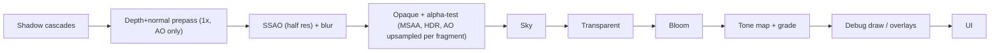

# Renderer

A custom forward renderer written directly on wgpu, tuned for stylized environments, runtime-generated meshes and a pleasant default look. Decision record: D1 in [DECISIONS.md](DECISIONS.md).

## 1. Goals and non-goals

**Goals**

- Attractive results with no setup: soft sun shadows, ambient light, fog, sky, tone mapping.
- Cheap, frequent updates of procedural meshes.
- Easy custom shaders. A stylized game can use dozens of them.
- Identical behaviour on Metal (Apple Silicon) and DX12 (NVIDIA).
- Always capturable headlessly for tests and visual verification.

**Non-goals for the first release:** photorealism, global illumination, ray tracing, virtual geometry, GPU-driven culling, bindless materials, HDR display output.

## 2. Why custom, and why forward

- No reusable Rust renderer fits: `rend3` is archived, and `bevy_render` requires `bevy_ecs` and Bevy's extraction model.
- **Forward with 4x MSAA** suits hard-edged stylized architecture, keeps transparency simple, and lets each material own its shading model (toon ramps, wrap lighting). Deferred shading would lose MSAA and complicate per-material stylized lighting.
- A **depth + normal prepass** is added when the first effect needs it (SSAO, outlines, water depth fade, depth decals). It arrives in RS3, not in M1.
- Local lights are stored in a counted buffer from RS2, so the shader interface does not change when clustering arrives.
- Upgrade path: clustered forward (Forward+) when a scene needs more than roughly 16 local lights; CPU light binning first.

## 3. Feature baseline

Only features available on both Metal and DX12 are assumed (from the wgpu 30.0.2 feature documentation):

| Used | Avoided |
|---|---|
| WebGPU core: instancing, storage buffers, compute, indirect draw | `MULTI_DRAW_INDIRECT_COUNT` (not on Metal) |
| 4x MSAA | Buffer and storage binding arrays (not portable) |
| `Rg11b10Ufloat` renderable (HDR target) | `PARTIALLY_BOUND_BINDING_ARRAY` (not on Metal) |
| BC texture compression | Pipeline cache (Vulkan only) |
| `TIMESTAMP_QUERY` (per pass) | Timestamp queries inside passes (not on Apple GPUs) |
| Depth clip control, line polygon mode | Mesh shaders, ray queries (experimental) |

Windows uses DX12 with statically linked DXC; Vulkan is the fallback.

## 4. Frame structure

An ordered list of passes with named transient textures. There is no render graph; one can be introduced later if pass ordering becomes hard to manage by hand.



The renderer draws into a `RenderTarget`, which is either the window surface, an offscreen texture shown in the editor viewport, or a headless texture read back to a PNG.

## 5. Staged delivery

| Stage | Milestone | Contents |
|---|---|---|
| **RS1** | M1 | Forward pass, HDR target, 4x MSAA, tone mapping (AgX or Tony McMapface via LUT), standard material (base colour, roughness, metallic, emissive), one directional light, hemisphere ambient, stable cascaded shadows with PCF, gradient sky with sun disc, distance and height fog, debug draw, headless capture, frame statistics |
| **RS2** | M4 | Textured materials (albedo, normal, ORM) with mipmaps, alpha modes (opaque, mask, blend, additive, multiply), transparent pass with back-to-front sorting, unshadowed point lights in a counted light buffer, custom `ShaderMaterial`, shader imports through WESL if it has proven stable |
| **RS3** | M6 | Core: depth + normal prepass, half-resolution SSAO, bloom, colour grading, automatic instancing. On demand, driven by the construction slice: depth and colour scene copies, simple water, depth decals, alpha-tested shadow casters, vertex-shader wind helpers, vignette |
| **RS4** | M7 | Skinned meshes, spot lights, one shadowed local light, an interior ambient override, CPU billboard particles |
| **RS5** | later | Clustered lights, SH ambient from sky, Hillaire atmosphere, tilt-shift depth of field, outlines, per-pass GPU timings, HDR output, compressed textures (at export, M9) |

The "on demand" items in RS3 exist because the construction slice uses them. They are general features, but they are built only when a game needs them, and they are not prerequisites for other games.

### RS2 as built (2026-11-15)

- **Textures** from `Assets<ImageData>` with mip chains, sRGB or linear format by `ColorSpace`, uploaded when the asset version changes, rewritten in place at the same size, freed when removed. Materials reference images by `AssetRef`, resolved through `AssetLookup` only when the material, the lookup generation or the set of uploaded textures changes. Missing or loading textures use 1x1 defaults (white base colour and emissive, linear white ORM, flat normal). One sampler: linear filtering with mipmaps, repeat, 8x anisotropy.
- **`StandardMaterial`:** base colour × factor × vertex colour; ORM occlusion scales ambient only, roughness and metallic multiply the factors; tangent-space normal maps with the bitangent `cross(n, t) * w` along +V (MikkTSpace/glTF), geometric normal when the mesh has no tangents; emissive × factor.
- **Alpha modes** are pipeline constants: Mask (alpha test, also in shadows), Blend (straight material alpha, premultiplied in the shader, One/OneMinusSrcAlpha), Additive, Multiply (unlit tint); the transparent modes cast no shadows. Double-sided: no culling, back faces flip the normal.
- **Transparent pass** inside the MSAA scene pass after the sky and the depth-tested scene lines, before the overlay lines; sorted back to front per object by bounds centre, depth test on, no depth write. Opaque and shadow draws are sorted by (pipeline, material, mesh).
- **Point lights:** unshadowed, inverse square with a smooth window to `range`, in a counted storage buffer (header plus at most 256 lights, frustum-culled, most important first). `intensity` is in the sun's unit (candela if the sun is read as lux).
- **`MeshRenderer.materials`** holds one material (`MaterialHandle::Standard` or `Shader`) per `MeshData` group slot; a missing slot or dead handle uses the default material.
- **`ShaderMaterial`:** user WGSL `surface` (and optional `vertex`) hooks composed with the engine library, parameters from an `@material` header, pipelines cached by `PipelineKey`; a failed compile keeps the previous version and reports file:line once; a shader that never compiled draws the magenta/black error material. WESL was not adopted (D1).
- **Selection outline** mask is `R32Uint` and holds per-object ids, so objects on a selected ground keep their own outlines.
- Showcase timings unchanged within noise; the vertex grew from 48 to 64 bytes for the tangent.

### RS3 as built (2026-11-16)

- **Frame:** shadow cascades → (AO on) depth + normal prepass → AO downsample → SSAO → AO blur → MSAA main pass (opaque, sky, scene lines, transparent) → outline mask → (bloom on) bloom chain → tone map (bloom mix, exposure, scene grade, tone mapper, display grade, dither) → outline composite, display lines. Depth and colour scene copies are not built; the water depth fade will resolve or copy the main MSAA depth when it arrives.
- **Spike S5 outcome:** the prepass is single-sample, full resolution, with its own `Depth32Float` and `Rgb10a2Unorm` world normals; it is not shared with the MSAA main pass. Edge quality comes from the upsample, not the prepass: occlusion is upsampled per fragment in `shade_standard` (`screen_ao`) against the fragment's own view depth, so the foreground and background fragments of an MSAA edge pixel each get their own surface's occlusion. Of the four nearest half-resolution texels it uses bilinear when all are within 3% relative depth, else the closest within 15%, else none (transparent surfaces, sub-texel geometry). A 4x MSAA prepass with a sample 0/nearest/farthest resolve looked the same with this upsample (40–443 of 3.7 M pixels differ by more than 10%) and cost about 3–4x as much (prepass plus resolve 0.18–0.22 ms against 0.056 ms at 2560x1440). A plain bilinear upsample changes about 800 silhouette pixels.
- **Prepass:** opaque and alpha-masked materials only, instanced like the main pass, geometric normals; `ShaderMaterial` runs its `vertex` hook and, for mask mode, `surface`. It runs only while ambient occlusion is on, and its targets are created on first use per render target.
- **SSAO:** half resolution. Scalable Ambient Obscurance (McGuire 2012, falloff B, scaled by the radius), 12 spiral samples with a 4x4 ordered-dither rotation and radius jitter, at most 80 half-res pixels, then a 4x4 depth-aware blur. It darkens ambient diffuse and specular; `direct_lighting` also darkens the sun and point lights.
- **Bloom:** Jimenez 2014. A 13-tap downsample (Karis average on the first level) from the resolved HDR image into up to 5 mips from half resolution, a 3x3 tent upsample blended with the blend constant `scatter`, then `mix(scene, bloom, intensity)` before exposure. Energy-conserving. An optional `threshold` (exposed luminance, 0 off by default) with a quadratic soft `knee` keeps only the bright part of each tap in the first downsample (`bloom_bright`); the tone-mapping pass then swaps only that part of the scene for its blur (`scene + (bloom - bright(scene)) * intensity`), so it stays energy-conserving and the rest of the image stays crisp.
- **Tone mappers:** `Environment.tonemapper`, a uniform switch in `tonemap.wgsl`: AgX (default, analytic), ACES fitted, Khronos PBR Neutral (identity after a small toe up to 0.76, then a roll-off that desaturates highlights only slightly), none (clamp).
- **Grading:** in the tone-mapping pass. White balance (LMS, temperature and tint in −1..1), contrast around 0.18 in log space and saturation before the tone mapper; lift, gamma and gain on the sRGB-encoded result. Identity grading is skipped and gives byte-identical output. No 3D LUT.
- **Settings:** `Environment.ambient_occlusion` / `.bloom` / `.color_grading` (reflected, in Scene Settings, saved in scenes; missing fields take their defaults). Defaults are on: AO intensity 1.5, radius 1 m, bias 0.02 m, power 1.2; bloom 0.025, scatter 0.7, threshold 0 (off), knee 0.5. `RenderSettings::show_ambient_occlusion` is a debug view.
- **Instancing:** persistent per-entity slots in an `objects` storage buffer (model, normal matrix, outline id, mirror sign), rewritten only when a transform or the selection changes (64-slot chunks), plus a per-frame `draw_slots` list uploaded only when it changes. Draws with equal (pipeline, material, mesh, index range) are one instanced draw in the main, shadow, prepass and outline passes; shadow draws ignore the material when the pipeline does not read it. 10,000 identical cubes: 15,080 → 9 draws, CPU to submit 14 → 0.94 ms; 20 meshes × 5 materials: 15,099 → 127 draws, 17.5 → 1.3 ms ([measurements/m6-renderer.md](measurements/m6-renderer.md)).
- **Diagnostics:** `Renderer::set_gpu_timing` times each pass with timestamp queries; headless runs report the GPU frame span and pass intervals. On Apple GPUs independent passes overlap, so compare frame spans rather than adding pass intervals.

### RS3 on-demand as built (2026-11-16)

- **Atmosphere** (fog.wgsl, `Environment.aerial_haze`, `.height_mist`, `.distance_quieting`; off by default): applied after the RS1 height fog in `apply_fog`, so opaque, blended and material-shader surfaces all get it; additive and multiply fade by fog × atmosphere transmittance. Order: quieting (desaturate, then `contrast` toward `tone`, smoothstep `start`..`end`), mist (by surface height, smoothstep `top`→`bottom` × `max_opacity` × near fade), haze (`1 − exp(−density·(d − start))` × `max_opacity`, toward `color` brightened by `sun_scatter` of the sun hue × (v·l)^6). Point-based, not integrated along the ray. The sky counts as infinitely far scenery below `aerial_haze.sky_height` (sine of elevation); the mist is evaluated 10 km along the ray, so it covers the sky below the horizon when its band is below the camera.
- **Sky** (`Environment.sky`): `SkyGradient::Simple` (RS1) or `Layered {upper, below_horizon}` (horizon → upper over 0..0.28 → zenith over 0.22..1; below the horizon to `below_horizon` within 0.12); `sun_glow`, `sun_disc` (1 = RS1), `horizon_glow` (warm band toward the sun's azimuth), `stars` (hashed cells on a 150-cell grid, 0.7% lit, discs wholly inside their cell, twinkling with `Time::elapsed`).
- **Grading:** shadows/midtones/highlights tints (Unity's luminance weights 0..`shadows_end`, `highlights_start`..1) in scene-linear after contrast, before saturation; lift/gamma/gain cannot express them. Unity's values are gamma-encoded: use value^2.2. `Vignette {intensity, smoothness, rounded}` uses URP's formula on the HDR image before exposure.
- **Alpha-tested casters** (since RS2): verified with foliage cards, instanced, and in the prepass.
- **Wind:** `Environment.wind` plus `StandardMaterial.wind: WindSway {strength, frequency, weight: HeightRamp{bottom, top} | VertexAlpha}`; `wind_offset` (wind.wgsl) gives a lean downwind swelling with gust fronts, flutter, across motion and a slight dip. Swaying standard materials use `*_wind` vertex entry points in the main, prepass, shadow and outline passes, all calling `wind_world_position`; material shaders call `wind_offset` from their `vertex` hook, which every pass runs. Materials that move vertices draw the outline mask with their own pipeline (`Pass::Outline`). Object bounds widen by 1.5 × sway × wind strength plus the material's `ShaderMaterial::bounds_padding` (camera, cascade and local-shadow culling, outline scissor); material-shader hooks are widened only by that padding. Normals are unchanged. The GPU vertex carries UV0 and UV1 (72 bytes, since the slice look); material shaders read `SurfaceInput.uv1`. `StandardMaterial.uv_scale` scales UV0 for all four textures. Transparent draws with equal (pipeline, material, mesh, range) that are adjacent after the back-to-front sort are one instanced draw.
- **Soft transparency:** `depth_fade` (m) on `StandardMaterial` (uniform) and `ShaderMaterial` (`DEPTH_FADE` constant), for transparent modes. The scene depth is the RS3 1x prepass depth (frame binding 7, `opaque_depth`); the prepass runs while AO is on, a depth-fading material is visible, or a visible material shader reads the scene depth (`ShaderMaterial::scene_depth`, or its file calls `scene_depth`). Material shaders read it with `scene_depth(in.frag_coord)` and `fragment_view_depth(in.frag_coord)` (material_api.wgsl, linear view metres); without it (no prepass this frame, the 1x1 placeholder bound in the prepass and shadow passes, the sky) `scene_depth` returns `SCENE_DEPTH_FAR`. The shadow pass layout carries a placeholder binding 7 so masked shaders that call it still build. No MSAA depth resolve and no colour copy; refraction would add the colour copy.
- **Pipeline state (R6):** `sort_bias`, `depth_write` (`Auto`/`On`/`Off`), `depth_test` and `prewrite_depth` on both material kinds resolve to `MaterialDepth` (pipelines.rs): a `DepthKey` (write, `Greater`/`GreaterEqual`/`Always`) in the main-pass `PipelineKey`, plus, for a transparent material with `prewrite_depth` and the test on, a `Pass::Prewrite` pipeline (no colour writes, depth write, `Greater`) drawn right before each of its transparent batches; its colour draw then tests `GreaterEqual`. Transparent draws sort by (bias, back to front); particles count as bias 0. Opaque materials that do not write and test depth stay out of the prepass. `AlphaMode::Multiply2x` blends `src × Dst + dst × Src` (unlit albedo, fades toward 0.5).
- **Costs** at 2560x1440 ([measurements/m6-look.md](measurements/m6-look.md)): atmosphere +0.02–0.03 ms GPU; sky, stars, SMH and vignette within noise; depth fade +0.09–0.15 ms (the prepass); alpha-tested foliage +0.01 ms; wind +0.02 ms. Everything is uniforms; animating the environment builds no pipelines (tested).

### RS4 skinning as built (2026-11-16)

- **Data:** a mesh with `joints` and `weights` gets a second vertex buffer (`GpuSkinVertex`: u16x4 joints, f32x4 weights, 24 bytes) and draws through `VertexLayout::Skinned` pipelines. Each frame every drawn entity with a `SkinnedMesh` whose `Skin` asset is loaded gets a palette in one storage buffer (group 1, binding 2): per joint `mesh⁻¹ × joint × inverse bind`, so the object's model matrix still places it. `Object.params.x` holds the palette start (bit-cast u32).
- **Passes:** `skin_vertex` (skin.wgsl) poses position, normal and tangent; every skinned entry point starts with it, in the main, shadow (cascades and the local light), prepass and outline mask passes (mesh_skinned.wgsl, shadow_skinned.wgsl, error_skinned.wgsl) and material shaders (custom_material_skinned.wgsl, run before the `vertex` hook). Skinned pipelines are built when a skinned mesh first uses a material. Skinned vertices move, so their outline uses material outline pipelines. Wind sway does not apply to skinned meshes.
- **Batching:** the palette offset is per instance, so skinned entities with equal (pipeline, material, mesh, range) are one instanced draw whatever their poses; skinned and static draws never merge. 500 characters: 30 draws.
- **Bounds:** per mesh at upload, the bind-space box of the vertices each joint influences; per frame, the union of those boxes moved by their palette matrices, a conservative bound used for frustum and cascade culling and the outline scissor.
- **Limits:** up to four influences per vertex, normals use the linear part (rigid or uniformly scaled joints), editor picking uses the bind pose, a skin that is not loaded draws the bind pose. Costs: [measurements/m7-animation.md](measurements/m7-animation.md).


- **Local lights:** `SpotLight {color, intensity, range, inner_angle, outer_angle}` shares the counted light buffer with `PointLight` (64-byte `LocalLight`: position, range, colour, shadow flag, axis, cone scale/offset; at most 256 visible, `MAX_LOCAL_LIGHTS`). `intensity` is the point light's unit on the axis (irradiance at 1 m), so narrowing a cone does not brighten it. Cone: `saturate(cos·scale + offset)²`, 1 inside `inner_angle`, 0 beyond `outer_angle` (≤ 90°), `SpotLight::cone_attenuation` on the CPU. Spot lights shine down the entity's −Z.
- **One shadowed local light:** of the drawn lights with `shadows`, the most important (brightness / (1 + gap²) from the camera, the cap's ranking). Spot: one perspective view (≤ 170°); point: six cube faces (+X, −X, +Y, −Y, +Z, −Z), each widened by two texels so 3x3 PCF never reads past a face. `LocalShadow {resolution, depth_bias, normal_bias}` (texels at the fragment's distance). Standard depth in a `Depth32Float` array (binding 8), the cascades' comparison sampler. The passes reuse the shadow pipelines and vertex entry points (instancing, alpha-masked casters, wind, later skinning); casters are culled per view. The map is reallocated only when its resolution or view count changes, then every frame bind group (also AO's, cached per generation) is remade. View matrices and parameters are in the light buffer header, not the globals.
- **Ambient volumes:** `AmbientVolume {half_extents, color, intensity, sky_contribution, blend_distance}` replaces the hemisphere ambient inside a box (entity transform × half extents), blending smoothly over `blend_distance` outward, per fragment in `shade_standard` (diffuse and specular ambient); SSAO darkens the result like any ambient, direct light is untouched. Up to 8 visible volumes (nearest), applied in order. Fit the box to the inner walls and keep the blend thinner than the walls.
- **Particles:** `ParticleEmitter` (reflected) with runtime `ParticleState`; `simulate_particles` runs in `PostUpdate` after transform propagation with `Time::delta`, so emitters use this frame's transforms (trails stay attached) and time scale and pause apply. Seeded PCG32: equal seeds and frame times give equal particles. Rate, rate per metre moved (spread along the path), bursts per cycle, looping, start/stop, `ParticleEmitter::burst(n)` one-shots that despawn; lifetime, speed, cone, spawn radius, gravity, drag, spin, size curve, colour gradient, intensity, texture with an atlas played over life, alpha or additive blending, soft edges (`depth_fade` on the prepass depth), optional per-vertex lighting (ambient with volumes, half the sun and local lights, unshadowed), world or local space. One 64-byte instance per particle in a per-frame vertex buffer (grown by doubling), camera-facing quads (triangle strip), alpha emitters sorted back to front, emitter draws merged with transparent meshes by depth.
- **Costs** at 2560x1440 ([measurements/m7-rs4.md](measurements/m7-rs4.md)): a spot light +0.014 ms GPU, 16 / 64 / 256 overlapping spots +0.30 / +1.09 / +4.64 ms (no clustering: RS5); shadowed spot +0.0–0.12 ms, shadowed point (six views) +0.55 ms GPU and +0.16 ms CPU; ambient volume +0.04 ms; 10,000 particles: simulation 0.05 ms, build + sort + upload +0.16–0.27 ms CPU, small particles near free on the GPU.

## 6. Lighting and look

Ranked by visual return for engineering effort:

1. HDR target plus a good tone mapper.
2. Hemisphere (sky/equator/ground) ambient, driven by an `Environment` resource. This matches the trilight ambient common in stylized games.
3. Height and distance fog tinted by sun and sky.
4. Stable cascaded shadows. With an orbit camera, shimmering is the visible artefact, so cascades are texel-snapped and fitted to bounding spheres.
5. Bloom.
6. SSAO.
7. Colour grading.

No baked lighting by default, because procedural geometry changes at runtime. This is a default, not an architectural assumption; baked or probe-based lighting for static scenes is not precluded. Ambient occlusion comes from SSAO and from **vertex-colour AO written by generators**, which know where eaves and wall bases are.

**Shadows (RS1):** 3–4 cascades in a 2048 depth array, comparison sampler, 3x3 or 5x5 PCF, normal-offset bias, blending between cascades. Deferred: PCSS. One local light (spot or point) is shadowed per frame since RS4.

**Water (RS3):** a plane or generated mesh with scrolling normals, depth-difference absorption and shoreline foam (using the opaque depth copy), Fresnel toward sky colour, sun glint. Deferred: planar and screen-space reflections.

## 7. Materials and shaders

- Language: **WGSL.** In M1 the engine uses plain WGSL with a small include step of its own, which is all the built-in shaders need. **WESL** (imports, conditional compilation) is adopted at M4, when user-authored materials arrive, provided it has proven stable by then; otherwise the include step is extended. The example below uses WESL-style imports.
- The engine ships a shader library: `globals` (camera, time, sun, fog, environment), `lighting`, `shadows`, `fog`, `noise`, `wind`.
- **`StandardMaterial`**: parameters and textures for the built-in lit shader.
- **`ShaderMaterial`**: a user WGSL file using `import box::<module>;` lines that defines `fn surface(in: SurfaceInput, p: P) -> Surface` and optionally `fn vertex(position, in: VertexInput, p: P) -> vec3f` (displaced world position). The engine lights the `Surface` with `shade_standard`, shadows and fogs it; `default_surface(in)` is a starting point. Parameters are declared in one header, `@material struct P { [/// doc] [@range(min, max)] [@color] name: f32|i32|u32|vec2f|vec3f|vec4f [= default], ... }`, parsed by `parse_material_header` so the inspector shows them without a GPU; they are also the global `material` (group 2). `globals.time` holds elapsed seconds and frame delta.

```wgsl
// Illustrative user material.
import box::globals::{view, sun};
import box::lighting::{shade_standard, Surface};

@material struct Params { tint: vec3f, wear: f32 }

fn surface(in: FragmentInput, p: Params) -> Surface {
    var s: Surface;
    s.base_color = p.tint * in.color.rgb;
    s.roughness = mix(0.6, 0.95, p.wear);
    return s;
}
```

- **Global uniforms** are a first-class concept. A stylized game can have a couple of dozen shader globals (sun direction, night factor, breeze, cloud time). The engine provides a fixed global block plus a small game-defined block.
- **Lights are not assumed to be one outdoor sun.** The global block exposes a primary directional light that may be absent, and local lights come from a counted buffer. Ambient comes from `Environment` and can be overridden for interiors (RS4). User shaders call the engine's lighting functions and do not read the sun directly unless they choose to.
- **Permutations:** a few shader flags (skinning, alpha mode, shadow pass). Pipelines are cached by (shader, flags, vertex layout, MSAA, target format). Keep flags under about six.
- **Hot reload:** file watcher, recompile inside a wgpu error scope, keep the previous pipeline if compilation fails, show the error in the console.
- **Compile hitches:** Metal and DX12 have no pipeline cache in wgpu. Pipelines for known materials are created at load time, not at first draw.

## 8. Meshes

- `MeshData` (in `box_core`) is the only CPU mesh format: positions, normals, tangents, up to four UV sets, vertex colour, `u32` indices, and material groups. Procedural games use UV1–UV3 as extra data channels, so multiple UV sets are a requirement. Optional joint indices and weights are reserved in the format from M1 so that skinning (RS4) does not change it.
- **M1 uses one vertex and one index buffer per mesh**, allocated with headroom and reallocated only on growth. A pooled allocator with shared buffers is added only if the M1 upload measurement (spike S3) shows spikes or draw overhead that it would fix.
- Uploads go through `Queue::write_buffer`. A **per-frame byte budget** is added with background generation (M5 or M6).
- Vertex-only updates (for example growth animation) rewrite the vertex range without touching indices.
- Mesh generation never happens in the render path; see [PROCEDURAL.md](PROCEDURAL.md) section 5.

## 9. Draw submission

- CPU frustum culling against per-mesh bounds.
- Opaque draws sorted by pipeline, then material, then mesh. Transparent draws sorted back to front.
- From RS3: per-instance data (transform, outline id) in a storage buffer with persistent slots; identical mesh, material and pipeline runs are one instanced draw.
- Expected capacity: low thousands of draws per frame on Metal in release builds. This is an assumption and is measured in M1.

Deferred: GPU culling, multi-draw indirect (emulated on Metal, so no benefit there), bindless textures.

## 10. Debug draw and overlays

An immediate-mode API for lines, boxes, spheres, text labels and translucent meshes with a depth-test toggle. The editor uses it for gizmos, grids and selection outlines; games use it for placement ghosts. Because it is a normal pass, overlays appear in offscreen captures (a known problem in engines where they do not).

## 11. Diagnostics

- CPU scopes through the `profiling` facade, viewable in Tracy.
- Per-pass GPU timestamps exist since RS3 (`Renderer::set_gpu_timing`, headless reports); a profiler UI remains RS5.
- wgpu validation and labels on every resource in development builds.
- Xcode Metal debugger on macOS; RenderDoc on Windows.
- A frame statistics resource: draw calls, instances, triangles, upload bytes, pipeline count.
- A debug view selector: albedo, normals, shadow cascades, overdraw.

## 12. Testing

- **Golden images:** small fixed scenes rendered headlessly and compared against reference images with a simple thresholded pixel difference. They run locally on the Mac until M9, when Windows references are added; hosted CI runners may not have a dependable GPU.
- **Capture command:** any example or project can render one frame to a PNG from the command line. Visual changes are not considered done without a capture.
- Shader compile tests: every engine shader is compiled in CI.

## 13. Risks to prove early

1. **Procedural mesh churn on Metal**: frame spikes from re-uploads and buffer growth. Measured with an upload stress example in M1 (spike S3).
2. **MSAA with prepass-driven effects**: SSAO and water depth fade need a manually resolved depth and normal buffer. Proven at the start of RS3 (spike S5) before committing to the effect list. Proven in S5 (RS3): see RS3 as built.
3. **Pipeline compile hitches.** Measured in M1 and M4. The shader module workflow (WESL) is evaluated at M4.
4. **Quarterly wgpu upgrades** across wgpu and egui-wgpu. Managed by the upgrade rule in [TECH_STACK.md](TECH_STACK.md).
