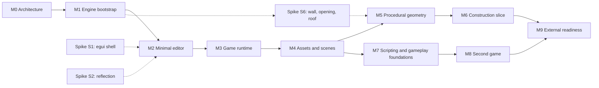

# Roadmap

Phased milestones for box-engine. Each milestone is independently verifiable and leaves the project in a usable state. There are no time estimates; milestones are ordered by dependency and judged by acceptance criteria.

## Overview

| Milestone | Result in one line | New crates |
|---|---|---|
| M0 | Decisions made and documented | — |
| M1 | A lit, shadowed 3D scene in a window, capturable headlessly | `box_core`, `box_render`, `box_engine` |
| M2 | An editor that can build, edit, save and load a scene of primitives | `box_editor` |
| M3 | Press Play, interact with a small native game, press Stop | `box_physics` (queries) |
| M4 | Imported models, textured materials, asset browser, hot reload, instanced scenes | `box_assets` |
| M5 | Non-destructive procedural objects with instant regeneration | `box_proc` |
| M6 | A small procedural structure built interactively in a construction game slice | `box_audio`, `plugins/box_arch` |
| M7 | Luau scripting plus the gameplay features a different game needs | `box_script` |
| M8 | A different game, built only on public APIs | — |
| M9 | Installable engine, exportable games, documentation | — |

M6 and the M7–M8 track both depend on M4 and are otherwise independent of each other. They can be done in either order. Doing M7–M8 first tests generality sooner; doing M6 first reaches the first game sooner.

### Changes from the suggested progression

| Change | Reason |
|---|---|
| Spikes S1 and S2 gate M2 | The UI framework and the reflection model are the hardest decisions to reverse. |
| Spike S6 (wall, opening, roof junctions) runs right after M1 | The central procedural risk needs only `MeshData` and the renderer. Testing it at M6 would be too late. Found by the complexity review. |
| A small sample game unlike the reference game is part of M3 | Generality is tested long before the second game. |
| Scripting moved from M3 to its own milestone, M7 | Luau has no user until the second game; the construction slice is native. Found by the complexity review. |
| "Second game" split into foundations (M7) and the game (M8) | The second game needs scripting, dynamics, skinned animation, particles, UI and save games. That is a milestone of its own. Found by the generality review. |
| M4 reduced | Prefab overrides, audio, texture compression and the import cache moved out. |
| Renderer features staged RS1–RS5 | See [RENDERER.md](RENDERER.md) section 5. |
| M6 is a vertical slice, not a port | A full game on the engine is a separate project after M9. |

Identifier note: **RS1–RS5** are renderer stages, **P0–P4** procedural stages, **R1–R24** risks, **S1–S7** spikes, **D1–D12** decisions, **Q1–Q9** open questions.

---

## M0 — Architecture and technical decisions

**Objective.** Make informed decisions before investing in code.

**Included.** Research; the documents in `/docs`; dependency choices; identified risks and spikes; the Milestone 1 implementation plan; independent reviews for complexity, generality and consistency.

**Excluded.** Any engine code.

**Main risks.** Decisions made on stale or unverified information; over-planning.

**Dependencies.** None.

**Test strategy.** Independent reviews; a cross-document consistency check.

**Acceptance criteria.**
- All planning documents exist and agree with each other.
- The owner has answered or explicitly deferred the questions under "Decisions requiring input" in the README.
- Versions in [TECH_STACK.md](TECH_STACK.md) are re-checked on the day M1 starts.

**What the developer learns.** The shape of the problem, where the real risks are, and what not to build.

---

## M1 — Engine bootstrap

**Objective.** Prove the renderer foundation and a minimal runtime core.

**Included.**
- Cargo workspace, toolchain pin, CI that builds and tests on macOS and Windows.
- `box_core`: a minimal app loop with ordered systems, time, world facade, transform hierarchy, input state, `MeshData`, handles.
- `box_render` stage RS1: forward HDR rendering with 4x MSAA, tone mapping, standard material, directional light, hemisphere ambient, cascaded shadows, gradient sky, fog, debug draw, shader loading with hot reload.
- Window, event loop and an orbit camera controller.
- Headless rendering to PNG and a golden-image test helper.
- Built-in primitive meshes.
- An upload stress measurement (spike S3).
- CPU profiling scopes and frame statistics.

**Excluded.** Editor UI, scene files, reflection, plugins, fixed timestep, events, asset importing, textures, transparency, point lights, instancing, post effects beyond tone mapping, scripting, physics, audio, a pooled mesh allocator.

**Main risks.** Mesh upload spikes (R6); pipeline hitches (R9); Windows divergence (R14); golden stability (R15).

**Dependencies.** M0.

**Test strategy.** Unit tests for transforms and hierarchy; golden images of a fixed scene, run locally on the Mac; shader compile tests in CI; a recorded upload measurement.

**Acceptance criteria.**
- `cargo run --example showcase` opens a window showing lit, shadowed primitives under a sky with fog, with an orbit camera, at the display refresh rate on the Mac Studio.
- `--capture out.png` renders the scene headlessly, and a golden test passes locally.
- The example builds on Windows CI and passes a manual smoke run on the Windows PC.
- Editing a shader file updates the running example; a shader error keeps the previous pipeline and logs the error.
- The upload measurement and build times are recorded in the repository.

**What the developer learns.** wgpu's real behaviour on Metal and DX12, the cost of mesh updates and draw calls, and what the shader workflow needs.

---

## Spike S6 — Wall, opening and roof junctions (after M1)

Throwaway code in `spikes/`. Generate a curved wall with a door and window, a second wall meeting it at a corner, and a roof over the result, using only `MeshData` and the M1 renderer. Its purpose is to learn how hard junctions are and what the generator abstraction must provide, before the editor and pipeline are built around assumptions. Its findings are written into [PROCEDURAL.md](PROCEDURAL.md).

---

## M2 — Minimal graphical editor

**Objective.** Deliver the core editing loop: view, add, select, transform, inspect, save, load.

**Included.**

*M2a — data model (no window required)*
- Spikes S1 and S2 completed and their decisions confirmed.
- Reflection and type registry in `box_core`; persistent `Uid`s; scene serialization to JSON with a version number.
- An editor command layer and undo stack, tested headlessly.
- A `Primitive` component (shape plus parameters) whose mesh is rebuilt when it changes (procedural stage P0).
- `box` CLI (D13): `new`, `check`, `registry`, `scene list/show/apply`, `render`, all with `--json` output. See [ARCHITECTURE.md](ARCHITECTURE.md) section 12.

*M2b — editor shell*
- `box_editor`: shell, theme, docking with saved layout, viewport panel, hierarchy, inspector driven by reflection, basic console, toolbar.
- Viewport navigation, picking by ray against bounds and triangles, selection outline, translate/rotate/scale gizmos with snapping, grid.
- Add, duplicate, delete, rename and reparent entities; add and remove components.
- Project creation and opening; scene save and load.

**Excluded.** Play mode, asset browser, imported assets, prefabs, textured materials, marquee selection, custom editor tools, scene migrations, a light theme.

**Main risks.** Editor look and feel (R2); reflection fit (R3); undo correctness.

**Dependencies.** M1; spikes S1 and S2.

**Test strategy.** Headless tests of commands, undo and serialization; a property test that random edit sequences undo to an identical serialization; scene round-trip tests; a golden screenshot of the whole editor.

**Acceptance criteria.**
- Workflow steps 1–8 from [EDITOR.md](EDITOR.md) can be performed without touching code.
- A scene of at least 1,000 entities remains responsive in the hierarchy and viewport.
- Every edit can be undone and redone; a gizmo drag is one undo step.
- Save, quit, reopen: the scene and the panel layout are restored exactly.
- A new component type added in Rust appears in the inspector and in saved scenes with no editor code.
- An agent using only the `box` CLI can create a project, add and edit entities in a scene, and render it to a PNG; the result opens identically in the editor.
- The editor builds on Windows CI and passes a manual smoke run.

**What the developer learns.** Whether reflection-driven tooling pays off, how egui behaves at editor scale, and what the scene format needs.

---

## M3 — Game runtime

**Objective.** Make scenes playable, and test the runtime with something unlike the construction game the engine is first proven on.

**Included.**
- Play, pause and stop with an isolated play world; autosave before Play.
- `Plugin` trait; fixed and variable update phases; typed events.
- Input mapping: named actions bound to keyboard, mouse and gamepad; cursor lock and relative mouse motion.
- Native project tier: a game crate with its own editor and player binaries.
- `box-player`: runs a project's start scene standalone.
- Runtime scene API: load, unload and switch scenes; spawn runtime entities.
- `box run`, and the MCP server (`box mcp`) with project tools and live tools for a running editor or player over an opt-in local socket (D13).
- `box_physics`: colliders, raycasts, shapecasts, overlaps and simple triggers on `parry3d`. Editor picking moves onto it.
- A small native sample game: a character moved with kinematic queries collects objects in an arena.

**Excluded.** Scripting, rigid-body dynamics, a character controller, audio, in-game UI beyond debug text, save games, export packaging.

**Main risks.** Play crash isolation (R12); an API shaped too much by one sample.

**Dependencies.** M2.

**Test strategy.** Play round-trip test (serialize, play, mutate, stop, compare); fault injection (a panic in a game system during Play); the sample game run headlessly for a fixed number of frames in CI; a benchmark of 5,000 moving entities with overlap queries.

**Acceptance criteria.**
- Workflow steps 9–11 work: Play, interact, Stop, and the edit scene is unchanged.
- The sample game is playable in the editor and through `box-player`, with keyboard and gamepad.
- The sample switches between two scenes at runtime.
- An MCP client connected to `box mcp` can query the running editor's world, apply a command, take a viewport screenshot, and press Play and Stop.
- A panic in a game system stops Play with an error where it can be caught, and the autosave is intact in every case.

**What the developer learns.** How isolated the play world is in practice, and which engine APIs a game actually reaches for.

**Status (2026-11-15).** Built and verified headlessly on macOS: Play/Pause/Step/Stop with an isolated play world and autosave (`crates/box_editor/tests/play.rs`: round trip, fault injection); `Plugin`, FixedUpdate and typed events; named input actions with keyboard, mouse and gamepad (gilrs) and cursor lock; `box_physics` on parry3d, with editor picking moved onto it; runtime scenes; `box-player`, `box run`, `box new --native`; `box mcp` with project and live tools for the editor and the player (`apps/cli/tests/mcp.rs::mcp_drives_the_running_editor` is the MCP acceptance test); the sample game `examples/collector` (kinematic capsule controller on shapecasts, trigger collectibles, two arenas switched with `Scenes::switch`, headless gameplay tests). The 5,000-entity overlap benchmark is in [measurements/m3-physics.md](measurements/m3-physics.md).

Not yet verified: a physical gamepad, cursor lock and raw mouse look in a real window (macOS and Windows), playing the sample by hand, and the Windows build and smoke run.

API gaps the sample game found (candidates for later milestones): the `box` CLI cannot edit or show game component types (it uses the engine registry; the sample authors its scenes through an `author` example instead); `ActionMap` has no mouse-motion binding; a game cannot set the window title; `box run`'s hint for native projects assumes a bin named `player`; character movement would benefit from a shapecast that ignores initial overlaps, a depenetration query and multi-entity exclusion in `QueryFilter`; fixed-step transform interpolation is not applied (`FixedTime::alpha` exists).

---

## M4 — Assets and scenes

**Objective.** Bring external content into projects.

**Included.**

*M4a — import and materials*
- `box_assets`: `.meta` sidecars with UUID identity, importers for glTF (meshes, materials, textures, node hierarchy) and images, background loading with placeholders.
- Renderer stage RS2: textured materials, alpha modes, a sorted transparent pass, point lights in a counted light buffer, custom shader materials.
- Material assets and a material inspector.
- `MeshRenderer` holds a material list indexed by `MeshData` material group slot, and the renderer draws each group with its material (gap found by spike S6).

*M4b — browser and reuse*
- Asset browser panel with thumbnails and drag-and-drop; import settings in the inspector.
- Hot reload of textures, models, materials and shaders through the asset server.
- Prefabs as instanced scenes (no per-instance overrides yet).
- Marquee selection and multi-object editing.

**Excluded.** Prefab overrides and nesting rules, a hashed import cache, a dependency graph beyond direct references, audio, fonts, skinned meshes, animation import, texture compression, export packaging, FBX.

**Main risks.** Asset edge cases (R21); pipeline hitches with many materials (R9); shader module system maturity (R8).

**Dependencies.** M2 for the editor; M3 for the runtime scene API.

**Test strategy.** Importer fixture corpus with snapshots, including malformed files; rename test; hot-reload tests; golden images for textured and transparent materials.

**Acceptance criteria.**
- Dropping a `.glb` into the project shows it in the asset browser; dragging it into the viewport instantiates it with materials and textures.
- Editing a texture or shader on disk updates the viewport without a restart.
- Renaming or moving an asset in the browser does not break scene references.
- A scene instanced several times as a prefab updates when the source scene changes.
- A custom shader material with inspector parameters can be authored and applied.
- A malformed asset produces a console error and a placeholder, not a crash.

**What the developer learns.** Where the asset pipeline's real complexity lies and how the material system needs to grow for stylized work.

**Status (2026-11-15).** Built and verified headlessly on macOS: `box_assets` (`.meta` identity, background import with placeholders, PNG/JPEG/glTF/material/scene/WGSL importers, hot reload, rename and move); renderer RS2 (textures with mips, alpha modes and a sorted transparent pass, double-sided, point lights in a counted buffer, per-group materials, `ShaderMaterial` with `@material` header params; WESL not adopted); runtime glue (`MeshAsset`, `PrefabInstance` runtime-only instancing following its source, Play-world asset copies with reloads forwarded); the editor's asset browser (thumbnails, rename/move with path repair, OS drop, drag into the viewport), asset picker, import settings, material and shader-parameter inspector; marquee selection and multi-object editing; `box import` and the MCP `import` tool. Each acceptance criterion has a test (`crates/box_engine/tests/assets.rs`, `crates/box_editor/tests/{assets,play_assets,multi}.rs`, `crates/box_assets/tests`) with captures. Import timings: [measurements/m4-import.md](measurements/m4-import.md).

Not yet verified: drag-and-drop and hot reload by hand in a real window (tests drive the same code paths, hot reload through `rescan` and the watcher test in box_assets), and Windows. Known gaps: no texture filter setting (needs sampler state on `ImageData`), external normal/ORM images beside a `.gltf` keep their own `.meta` colour space (a warning says to set linear), no rendered thumbnails for models and materials, primitives copy a dropped material's values instead of linking it, custom asset types are not forwarded into Play, and handles are not reference counted (nothing unloads).

---

## M5 — Procedural geometry

**Objective.** Establish the non-destructive procedural core.

**Included.**
- `box_proc`: `Generator` trait, cache keys, declared dependencies, throttled flush. `Primitive` becomes a set of generators.
- `MeshBuilder`; 2D polygon kernel (booleans, offset, triangulation); extrude; lathe.
- 3D spline component with editor handles; sweep along a spline.
- Split-and-repeat helpers.
- Native projects can register their own generators.
- "Bake to mesh" command.
- Golden hash and image tests per generator.
- A viewport tool extension point in the editor, used here for spline editing.
- Derived entities: `Derived { owner, key, rule }`, `reconcile`, selection that maps generated geometry to its owner, and "Generated by" plus warnings in the inspector.
- `examples/walls`: neighbour-aware walls and a fence sharing one adjacency rule, as the acceptance scenario for derived entities ([PROCEDURAL_DIRECTION.md](PROCEDURAL_DIRECTION.md) section 7).

**Excluded.** A general rules framework, resolvers or constraint solving; manual overrides and drawing tools (M6). Background generation jobs and preview quality (added only if the latency benchmark fails; otherwise in M6), architectural elements, roofs, scatter, terrain, node graphs, general booleans, a disk cache.

**Main risks.** Regeneration latency (R6); dependency-tracking bugs; scope creep toward a modelling tool.

**Dependencies.** M2 (primitives), M4 (materials for generated meshes), the findings of spike S6.

**Test strategy.** Determinism tests (same parameters and seed give the same hash); golden captures; a latency benchmark from parameter change to visible mesh; property tests on the polygon kernel.

**Acceptance criteria.**
- Dragging a parameter of a lathe or sweep updates the viewport continuously with no dropped frames.
- Editing a spline regenerates every object that depends on it.
- A scene with procedural objects stores only parameters; reopening it reproduces the same geometry.
- A generator defined in a native project appears in the editor's add menu and inspector.
- Changing a generator's output without bumping its version fails a test.
- In `examples/walls`, two touching walls connect; dragging one regenerates only it and the walls it touches; undo restores a byte-identical scene and identical derived mesh hashes; the saved scene holds only the wall and fence paths; the fence needed no engine change.

**What the developer learns.** How far simple typed generators go, and what regeneration costs under real interaction.

**Status (2026-11-15).** Built and verified headlessly on macOS: `box_proc` (`Generator` trait with `VERSION`, `Procedural` and stamp plus throttled flush, `mesh_hash` golden fixtures that fail without a version bump, seeded `Rng`, `.glb` writer); the geometry kernel (`MeshBuilder`, polygon booleans/offset/triangulation, extrude, lathe, splines, sweep, split-and-repeat); built-in generators `Primitive`, `Lathe`, `Extrude`, `Sweep` and the `Spline` component; derived entities (`Derived`, `reconcile`, `add_rule`, pick-to-owner, Generated section and warnings); the viewport tool extension point with Place on Surface and the spline editor; Bake to Mesh; native generators listed under Add (`examples/generator.rs`); and `examples/walls` with a fence that needed no engine change. Each acceptance criterion has a test: `crates/box_editor/tests/{shapes,splines,procedural,generated}.rs` (no drag frame over 16.7 ms), `crates/box_engine/tests/{procedural,splines}.rs`, `crates/box_proc/tests/{runtime,derive,builtin,geometry,poly_props}.rs`, `examples/walls/tests/acceptance.rs`. Numbers: [measurements/m5-geometry.md](measurements/m5-geometry.md), [measurements/m5-walls.md](measurements/m5-walls.md).

Not yet verified: interactive dragging by hand in a real window, and Windows. Known gaps: games cannot yet register viewport tools through `run_game`; a rule sees one intent type (a fence cannot react to walls); `ColliderHint` is not used by physics; the extrude bevel on thin rims can leave holes; no orthographic or unlit view.

---

## M6 — Construction vertical slice

**Objective.** Prove the engine on its first demanding use: building a small structure with procedural walls, openings and roofs. The slice is built against a private reference game (a procedural building game made with another engine), which is the behavioural and visual target; the slice itself is not part of the public repository.

**Included.**

*M6a — look*
- Spike S5 (MSAA with depth-based effects).
- Renderer stage RS3: depth and normal prepass, SSAO, bloom, colour grading, instancing.
- Further RS3 items only as the slice demands them: scene depth and colour copies, simple water, alpha-tested shadow casters, wind helpers.

*M6b — construction*
- `plugins/box_arch`: walls along curves, door, window and arch openings, closed-form roofs, platforms, stairs, attachment anchors, vertex-colour ambient occlusion.
- Background generation jobs, upload budget and asynchronous collider rebuild, if not already added in M5.
- Scatter with instancing for plants, with painted regions.
- Wall and path drawing tools, manual overrides of generated parts (`Overrides`), and a rule list panel ([PROCEDURAL_DIRECTION.md](PROCEDURAL_DIRECTION.md) sections 5 and 6).
- `box_audio`: ambience loops and positional one-shots.
- A slice project (native tier): direct-manipulation placement with ghost previews, a few building elements, an orbit camera, time-of-day mood, a handful of decorations, a minimal tool UI built directly on egui, save and load.

**Excluded.** The reference game's full rule set and systems, the complete shader set, arbitrary-footprint roofs, a complete port.

**Main risks.** Junction quality (R5); porting size (R13); MSAA with depth effects (R10).

**Dependencies.** M5 (procedural core), M4 (assets, materials), M3 (runtime, queries).

**Test strategy.** Golden captures of reference structures compared side by side with captures of the reference game; interaction latency measurements while dragging; a stress structure for frame time; save and load round trips; generator golden tests for `box_arch`.

**Acceptance criteria.**
- A player can build a small structure: walls with a door and windows, a roof, a platform and a stair, with immediate visual response.
- The result is visually comparable in mood to the reference game in a side-by-side capture: lighting, fog, shadows and ambient occlusion.
- Placement and dragging hold the display refresh rate on the development Mac for the reference structure.
- No game-specific type exists in `box_core`, `box_render`, `box_proc` or `box_editor`.
- The slice passes a manual run on Windows.

**What the developer learns.** Whether the procedural model survives contact with a real design, and what a full game on the engine would cost.

**Status (2026-11-16).** Built and verified headlessly on macOS.
- *M6a look:* RS3 (single-sample prepass after spike S5, half-resolution SSAO with a per-fragment depth-aware upsample, bloom, colour grading, automatic instancing) and the on-demand items the slice needed (aerial haze, valley mist, distance quieting, layered sky with stars, shadows/midtones/highlights grading, vignette, wind, depth-fade transparency, UV1 on the GPU, `uv_scale`). Numbers: [measurements/m6-renderer.md](measurements/m6-renderer.md), [measurements/m6-look.md](measurements/m6-look.md).
- *M6b construction:* `plugins/box_arch` (walls with openings and junctions, closed-form roofs, platforms, stairs, anchors, vertex AO); scatter with a paint brush; the generic path tool, `Overrides`, the rule list, rules over several intent types and game `EditorPlugin`s; edit-world systems; `box_audio`. The slice builds walls with doors and windows, flat and pitched roofs, platforms, stairs and decorations through direct manipulation with real-rule ghosts, with a camera rig, time of day, an egui tool UI, save/load with autosave and sound.
- *Acceptance:* building a structure with immediate response is tested in the slice. Placement and height drags hold 60 Hz on an Apple M3 Ultra, also with a 32-building stress structure (CPU p95 under 5 ms, GPU about 9 ms at 1600×900, look on). No game-specific type exists in box_core, box_render, box_proc or box_editor (tested). Side-by-side captures against the reference game are comparable in lighting, fog, shadows and AO by day; evening moods are comparable in light direction, shadows and lit windows, with small colour differences.

Not yet verified: the manual run on Windows (an acceptance criterion) and an interactive run by a person. Known gaps: roof valleys, L runs and side-on abutment; weathering only on plaster; no normal maps on box_arch meshes (no tangents).

---

## M7 — Scripting and gameplay foundations

**Objective.** Add the script tier and the general gameplay features that the construction slice never needed, so that a different game can be built.

**Included.**
- Spike S4 first: a throwaway Luau binding test to settle API shape.
- `box_script`: Luau host, `Script` component, lifecycle callbacks, inspector properties, hot reload, generated type definitions, coroutine-style waits, batch queries over entities, and a defined model for script state that can be saved.
- Dynamics: `rapier3d` rigid bodies, joints as needed, and a kinematic character controller, behind the dynamics feature.
- Animation: skinned meshes, glTF skin and animation import, a clip player with crossfade and a minimal state machine, and property tweens.
- Renderer stage RS4: spot lights, one shadowed local light, an interior ambient override, CPU billboard particles.
- In-game UI: the script-facing UI API decided in D11, with gamepad and keyboard focus navigation; a key-based string table for text.
- Save games: a play-world snapshot with script save and load hooks.
- Data assets: JSON tables readable from scripts.
- Procedural rules callable from scripts (a rule function plus `reconcile`), so script projects can author rules without Rust; only if M5 is done.
- Fonts as assets.

**Excluded.** A script debugger, WebAssembly or C# scripting, navigation meshes, clustered lighting, vehicle physics, terrain, text shaping for right-to-left scripts.

**Main risks.** Milestone size (R23); binding layer cost (R11); skinned animation scope; in-game UI design (R18).

**Dependencies.** M4. Independent of M5 and M6.

**Test strategy.** One small test scene per feature, each run headlessly in CI; script hot-reload and error tests; a benchmark of 10,000 script callbacks per frame and of batch queries over 5,000 entities; golden captures for skinned poses, particles and local shadows; save and load round trips including script state.

**Acceptance criteria.**
- The M3 sample game is rewritten in Luau without touching Rust, with editor completion from generated definitions.
- A script error is reported in the console with file and line and does not crash the editor; editing a script during Play takes effect without restarting Play.
- A skinned character walks, runs and jumps under a character controller with blended animation.
- An interior scene is lit by spot and point lights with one shadowed local light and no sky ambient leak.
- A menu can be navigated by gamepad, and its text comes from a string table.
- A saved game restores entity and script state.

**What the developer learns.** The real cost of the script boundary, and how much of a general engine the construction slice had not exercised.

**Status (2026-11-16).** Built and verified headlessly on macOS: spike S4 and `box_script` (lifecycle, inspector properties, hot reload, generated definitions, waits, batch queries, save hooks); dynamics (rapier3d bodies, joints, forces, collision events, character steps and pushing); skinned animation (glTF skins and clips, GPU skinning, crossfading player, state machine); RS4 (spot lights, one shadowed local light, ambient volumes, CPU particles); `box_ui` (D11) with string tables and fonts; save games; data tables; script bindings for all of them; and procedural rules written in Luau (`ScriptIntent`, a pure rule VM that also runs in the editor's edit world; `examples/script_rules`). Every engine app has kinematic characters, so data projects need no Rust. Acceptance, one test per criterion:
- The M3 game in Luau with completion: `examples/collector_luau`; `crates/box_engine/tests/m7_acceptance.rs` (`luau_collector_*`, including `luau_collector_definitions_are_current`).
- Script errors with file and line, editing during Play: `crates/box_editor/tests/scripts.rs`, `crates/box_editor/tests/m7_collector_luau.rs`.
- Skinned character walks, runs and jumps with blending: `skinned_character_walks_runs_and_jumps_with_blended_animation`.
- Interior lighting: `interior_is_lit_by_local_lights_without_sky_leak`, plus the `interior` golden.
- Menu by gamepad with string-table text: `pause_menu_navigates_by_gamepad_with_string_table_text`.
- A saved game restores entity and script state: `saved_game_restores_entities_and_script_state`.

Bindings: `crates/box_engine/tests/script_bindings.rs`; script rules: `crates/box_script/tests/{rules,script_rules}.rs`, `crates/box_editor/tests/script_rules.rs`. Costs: [measurements/m7-script.md](measurements/m7-script.md) (10,000 callbacks 0.56 ms; 5,000-entity batch 0.50 ms; script rules 5.3 ms per edit at 100 intents), [m7-animation](measurements/m7-animation.md), [m7-dynamics](measurements/m7-dynamics.md), [m7-rs4](measurements/m7-rs4.md), [m7-ui](measurements/m7-ui.md).

Not yet verified: a Windows run and an interactive run by a person. The generated definitions are checked with luau-lsp 1.70.1 (`luau_definitions` test; it first showed the file did not load: fixed). Known gaps: script rules without a declared `scope` re-run every intent of their file per edit (25 ms at 1,000 intents; scoped rules 0.19 ms); one `Script` per entity; no debugger.

Scope control: each feature here is built to the minimum the M8 game needs. The choice of second game (Q5) may remove items from this list.

---

## M8 — Second game validation

**Objective.** Test the engine's generality with a substantially different small game.

**Included.**
- A small game unlike the construction slice (Q5). The recommended candidate is a short third-person action-platformer written in Luau on imported glTF levels: one outdoor area and one interior with a scene transition, a skinned character, a character controller and a few rigid bodies, a wave of many simple enemies and projectiles with particles, gamepad input, a HUD, a pause menu, a short dialogue, and a checkpoint save.
- Engine fixes and API additions that the game reveals.
- A written gap report: everything the game needed that required engine changes.

**Excluded.** Features the game does not need. Polish beyond what validates the engine.

**Main risks.** Engine overfitting revealed late (R4); script performance with many entities (R24).

**Dependencies.** M7.

**Test strategy.** The game is built only against `box_engine::prelude` and the script API; each needed internal change is logged. Headless play test in CI. Performance capture on both platforms.

**Acceptance criteria.**
- The game is completable from start to finish in the editor and in the standalone player, on macOS and Windows.
- Gameplay is written in Luau without engine source changes, apart from logged and justified API additions.
- A native project builds without the dynamics and scripting features and still runs. *Done: `examples/minimal_native` (physics + audio), the `box new --native` opt-out (`default = ["physics", "audio"]`, tested by `box_cli` `lean_native_project_builds_and_runs`), a box_engine feature-matrix CI job; numbers in [measurements/m8-lean-build.md](measurements/m8-lean-build.md).*
- The gap report exists and its items are either fixed or scheduled.

**What the developer learns.** Which abstractions were general and which were the reference game in disguise.

**Status (2026-11-16).** Built and verified headlessly on macOS. The game, `examples/cinder_keep` (Luau only), is a third-person action-platformer on two glTF levels generated outside the editor: dialogue, checkpoints, crates, rockfall, a 120-enemy wave with projectiles and particles, a hinged gate, a scene transition, pause menu and win.
- Completable start to finish in the standalone player (`crates/box_engine/tests/m8_game.rs`) and in the editor's Play mode (`crates/box_editor/tests/m8_cinder_keep.rs`), through one gamepad playthrough.
- Gameplay is Luau only; engine changes are general and logged in [M8_GAP_REPORT.md](M8_GAP_REPORT.md) (mesh colliders and the glTF `colliders` import setting, the scene .glb writer, combat clips, `app.quit`, script stage timings, modal input capture without a leaked fixed step). Every item is fixed or scheduled.
- A native project builds without dynamics and scripting (`examples/minimal_native`, the `box new --native` opt-out).
- Costs: [measurements/m8-game.md](measurements/m8-game.md): wave scripts take 0.27 ms for 120 enemies and 0.46 ms for 200; render 2.6 ms at 1080p. Lean build: [measurements/m8-lean-build.md](measurements/m8-lean-build.md).

Not yet verified: the Windows run (an acceptance criterion) and an interactive run by a person.

---

## M9 — External developer readiness

**Objective.** Make box-engine usable by someone who did not build it.

**Included.**
- Export from the editor: cooked assets, pak, prebuilt player, macOS `.app` and Windows bundle, development and release profiles (spike S7 first).
- Texture compression at export; import cache if load times require it.
- Scene migration mechanism and unknown-data preservation, if not already built.
- Engine releases: downloadable editor with player templates for both platforms.
- Project templates and at least three example projects.
- Documentation: getting started, editor manual, scripting guide with generated API reference, native-plugin guide, procedural guide.
- Error-reporting pass: actionable messages for common failures; crash log capture.
- Windows parity pass, including golden images on real hardware.
- API review and a stability statement for the script API and file formats.
- Contribution guidelines, and a public repository if desired (licence: MIT, already chosen).

**Excluded.** Linux, web, mobile and console targets; an asset store; a plugin registry; visual scripting; collaborative features.

**Main risks.** Export and signing (R16); documentation effort; API stability promises made too early.

**Dependencies.** M8, and M6 for the procedural guide and examples.

**Test strategy.** A clean-machine test on each platform: install, create a project from a template, follow the getting-started guide, export, run. An upgrade test of the example projects.

**Acceptance criteria.**
- On a machine without Rust installed, a user can install box-engine, create a project, write a script, and export a runnable game for macOS and Windows.
- The example projects open and run on both platforms.
- Every public script API item has generated reference documentation.
- A project made with the previous engine version opens after automatic migration.

**What the developer learns.** What it takes to turn a personal engine into a product, and which rough edges only outsiders find.

**Status (2026-11-16).** Built and verified headlessly on macOS:
- Export (spike S7, `box_export`): `box export` and the editor's File ▸ Export cook the project into `game.pak` (BOXPAK, read through `box_assets::vfs`) next to a prebuilt player, as a macOS `.app` (ad-hoc signed) or a Windows folder (`editpe` resources), with development and release profiles ([EXPORT.md](EXPORT.md), [measurements/m9-export.md](measurements/m9-export.md)). Texture compression is deferred: the examples ship 1.7 MB of textures, so there is nothing to gain yet (EXPORT.md §7, R22 open).
- Migration: format chains, `$version`, unknown-field preservation and type migration steps in `box_core::migrate`; `box upgrade`, the player's `--upgrade` and the editor's Upgrade prompt rewrite files after a backup (`crates/box_engine/tests/upgrade.rs` upgrades vendored older projects). Partial enum variants complete from per-type variant defaults ([FORMATS.md](FORMATS.md) §5).
- Releases: `scripts/release/package-macos.sh` builds the release folder, zip and disk image with the player templates, the project templates and the examples gallery inside Box Editor.app; `scripts/release/clean-machine-test.sh` installs it in a fresh home without Rust, follows the getting-started guide (or a template), exports and runs the game. `.github/workflows/release.yml` builds a draft release from a `v*` tag in the public repository ([RELEASING.md](RELEASING.md)); it has not run on GitHub yet.
- Templates and examples: four project templates (`empty`, `third-person`, `procedural`, `native`) for `box new --template` and the editor's New Project; five example projects in the editor's Open Example gallery (`collector_luau`, `cinder_keep`, `script_rules`, `script_demo`, `guide_samples`), each opened and run by `cargo test -p box_cli --test templates`.
- Documentation: user guides in [guide/](guide/) (getting started, editor, scripting, native plugins, procedural) with every sample taken from tested projects; the script API reference generated by `box script docs` ([reference/](reference/), every item described, checked by `crates/box_engine/tests/script_reference.rs`).
- Errors: crash reports (`box_engine::crash`, nothing uploaded), actionable messages with fixes for file errors (`io_hint`) and common failures ([TROUBLESHOOTING.md](TROUBLESHOOTING.md)), the editor's crash prompt and toasts with Copy and Show File.
- API review and stability: renames with deprecation aliases (`crates/box_engine/tests/api_review.rs`), [STABILITY.md](STABILITY.md) for the script API and file formats, [CONTRIBUTING.md](../CONTRIBUTING.md).
- Public repository: the source stays private; a public mirror is exported, leak-checked, built and tested before each sync, and published as `karlhills/box-engine-public`.

Not yet verified: the Windows parity pass (an exported Windows game, the clean-machine test and golden images on real Windows hardware; owned separately), a Windows release package for the editor and CLI (no packager yet), the release workflow's first run, and an install by someone outside the project.

---

## After M9 (not scheduled)

A full construction game; Linux; clustered lighting; atmosphere model; heightfield terrain and sculpting; arbitrary-footprint roofs; prefab overrides and variants; navigation; out-of-process play; WebAssembly scripting; a node-graph layer for procedural generators; visual scripting; a script debugger; localization beyond string tables.
