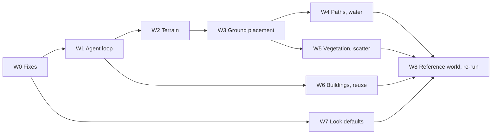

# World building plan (M10 candidate)

How box-engine closes the gaps found when an AI agent built a small exploration game on the 0.1.0 release. The goal is that a developer, or an agent, can make a cohesive outdoor world (ground, paths, water, vegetation, buildings, props) with the engine's own tools, without writing geometry workarounds.

Status: proposed, not scheduled. Ordered by dependency, no time estimates, like [ROADMAP.md](ROADMAP.md).

## 1. The test that produced this plan

An agent was given a fresh `third-person` project, the installed release and the `box mcp` server, and this prompt:

> Create a small, beautiful 3D exploration game with a stylized village, procedural vegetation, winding paths, and a playable character. Work autonomously. Run the game, inspect your results, identify problems, and refine the experience until it's cohesive and playable. Use the engine's native tools rather than manually creating geometry.

The result looked good from the player's camera (cottages, autumn trees, lanes, a pond, a shrine, a four-pickup goal). The gaps were in how it got there. Of 454 saved entities, 275 were hand-placed `Primitive`s, the scene grew by about 23,000 lines (409 spawn commands from a Python script), and most of the agent's effort went into workarounds:

| # | Gap | What the agent did instead |
|---|---|---|
| G1 | No terrain | One 66 m cuboid as ground; hills from scaled spheres, then wide `Sweep` strips with 17 tilted cuboid colliders; the ground collider split into five pieces to leave room for a pond. The world ends at a visible cuboid edge. |
| G2 | No ground height query or snapping | A Python `grade(z)` function re-seated paths, lamps, pickups and the player; it re-implemented Catmull-Rom to insert grade points and packed elevations into rule intents. |
| G3 | `Scatter` places only imported meshes and prefabs | A custom planting rule with a hand-rolled LCG (scoped rules cannot use `math.random` and get no seeded RNG); no avoidance of paths or buildings (a tree grew into the shrine stairs). |
| G4 | No vegetation generators | Trees from a cylinder and five spheres, grass blades from stretched spheres. |
| G5 | `box_arch` (Wall, Roof, Stair, Platform) is not in the shipped editor, player or CLI | Each cottage is about 35 cuboids from a Luau rule; roofs are tilted slabs; stairs are cuboids. |
| G6 | Reuse is not discoverable | Eight lamps of 11 entities each, fences, barrels and hives copied entity by entity. `.scene.json` prefabs exist (`PrefabInstance`) but there is no "save selection as prefab" and the agent never found them. |
| G7 | No path or water tools | Lanes are flat `Sweep` strips at staggered heights (0.031–0.039 m) to avoid z-fighting, with visible seams at junctions; water is a flat `Extrude` plus ten `Sweep` "glints". |
| G8 | Rule and command friction | `Sweep.profile.points` and `Lathe.shape.profile` cannot be built from a script ("this type has no default value"); a Lathe profile array of 3 gives `invalid length 3, expected fewer elements` without the expected length; a field left out is reported as `value_clamped`; `ColliderShape::Mesh` on a generated mesh silently does nothing; colours are linear only, rotations quaternions only, script references need the `.meta` id. |
| G9 | Agent verification loop | No input over MCP (the agent compiled a helper that posted OS key events), no camera pose for `render`/`--capture`/`screenshot` (every capture came from the start lane), live edits are not saved so every fix was applied twice, new projects carry no agent guide, and `~/.local/bin` was not on the agent's `PATH`. |
| G10 | Rendering | Close to large surfaces (walls, tree crowns) the default ambient occlusion (intensity 1.5, radius 1.0) shows dark, stair-stepped blotches. Observed in captures. Measured cause: 12 SSAO samples over up to 80 half-resolution pixels; the 4x4 blur cannot remove the residual (fixed in W0: 24 samples). |

### Second pass

A follow-up prompt on the same project asked for "gentle terrain variation and warmer dusk lighting", then a playthrough of the full route to check that the paths and the shrine were still easy to navigate. The lighting landed (lower amber sun, rose-to-indigo sky, brighter lanterns). The rest repeated G1, G2, G8 and G9 and added three gaps:

- Terrain became two 66 m wide `Sweep` strips that rise only along one axis, carried by 39 hidden tilted cuboid colliders. Before building them the agent re-tested `ColliderShape::Mesh` on a dome, a sphere and a `Sweep`; the player fell through all three with no warning.
- The same Python `grade()` re-seated lanes and plantings; the planting rule grew extra grade points to carry heights.

| # | Gap | What the agent did instead |
|---|---|---|
| G11 | No way to check that a route is walkable | Timed OS key presses (the G9 helper) with an MCP `world_query` of the player's position after each leg, asserting heights by hand. |
| G12 | Look that holds at eye level fails from above | The warm dusk reads well from the player's camera, but in an overview the aerial haze (density 0.019, start 28 m) turns the whole village mauve. Aerial haze depends only on distance from the camera (`atmosphere` in `fog.wgsl`), so a far overview camera sees everything past the haze start; that this alone causes the wash is not yet confirmed with a capture. |
| G13 | Hard edges where ground pieces meet | Where a ramp strip meets flat ground at the shrine there is a visible edge, and lanes cross it with a step. |

## 2. Principles

- **Intent in, world out** ([PROCEDURAL_DIRECTION.md](PROCEDURAL_DIRECTION.md)). Every new tool is a saved, parameterised component or rule input; meshes, colliders and instances are derived.
- **Agent-usable by construction.** Every tool is reachable from scene commands and `box mcp` with the same validation and undo as the editor, takes human units (metres, degrees, sRGB), and has a one-line example in `box scene apply --help` or the MCP tool description.
- **Stamp and flush.** Brushes and drags accumulate cheap stamps; rebuilds (terrain chunks, colliders, scatter chunks) are throttled and chunk-local. Each workstream states its per-frame cost.
- **One reference world.** A village example built only with these tools is the acceptance target (W8).

## 3. Workstreams

### W0 — Fixes from the test (small, first)

- **First:** `ColliderShape::Mesh` (and `ConvexHull`) on `Primitive`/`Procedural` meshes: build the shape from the generated `MeshData`, or warn once naming the entity when there is no mesh asset. The agent hit this silent failure in both passes and worked around it with hidden tilted cuboids each time.
- Script-buildable list fields: `Vec<Vec2>`/`Vec<Vec3>` and other default-less fields constructible from Luau rules (Sweep profiles, Lathe custom profiles); a test builds every registered generator field from a rule.
- Error text: fixed-length arrays name the expected length; accept a 3-component vector where a `Vec2` profile point is expected (z ignored) or say so.
- Warning codes: a missing field filled from a default reports `field_defaulted`, not `value_clamped`.
- G10: reproduce the AO blotches in a capture test, bisect the AO settings and resolution, then fix or retune the defaults. No cause is assumed until measured.

**Acceptance.** A rule emits a custom-profile `Sweep` and `Lathe`; the player stands on a mesh collider over a generated dome; an AO close-up capture shows no blotches (golden).

### W1 — Agent loop and command ergonomics

Cheap, and it multiplies the value of everything after it.

- `box render` and `--capture`: `--eye x,y,z --look-at x,y,z [--fov]`; `--views <file>` renders several poses to numbered PNGs; `--overview` frames the scene bounds from above at an angle.
- MCP `screenshot` takes an optional camera pose (a temporary camera, not saved).
- MCP `send_input`: press, hold for a duration, or set an axis for named actions; `teleport` an entity. Works on a live player and in editor Play.
- Route check (G11): MCP `walk_route` and `box walk <scene> --route <file>` walk a probe `KinematicCharacter` (the scene player's size) through a list of waypoints against the scene's colliders, without playing it, and report, per leg, reached or stuck (and where), the largest step, falls, and the steepest slope crossed. (A probe rather than the game's own player: a game's movement script reads input relative to its camera, so driving it by input is game-specific; `send_input` covers that.) An agent asked whether paths are "easy to navigate" gets an answer without writing its own input loop.
- Repeatable playtests: a playtest file (`playtests/<name>.playtest.json`) holds a start state (scene, `seed`, optional `teleport`) and steps: named-action input per 1/60 s frame (`{"input": {"move": [0, 1]}, "frames": 90}`, never keys; `mouse` for mouse look), `wait`, and checks (`entity_near`, `entity_gone`, `entity_exists`, `component_equals`, `event_seen`, `log_contains`). MCP `record_start` (restarts the game from its scene) and `record_stop` (`save`) record what a person or `send_input` did in a live player or editor Play, resampled to 1/60 s, with checks for what changed (gems gone, where the player ended). `box playtest <project> [file] [--capture-every N]` (MCP `playtest`) replays headless with the fixed step from a fresh load, waiting for assets a frame requests before the next, so replays are deterministic; it reports each check with its frame and values plus an end-state `fingerprint`, and exits 1 on a failure. MCP `playtest` with `live: true` (control `playtest`/`playtest_status`) replays in the running game. The camera's starting pose is part of the scene file, so camera-relative movement replays the same way as long as look input is in the steps too (the run that went off course had turned the camera by hand). A native project's playtests run in its own player (`--playtest`). Sample: `examples/collector_luau/playtests/route.playtest.json`.
- Live edits that persist: `apply_commands` with `"save": true` (editor, not playing) goes through the edit stack and marks the scene dirty, or saves it; in Play it also applies to the parked edit world.
- Scene command values: colours accept `"#rrggbb"` and `{ "srgb": [r, g, b] }`; rotations accept `{ "euler_deg": [x, y, z] }` and `{ "look_at": [x, y, z] }`; asset references accept a path alone (id resolved from the `.meta`).
- Project agent guide: every template gets `AGENTS.md` (what a project is, the command list, where the guides and the script reference are, the verify loop, and a short "known limits" list kept current, so agents do not rediscover a limit by trial as happened with mesh colliders), and `box new` writes it; the installer's PATH hint also prints in `box new` when the tools are not on `PATH`.

**Acceptance.** An agent captures five chosen views without editing the scene, walks the player to a point with `send_input`, checks a four-leg route with `walk_route`, and a live fix is saved once. A recorded route that picks things up replays twice with identical reports, and a check fails when the scene changes (`crates/box_engine/tests/playtest.rs`).

### W2 — Terrain (G1)

Status (2026-11-22): stamps, chunked generation with local regeneration, heightfield colliders, layer colours, skirt and the walkability view are in (`Terrain`, [measurements/w2-terrain.md](measurements/w2-terrain.md)). Brushes, painted layers, holes, editor Add ▸ Terrain and `terrain_sample` are not yet.

`Terrain` component in `box_proc` (decided as "chunked heightfield first" in [PROCEDURAL.md](PROCEDURAL.md) §8):

- Saved data: cell size, chunk size, sparse height tiles (like `ScatterMask` tiles), up to four splat layers with materials, a hole mask. Edits write tiles; untouched chunks cost nothing.
- **Procedural stamps first, brushes second.** Saved, editable modifiers evaluated in order: `Hill { centre, radius, height, falloff }`, `Ridge` along a spline, `Flatten` (area or spline, with banks), `Noise { seed, scale, amplitude }`, `Basin` (for water). Brush sculpting adds a painted delta layer on top. Agents and scripts use stamps; people use either.
- Output: one derived mesh and one parry `HeightField` collider per chunk, rebuilt only for chunks a change touches (stamp, then throttled flush); smooth normals across chunk edges; a skirt or edge falloff so the world does not end at a visible edge.
- Shading: splat blend with triplanar sampling on steep slopes in the standard material path; default layers (grass, dirt, rock) so a new terrain looks good at once.
- Editor: Add ▸ Terrain; brushes Raise, Lower, Smooth, Flatten, Paint, Hole on the existing brush tool.
- Commands and MCP: add, remove and edit modifiers; `terrain_sample` (height, normal, layer at x, z).

**Acceptance.** A 256 m terrain with five stamps and painted layers; where a `Flatten` meets a `Hill` there is no visible edge and `walk_route` reports no step (G13); a brush stroke at 60 Hz costs under 1 ms per frame on average with chunk rebuilds throttled (measured, [measurements/](measurements/)); a golden capture; the character walks over it.

### W3 — Ground-aware placement (G2)

- `ground_height(x, z)` and `ground(x, z)` (height and normal) for scripts and for rules. A rule that samples the ground declares it, and an edit to the terrain under its intents re-runs only those intents (scoped like `{ neighbours = r }`).
- `Spline.follow_ground` (with an offset) and a `conform` option on derived parts: Y comes from the ground at evaluation time.
- Scene command `snap_to_ground { entity, offset?, align? }`; editor Snap to Ground on the selection; placing a dragged asset already lands on the surface.
- `Scatter.surface` accepts a `Terrain`.

**Acceptance.** Raising a hill under a lane, a lamp and a planting intent moves all three with it, with no script involved.

Status (2026-11-21): the `Ground` resource (heights of the drawn surface of every `Terrain`, with the areas each change touched), `FollowGround { offset }`, `Sweep.follow_ground` / `ground_offset` (generators declare `inputs.ground()`), and the Luau `ground` global (`height`, `at`) in scripts and rules are in; a rule that samples the ground re-runs for the intents in the changed area. The acceptance is `crates/box_script/tests/ground.rs`; costs in [measurements/w3-ground.md](measurements/w3-ground.md). Since 2026-11-22: the `snap_to_ground { entity, offset?, align? }` command (origin onto the terrain; heights through the registry's `GroundSampler`, which box_proc installs, so `box scene apply` works on a scene that never ran a frame) and Edit ▸ Snap to Ground (End; the lowest point of the selection's meshes lands, one undo step); tests `crates/box_engine/tests/snap_to_ground.rs`, `crates/box_editor/tests/snap_to_ground.rs`. A model dragged into the viewport lands on the surface under the pointer (terrain chunks are picked like any mesh) by the lowest point of its meshes, in the same undo step, once loaded (`a_dropped_model_lands_on_the_terrain_by_its_lowest_point`). Not yet: a `conform` option on derived parts, `Scatter.surface` on a terrain.

### W4 — Paths and water (G7)

- `TerrainPath` with `Spline`: a dirt ribbon fitted to the terrain's drawn triangles across its width. Lanes targeting the same terrain merge where they cross or share endpoints. Author them in Add ▸ Terrain Path or with scene commands.
- Grade lanes with the existing `FlattenPath` stamp. Automatic grading and splat-layer painting remain planned.
- `WaterBody` generator from an outline or a spline: writes a `Basin` modifier and a hole or depression, a surface mesh and a trigger volume.
- Built-in water material: a `ShaderMaterial` shipped with the engine (depth-tinted colour and edge foam from `scene_depth`, refraction from `scene_color`, normal ripples, wind-linked flow). Selectable like any material.
- Scatter and planting can avoid paths and water bodies (W5).

**Acceptance.** The reference village's lanes join without seams and sit in the ground; the pond reads as water at eye level and from above (captures).

### W5 — Vegetation and procedural scatter (G3, G4)

- Generators `Tree` (broadleaf, conifer, round; trunk and branch sweep, clustered crown, seed, palette), `Bush`, `GrassTuft`, `Flowers`: stylized, low-poly, wind on by default, golden-hashed like other built-ins.
- `ScatterSpecies` source `Generator { value }`: any registered generator component with its parameters. Instances of the same parameters share one generated mesh; a seed range gives variants (a fixed number, so instancing still batches).
- Scatter exclusion: `avoid` list of entities (paths, water, buildings, colliders) with a margin; candidates inside are dropped (pure, per chunk).
- Rules get `it:rng()` (seeded from the intent's uid and a seed property), so scoped rules can vary without `math.random` or a hand-rolled generator.

**Acceptance.** A forest edge, an orchard and meadow grass from three `Scatter`s with generator species on terrain, avoiding paths; 20,000 instances within the existing scatter budgets ([measurements/m6-scatter.md](measurements/m6-scatter.md)).

### W6 — Buildings and reuse (G5, G6)

- Ship `box_arch` in the editor, player and CLI registries for data projects (D-record: binary size and stability of its saved types under [STABILITY.md](STABILITY.md)); its generators appear under Add, in `box registry` and in the script types.
- A `Building` rule or generator over `box_arch`: footprint, storeys, roof kind, openings by side, palette. Cottage-scale buildings from one intent.
- Prefabs from scenes: editor Save Selection as Prefab (writes a `.scene.json`, replaces the selection with a `PrefabInstance`); scene command and MCP `save_prefab`; documented in the editor and procedural guides as the way to make a reusable prop.
- Rules may emit a prefab instance as a part (`out:prefab(it, key, scene, transform)`), so a fence rule can place a post prop.

**Acceptance.** The reference village's houses are `Building` intents; lamps, fences and barrels are prefabs; no prop is copied entity by entity.

### W7 — Look defaults for outdoor worlds

- Outdoor presets for `Environment` (sun, sky, haze, grading): day and dusk to start, chosen in New Project and applicable as a command.
- G12: capture the dusk preset with the haze off and on from an overview to confirm the cause; if it is the distance-only haze, give the aerial haze an altitude falloff (thinner as the camera and the line of sight rise), kept as uniforms like the rest of the atmosphere.
- After W0's AO fix, re-check goldens and the template captures.

**Acceptance.** Each preset has an eye-level and an overview golden of the reference village, and both read as the intended time of day.

### W8 — Reference world and the re-run

- A `village` example in the gallery and a `world` template, built only with W2–W6.
- **Re-run the original test**: same prompt, a fresh agent, a fresh project from the release. Record what it built and what it worked around in a gap report like [M8_GAP_REPORT.md](M8_GAP_REPORT.md).

## 4. Order

W0 and W1 are small and pay off at once. W4, W5 and W6 are independent once W3 is in and can run in parallel.

## 5. Milestone acceptance

- The re-run (W8) builds a comparable or better village with **no** external geometry scripts, **no** hand-placed primitives standing in for ground, paths, water, vegetation or buildings, and a scene file under a tenth of the first run's size.
- The agent verifies from at least five camera poses and checks the route with `walk_route`; no OS input helper.
- A second prompt like the second pass ("gentle terrain variation, warmer dusk, re-check the route") is done with terrain stamps, a preset and `walk_route`, with no hidden colliders and no external grading script.
- Every new tool has scene commands, MCP reach, reference docs, a guide section, golden or hash tests, and a recorded cost.
- Definition of done in [AGENTS.md](../AGENTS.md) holds for each workstream.

## 6. Open questions

- **Q-W1.** Does this milestone come before, after or interleaved with the next large game project? It overlaps with what an outdoor game needs, so it can also be driven by that game's gap reports.
- **Q-W2.** Terrain size ceiling for the first version (proposed 512 m × 512 m, no LOD); LOD only when a game needs a larger view distance.
- **Q-W3.** Ship `box_arch` as a default module of the data-project binaries, or as an opt-in module the editor always has.
- **Q-W4.** Should rules be allowed to read the ground (W3)? It keeps rules declarative but adds a dependency the scoped rerun must track.
