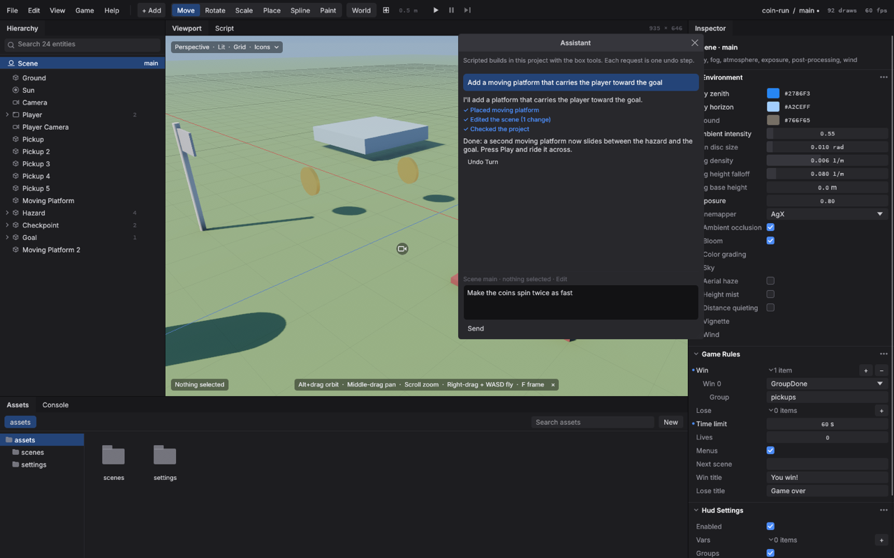

# The Assistant

The Assistant is a window in the editor where you describe what you want, such as "add a moving platform here that carries the player to the ledge", and an AI agent builds it in your open project while you watch. It works with the same pieces you do: presets, components, scene settings and, when nothing else fits, Luau scripts. What it makes stays editable in the inspector, and each request is one undo step.

## Contents

- [What you need](#what-you-need)
- [Open it](#open-it)
- [Ask for something](#ask-for-something)
- [What it can and cannot do](#what-it-can-and-cannot-do)
- [Undo, Stop and Undo Turn](#undo-stop-and-undo-turn)
- [Good requests](#good-requests)
- [Privacy and cost](#privacy-and-cost)
- [Using another agent](#using-another-agent)
- [Troubleshooting](#troubleshooting)

## What you need

- **Claude Code**, installed and signed in on this computer. Install it from [claude.com/claude-code](https://claude.com/claude-code), then sign in once from a terminal:

  ```bash
  claude auth login
  ```

  `claude auth status` should then say `"loggedIn": true`.
- **An open project.** The Assistant works on the project in the editor.

The editor stores no keys or passwords: the agent uses Claude Code's own sign-in.

## Open it

Choose **View ▸ Assistant** (or press Cmd+K and type "assistant"). A window opens over the editor; drag it by its title to where it is out of the way. It keeps working, and keeps its history, while closed.

When it opens it starts the agent in the background, so it is ready by the time you have typed your first request.



## Ask for something

1. Type a request in the box at the bottom.
2. Press **Send** (or Cmd+Enter).

The window lists what the agent says and each step it takes, in plain words: "Placed pickup ×5", "Checked the project", "Looked at the viewport". Hover a step to see its details. The scene changes as it works.

Every request also tells the agent:

- the open scene,
- what you have selected,
- where the viewport camera is looking.

So "make this bigger", "put a tree here" and "why can't I jump onto the selected ledge?" mean what you would expect.

When it is done, it says what it made, what it checked, and what to try ("Press Play and collect the coins").

Requests take from a few seconds to a couple of minutes. A request cannot be sent during Play: stop the game first, because changes made while playing are thrown away at Stop.

## What it can and cannot do

It can:

- place presets (Player, Pickup, Hazard, Moving Platform, Checkpoint, Goal) and any other object,
- change any component field or scene setting,
- set up win and lose rules and the HUD,
- read and write text files under `assets/`: scripts, data tables, string tables, settings,
- check the project, take a screenshot of the viewport, render the scene, and play it with a playtest to see whether the player can reach things,
- explain what is in the scene and why something does not work.

It cannot:

- run programs or reach files outside the project's `assets/` folder: it has no shell,
- import models, sounds or images you have not added to the project,
- change engine code.

It is told to build with presets and behaviours first and to write scripts only when nothing else can do the job, so that what it makes is something you can tweak by hand.

## Undo, Stop and Undo Turn

- **One request is one undo step**, labelled "Assistant: <your request>". Cmd+Z after a request undoes all of it.
- **Your own edits** while it works stay separate steps, so undo never mixes yours with its.
- **Stop** ends the request at once. What it already changed stays, as one undo step.
- **Undo Turn**, under each request, reverts that request's scene changes and puts back any files it wrote. It is available while that request's changes are the latest ones; if you have edited since, undo your edits first (or fix things by hand).
- Changes are not saved until you save the scene (Cmd+S), unless you asked the agent to save.

## Good requests

- **One thing at a time.** "Add five coins in a line toward the goal", then "make the last one float higher". Follow-ups remember the earlier conversation.
- **Say how it should play.** "A platform that carries the player across the gap, slowly enough to jump on" works better than "a platform".
- **Point at things.** Select an object and say "this", or look at a spot and say "here".
- **Ask questions.** "Why does the player fall through the bridge?" or "what happens when all the coins are collected?" The agent can inspect the scene and play it.
- **Name the rules.** "The game is won when all coins are collected, with a 90-second limit and 3 lives."

Examples that work well:

- "Make a small game: a player, eight coins to collect and a goal that wins once they are all collected."
- "Add a moving platform here that carries the player up to the selected ledge."
- "Put spikes along the edge of this platform and a checkpoint before it."
- "Make the coins spin twice as fast and glow a bit more."
- "Give me a HUD that shows the coins and the time left."

## Privacy and cost

- Nothing is sent anywhere until you press **Send**. Then your request, the editor context (scene name, selection, camera) and whatever the agent reads from the project go to Anthropic through Claude Code, under your account's terms.
- The Assistant uses your Claude plan's usage (or API credit, with an API key). Building a whole small game in one request (player, coins, goal, rules, checked with a playtest) used about 0.80 USD worth in testing; small changes use much less.
- The agent is started with the project's own `CLAUDE.md` and `AGENTS.md`, which every new project gets, not with your personal Claude Code hooks.

## Using another agent

The Assistant drives the editor through the same tools any agent can use: `box mcp`, the engine's MCP server. To use another agent, or Claude Code in your own terminal:

1. In the editor: **File ▸ Allow Agent Control**.
2. Give your agent the MCP server for the project:

   ```bash
   claude mcp add box -- box mcp --project /path/to/my-game
   ```

Edits from an outside agent are undo steps labelled "Agent edit", one per command list, without the Assistant's per-request grouping.

## Troubleshooting

| What you see | What to do |
|---|---|
| "Claude Code is not installed" | Install it, then close and reopen the Assistant window. |
| "Failed to authenticate" | Run `claude auth login` in a terminal, then send again. |
| "Open or create a project first" | The Assistant edits a project: open one. |
| Send is greyed out | Stop Play, or type a request. |
| A step shows ✗ | Hover it to read the error; the agent usually notices and tries another way. |
| It changed something you did not want | Undo Turn, or Cmd+Z. |
| It seems stuck | Press Stop; what it changed so far stays and can be undone. |
