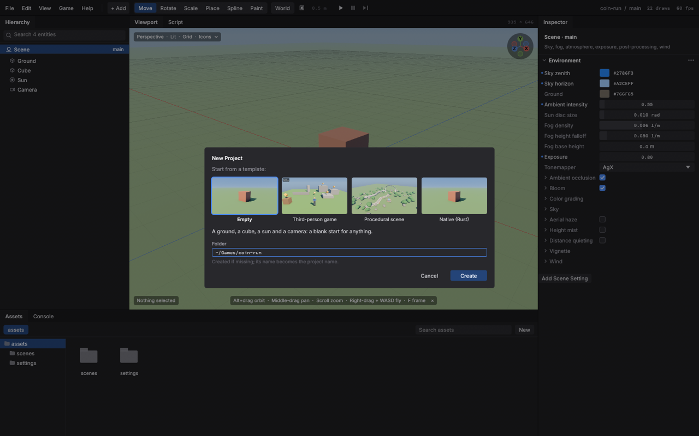
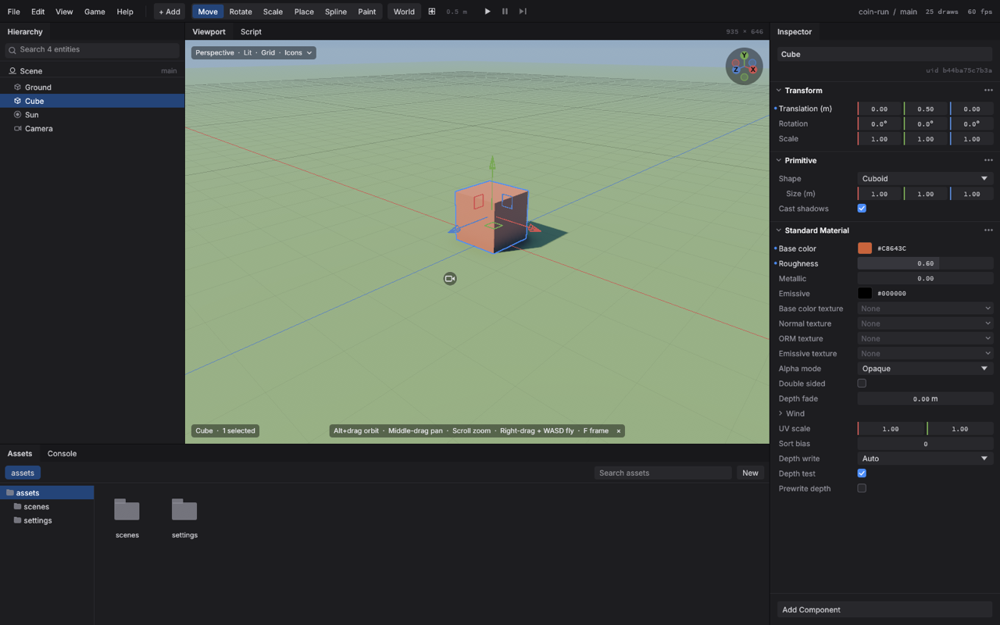
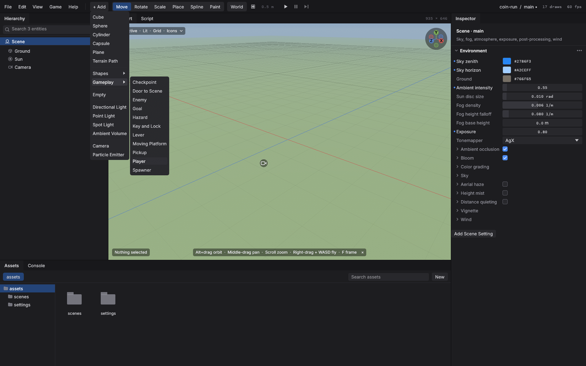
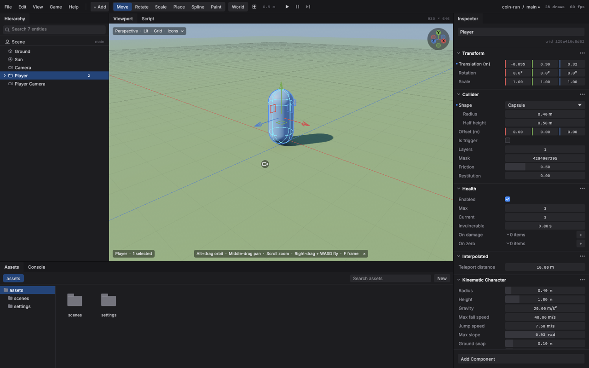
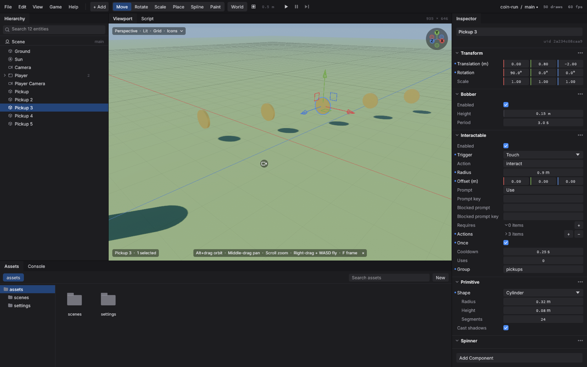
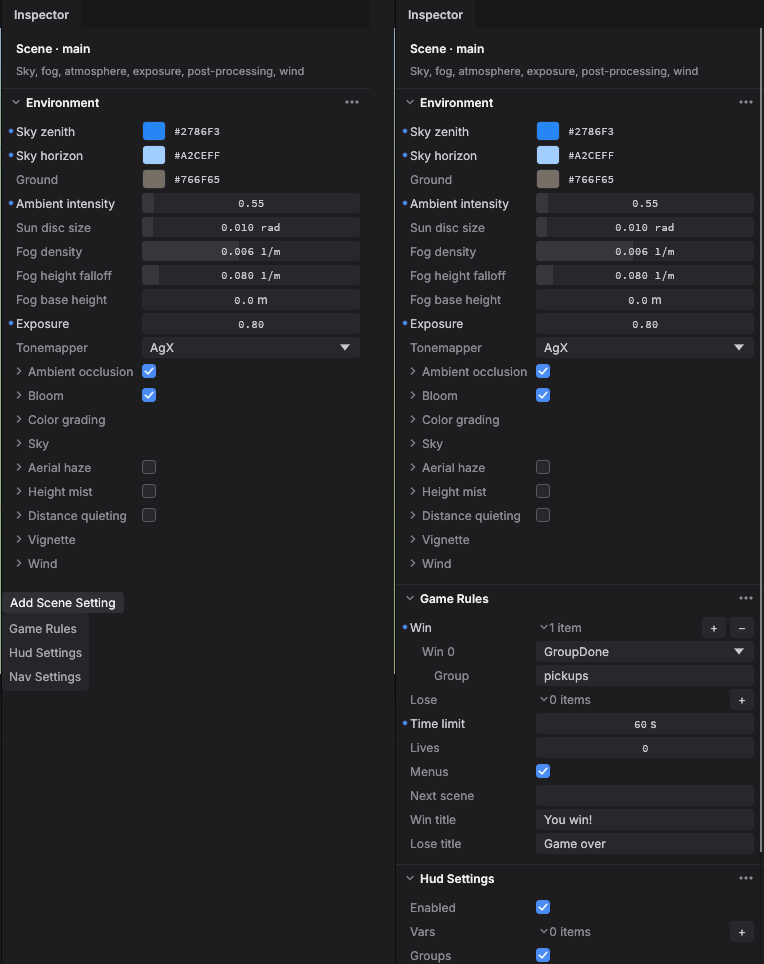
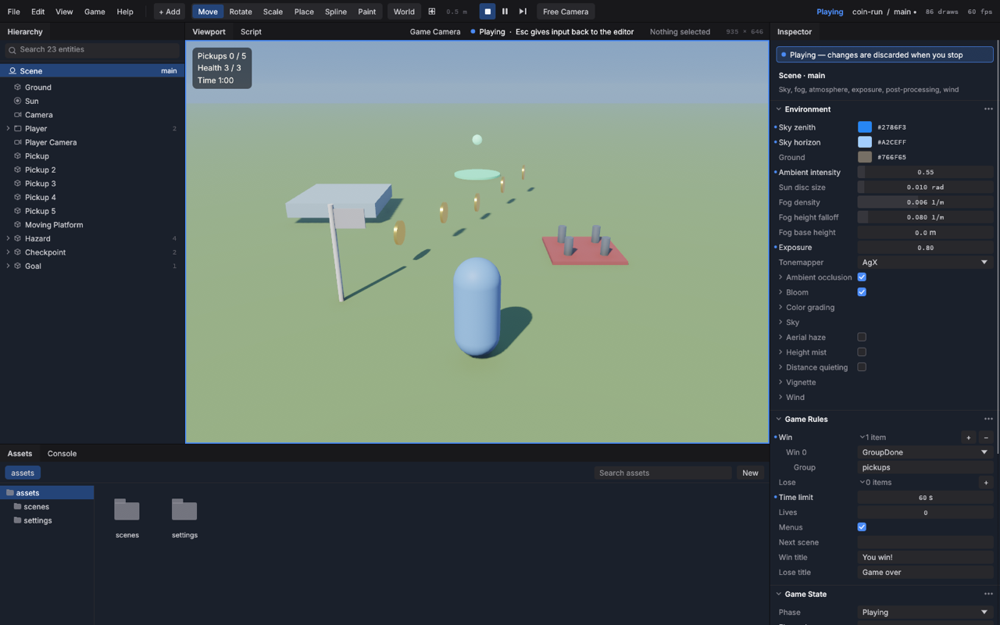
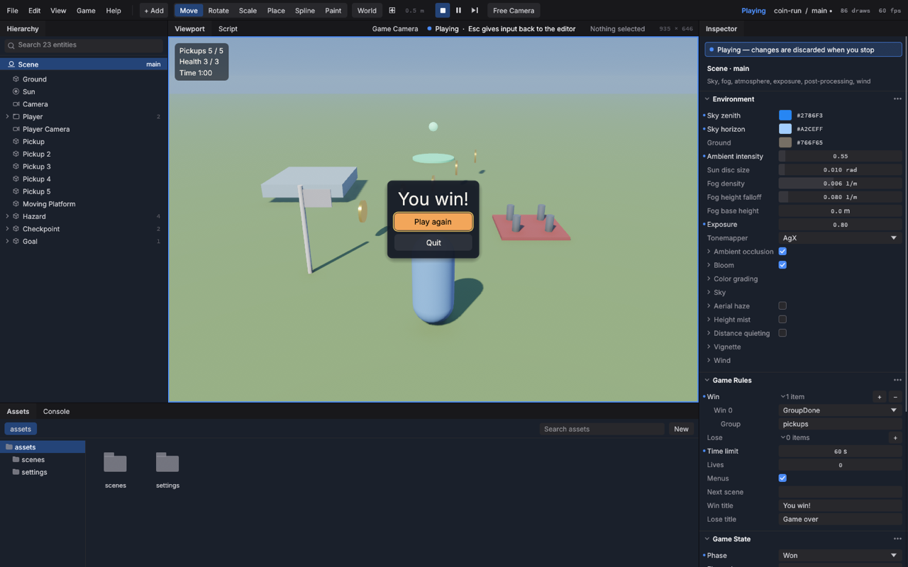

# Your first game

In about twenty minutes you will make a small 3D game without writing code: a character you control, coins to collect, a moving platform, spikes to avoid, a timer, and a win screen. Then you will tune it, and export it as an app you can share.

You need box-engine installed ([Getting started](getting-started.md#install-a-release)). Everything here happens in the editor.

## Contents

- [1. Create a project](#1-create-a-project)
- [2. Add the player](#2-add-the-player)
- [3. Try it](#3-try-it)
- [4. Add coins](#4-add-coins)
- [5. Decide how to win](#5-decide-how-to-win)
- [6. Add a challenge](#6-add-a-challenge)
- [7. Name things your way](#7-name-things-your-way)
- [8. Tune the feel](#8-tune-the-feel)
- [9. Save and share](#9-save-and-share)
- [What you built](#what-you-built)
- [Where to go next](#where-to-go-next)

## 1. Create a project

1. Open **Box Editor**.
2. Choose **File ▸ New Project**, pick **Empty**, type a folder, for example `~/Games/coin-run`, and press **Create**.

The new scene has a ground, a cube, a sun and a camera. You will not need the cube: click **Cube** in the Hierarchy (the list on the left) and press **Delete**.

> Move around the scene with the mouse: Alt-drag (Option-drag) to orbit, middle-drag to pan, scroll to zoom. Hold the right mouse button and use WASD to fly. Press **F** to frame the selection.

## 2. Add the player

Click **+ Add** in the toolbar and choose **Gameplay ▸ Player**.

Two things appear where the centre of the view is looking:

- **Player**: a capsule character with a `PlayerController`. It walks, runs and jumps, and falls back to its start if it drops off the world.
- **Player Camera**: a camera with a `FollowCamera` that follows the player. When the game runs, it becomes the camera you see through.

Everything in the **Gameplay** menu is a *preset*: a ready-made object built from ordinary components. Select **Player** and look at the Inspector (on the right): every setting is there to change.

## 3. Try it

Press **Play** (▶ in the toolbar, or Cmd+P). The editor panes turn a different colour while the game runs.

| Control | Keyboard and mouse | Gamepad |
|---|---|---|
| Move | WASD or arrow keys | Left stick or d-pad |
| Run | Hold Shift | West button |
| Jump | Space | South button |
| Look around | Click the game, then move the mouse (Escape lets go) | Right stick |
| Pause | P | Start |

Press **Stop** (■) when you are done. Anything that changed during Play is put back, so you can experiment freely.

## 4. Add coins

1. Choose **+ Add ▸ Gameplay ▸ Pickup**. A spinning coin appears.
2. Press **W** for the Move tool and drag the coin's arrows to place it.
3. With the coin selected, press **Cmd+D** to duplicate it, and move the copy. Make five coins in all.

Each coin is an `Interactable` that fires when the player touches it: it adds 1 to the `score` game variable, sparkles, and hides itself. All coins share the group `pickups`, which is how the game can tell when they are all collected.

Press Play and collect one, to check.

## 5. Decide how to win

The scene itself holds the rules.

1. Click the **Scene** row at the top of the Hierarchy. The Inspector shows Scene Settings.
2. At the bottom, choose **Add Scene Setting ▸ Game Rules**.
3. Next to **Win**, press **+**. A condition appears (**AtLeast**). Change it to **GroupDone** and type `pickups` in **Group**.
4. Choose **Add Scene Setting ▸ Hud Settings** to show the score and the coin count on screen.

Press Play: the corner shows `Pickups 0 / 5`, and `Score` once you collect the first coin (variables appear in the HUD once they have a value). Collect all five and the win screen appears, with **Play again** and **Quit**. Press **P** during the game for the pause menu.

While you are in Game Rules, try a **Time Limit** of 60 seconds (the HUD counts down, and running out loses) or **Lives** of 3.

## 6. Add a challenge

From **+ Add ▸ Gameplay**:

- **Moving Platform**: a slab that slides back and forth and carries the player. Put a coin on top, or across a gap. Its path is **Mover ▸ Points** in the Inspector, measured from where it starts.
- **Hazard**: spikes. Touching them sends the player back to the last checkpoint, and costs a life when the rules count lives.
- **Checkpoint**: a flag. Walking past it makes it the new respawn point, and it lights up.
- **Goal**: a glowing pad that wins the game when stepped on. To make it wait for the coins, select it and add a **GroupDone** `pickups` condition to **Interactable ▸ Requires**. Then you can remove the Win condition from Game Rules.

## 7. Name things your way

The HUD's labels come from names in your scene:

- **"Pickups 3 / 5"** is the group's name. Select all the coins (click the first, Shift-click the last) and change **Interactable ▸ Group** to `coins` once: it applies to all of them. Change the Game Rules **GroupDone** group to `coins` as well. The HUD now says **Coins 3 / 5**.
- **"Score 3"** is the `score` variable. In **Hud Settings ▸ Vars**, press **+**, set **Var** to `score` and **Label** to `Gold`.
- Object names (**F2**, or double-click a name in the Hierarchy) are for you; the game does not care.

## 8. Tune the feel

Select something and change its numbers. During Play the changes apply at once; tick **Keep after Stop** next to a field to keep a value you like.

| To change | Select | Field |
|---|---|---|
| How fast the player walks and runs | Player | `PlayerController ▸ Speed`, `Run Speed` |
| How high it jumps | Player | `KinematicCharacter ▸ Jump Speed` |
| How floaty it is | Player | `KinematicCharacter ▸ Gravity` |
| How far the camera sits | Player Camera | `FollowCamera ▸ Distance`, `Height` |
| How fast coins spin | a coin | `Spinner ▸ Speed` |
| Platform speed and pause | Moving Platform | `Mover ▸ Speed`, `Wait` |
| Colours | anything | `StandardMaterial ▸ Base Color` |

Hover any field to read what it does.

## 9. Save and share

- **Cmd+S** saves the scene. A dot next to the scene name in the toolbar means unsaved changes.
- **File ▸ Export** makes a standalone game: a macOS app (or a Windows folder, where the release includes the Windows player). Anyone can run it without box-engine. See [Exporting games](../EXPORT.md).

## What you built

No code, but a complete game loop:

| Piece | What it is |
|---|---|
| Player and camera | `PlayerController`, `KinematicCharacter`, `FollowCamera` components |
| Coins, spikes, checkpoint, goal | `Interactable` components with actions (`AddVar`, `Hide`, `Respawn`, `SetCheckpoint`, `Win`) |
| Moving platform | a `Mover` component |
| Winning, losing, pause, HUD | the scene's `GameRules` and `HudSettings` |

Each is explained in [Behaviours](behaviours.md) and [Interactions](interactions.md).

## Where to go next

- **Add an enemy.** **+ Add ▸ Gameplay ▸ Enemy** places a guard that chases you around walls and costs a health on contact; give it patrol points in the inspector. Open Example ▸ **First Game** is this game finished, with an enemy, a ledge and coins riding platforms.
- **See how a behaviour works.** Select something that spins, bobs or moves, open the ⋯ menu of its Spinner, Bobber or Mover section and choose **Convert to Script**: it becomes a Luau script that does the same, with your values as its properties, ready to change.
- **Ask the Assistant.** View ▸ Assistant: describe what to add ("three more coins in a ring around the goal") and an AI agent builds it as one undo step. See [The Assistant](assistant.md).
- **Write a script.** For anything the behaviours do not cover, attach a Luau script. The [Scripting guide](scripting.md) starts from a spinning cube.
- **Start from a template.** File ▸ New Project ▸ **Third-person game** is this kind of game with a skinned, animated character. Open Example ▸ **Third-person (Luau)** is the same game written as scripts, to compare.
- **Build a bigger world.** [Procedural creation](procedural.md): terrain, paths, scattered plants, walls and buildings.
